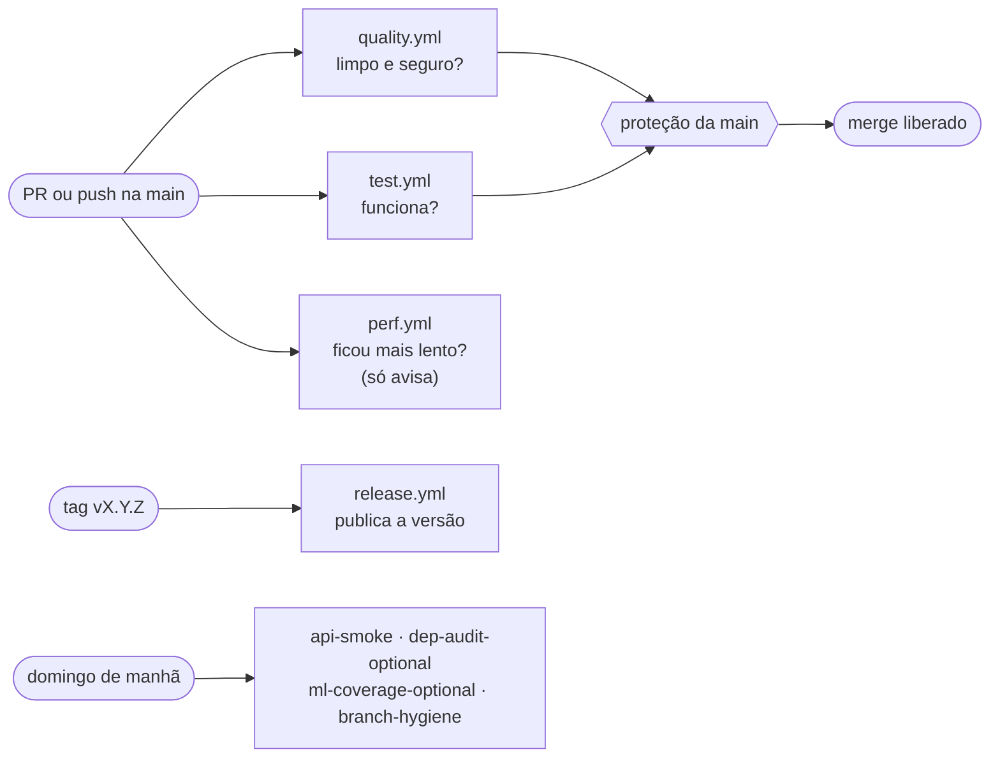
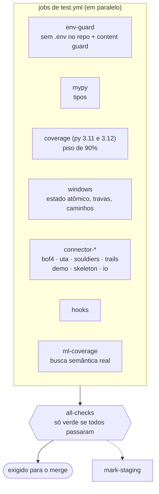
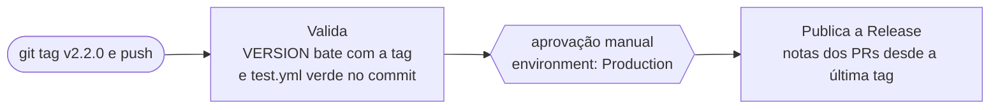

# CI/CD — o que roda sozinho neste repositório

> **Em uma frase:** toda vez que o código vai para o GitHub, "robôs" (os *workflows*) conferem tudo.
> 🟢 verde = passou; 🔴 vermelho = algo quebrou. Cada `.yml` desta pasta é um robô, visível na aba **Actions**.

## Visão geral

Num PR rodam 3 workflows ao mesmo tempo. Só `quality` e `test` bloqueiam o merge.

| Workflow | Quando roda | Pergunta que responde |
|---|---|---|
| `test.yml` | todo PR e push na `main` | O código **funciona**? |
| `quality.yml` | todo PR e push na `main` | O código está **limpo e seguro**? |
| `perf.yml` | todo PR e push na `main` (não bloqueia) | Alguma operação ficou **mais de 2× mais lenta**? |
| `api-smoke.yml` | domingo + manual | A **API da Anthropic** ainda responde? |
| `dep-audit-optional.yml` | domingo + manual | As stacks **opcionais** (kb/ml) têm CVE novo? |
| `ml-coverage-optional.yml` | job de `test.yml` + domingo + manual | A busca semântica funciona **de verdade**, sem mock? |
| `release.yml` | push de tag `vX.Y.Z` | Pode **publicar** essa versão? |
| `branch-hygiene.yml` | domingo + manual | Sobrou **branch mergeada** demais? |

> **Vocabulário:** *push* = enviar código · *PR* = pedido para juntar uma branch na principal ·
> *job* = tarefa dentro de um workflow · *step* = passo dentro do job.

---

## 1. `test.yml` — "O código funciona?"

Jobs em paralelo: se um falha, os outros continuam e você vê qual quebrou.

- **`env-guard`:** barra `.env` enviado por engano e, pelo *content guard* (`.claude/hooks/content_guard.py`),
  arquivo de jogo/dado pessoal fora da allowlist e e-mail pessoal nos commits do PR.
- **`coverage`:** roda o motor (runtime, validação, banco, skills) e exige **≥ 90%** de cobertura; duas vezes, uma por versão do Python.
- **`windows`:** a mesma suíte no Windows, onde o projeto roda de verdade.
- **`connector-*`:** testes de contrato por jogo, mais demo e template. O principal é o **round-trip**:
  extrair e reinserir sem traduzir tem que devolver o arquivo **byte a byte idêntico**. Sem o arquivo do
  jogo (que não vai ao repositório) esses testes se pulam; o sintético, montado em memória, roda sempre.
- **`all-checks`:** o agregador que a proteção da `main` exige.

## 2. `quality.yml` — "O código está limpo e seguro?"

Quatro conferências independentes:

| Job | Ferramenta | O que faz |
|---|---|---|
| Lint | `ruff` | Estilo e erros bobos (import sem uso, variável esquecida). |
| SAST | `bandit` | Padrões perigosos no próprio código (inclui `projects/*/connector/`). |
| Secret scan | `gitleaks` | Senha, chave ou token no código ou no histórico. |
| Dependências | `pip-audit` | Biblioteca com falha de segurança conhecida (CVE). |

## 3. Workflows agendados (domingo de manhã)

- **`api-smoke.yml`:** uma chamada real à API (~US$ 0,002) para ver se ela ainda responde como esperado.
  Precisa do segredo `ANTHROPIC_API_KEY`; sem ele, pula (verde, com aviso).
- **`dep-audit-optional.yml`:** audita `requirements-kb.txt` e `requirements-ml.txt` (stacks opcionais, pesadas).
  Se falhar, abre ou atualiza uma issue sozinho.
- **`ml-coverage-optional.yml`:** instala a stack de ML de verdade e roda os testes de `embedder.py` e
  `validate_model.py` sem pular nada (piso de 85%, `.coveragerc-ml`). Também é chamado por `test.yml`
  (job `ml-coverage`), por isso é obrigatório em todo PR.
- **`branch-hygiene.yml`:** apaga as branches já mergeadas além das 50 mais recentes. Nasce em *dry-run*
  (só lista); nunca toca branch com trabalho não integrado.

## 4. `perf.yml` — "Alguma operação ficou mais lenta?"

Roda `framework/runtime/perf_bench.py` (`append_line`, `build_pack`, `state_index_tm`, em dados sintéticos)
contra o baseline do runner. Mais de 2× vira aviso e o `perf.json` fica como artefato. **Não bloqueia**: tempo
de CI é ruidoso e barrar PR por ruído ensina a ignorar o aviso. Quem falha de verdade é `test_perf_bench.py`.

## 5. `release.yml` — publica uma versão

O número da versão (patch/minor/major) é decisão manual de quem tagueia
([ADR 0013](../../docs/adr/0013-versionamento-semver-manual.md)).

**Se uma release sair quebrada** (procedimento manual):
- *Esconder:* `gh release delete vX.Y.Z` apaga a Release; a tag continua. Antes, `gh release edit` pode avisar nas notas.
- *Hotfix:* `git checkout -b hotfix/descricao vX.Y.Z` (parte da tag, não da `main`), corrige, abre PR normal,
  e depois do merge sobe o `VERSION` (patch) e cria a tag nova a partir da `main`.

---

## Como ler o resultado

- O **título** de cada execução é a mensagem do commit que a disparou. O que descreve o que roda são os
  **nomes dos jobs**, definidos no `.yml`.
- Clique no run e no passo vermelho para ver a mensagem de erro.

## Arquivos relacionados

- `.github/dependabot.yml`: abre PRs toda semana atualizando bibliotecas Python e versões de Actions.
- `.pre-commit-config.yaml` (raiz): roda as mesmas conferências no seu PC, no `git commit`. Instale com `pip install pre-commit && pre-commit install`.

*Por que `uses: actions/checkout@3d3c42e… # v7.0.1`?* O SHA fixo garante exatamente a versão revisada (e não uma
futura adulterada); o comentário diz a versão legível e o Dependabot mantém os dois em dia.
