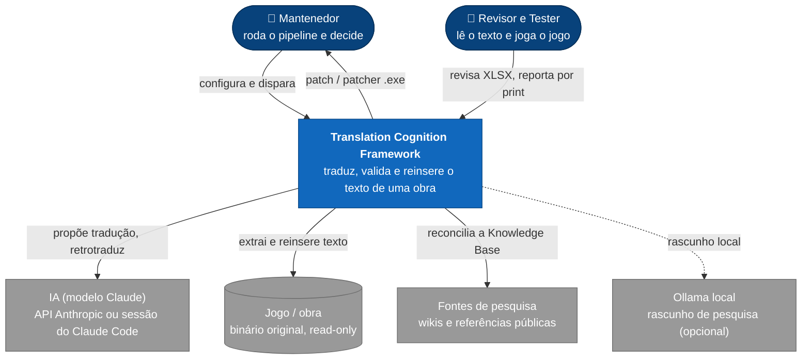
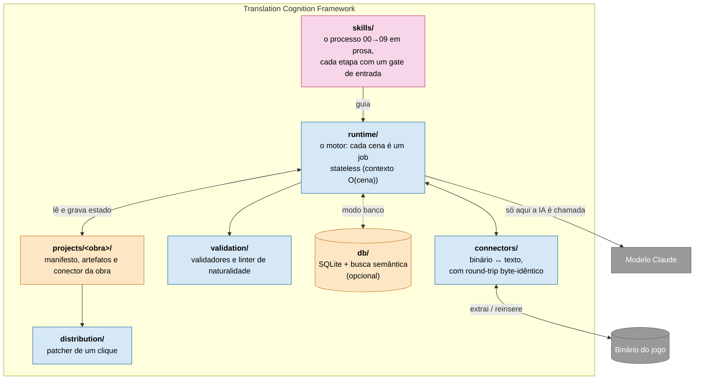
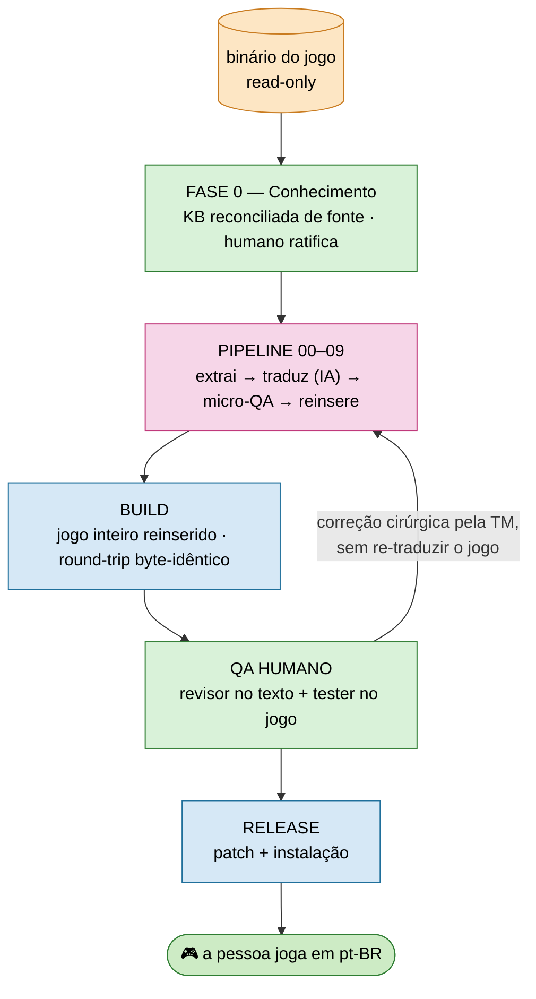

# Translation Cognition Framework

[](https://github.com/scudellerlemos/translation-cognition-framework/actions/workflows/test.yml) 

> **Um framework para localizar obras narrativas longas** (jogos, visual novels; filmes e séries em extensão)
> **sem perder consistência de termos, voz dos personagens nem controle de spoiler.**
> A IA só **propõe** a tradução. **Gates determinísticos julgam**. **O humano tem a palavra final.**

## Em 30 segundos

| | |
|---|---|
| **O problema** | Pedir a um LLM "traduza este jogo" falha de quatro jeitos: esquece o que decidiu, vaza spoiler, muda a voz do personagem e estoura contexto e fatura. |
| **A ideia** | Tirar memória, governança e fluxo de **dentro** do modelo. O modelo faz só o que exige IA; o resto é código testável. |
| **A prova** | 4 jogos reais traduzidos EN→pt-BR em 3 engines. O de referência: 146 cenas, ~45.100 linhas, round-trip byte-idêntico, ~R$ 338 e R$ 0 desperdiçado. |

---

## Arquitetura (modelo C4)

### C1 — Contexto: quem usa e com o que fala



### C2 — Containers: as peças dentro do framework



O próximo nível (C3, os componentes do motor) está em [`framework/runtime/README.md`](framework/runtime/README.md).

| Pasta | O que é |
|---|---|
| `framework/` | O processo e o motor. Genérico, **sem dado de obra**. Guia em [`framework/README.md`](framework/README.md). |
| `projects/` | Uma pasta por obra traduzida (as instâncias). |
| `docs/` | Arquitetura, conceitos, governança, ADRs (decisões), roadmap. |
| `.github/workflows/` | A esteira de CI. Ver [`.github/workflows/README.md`](.github/workflows/README.md). |

---

## Como o trabalho flui

As cores são as 4 camadas: **IA** (rosa), **estado** (laranja), **execução** (azul), **gates** (verde). A IA fica
presa na primeira; as outras três são código determinístico.



### Quem faz o quê

| Ator | Faz | Não faz |
|---|---|---|
| 🩷 **IA-tradutora** | propõe a tradução de cada fala | gravar no dado canônico; decidir lore |
| 🩷 **IA-revisora** | retraduz pt-BR→EN nas falas de risco que o projeto exige (`back_translation_risk`) e aponta | dar veredito |
| 🟩 **Gates determinísticos** | round-trip, fonte da KB, spoiler, largura de balão, glossário: **bloqueiam** | opinar sobre gosto |
| 👤 **Humano** | ratifica a KB, revisa o texto, testa na tela: **juiz final** | mexer no binário |

### O pipeline em 3 blocos

| Bloco | Etapas | Para quê |
|---|---|---|
| **A. Preparação** (1× por obra) | `00` extração · `01` discovery · `02` entidades · `03` conhecimento · `04` glossário · `04b` decision log · `05` plano · `05b` corpus sintético | entender a obra e congelar a verdade |
| **B. Laço por cena ou onda** | `06` tradução · `06b` micro-QA | traduzir com contexto limitado e conferir |
| **C. Fechamento** | `07` QA final · `08` reinserção · `08b` textos de sistema · `08c` teste no jogo · `09` distribuição | entregar o jogo traduzido |

Detalhe das etapas: [`framework/skills/_index.md`](framework/skills/_index.md). Desenhos: [`docs/DIAGRAMAS.md`](docs/DIAGRAMAS.md).

---

## Custo previsível

- **Teto antes de gastar:** estimativa pré-voo e `--max-usd`; só entra no lote o que cabe no teto.
- **Conserto por linha:** um defeito de 1 linha re-traduz 1 linha, não a cena.
- **Cada centavo auditável:** o `api_ledger.jsonl` registra toda chamada, até as que falham.
- **Caminho de sessão:** a tradução roda na sessão do Claude Code, em ondas por lote, sem chamar a API
  (o equivalente de API fica no ledger).
- **Reuso:** a Translation Memory (só acrescenta) evita pagar duas vezes pela mesma fala.

---

## Glossário rápido

| Termo | Significado |
|---|---|
| **TM** | Translation Memory: traduções já decididas, reusadas de graça. |
| **KB** | Knowledge Base: glossário, lore e vozes reconciliados de fonte e congelados antes de traduzir. |
| **Round-trip** | Extrair e reinserir **sem mudar nada** tem que gerar o binário idêntico. Prova que não corrompemos o jogo. |
| **Back-translation** | Traduzir o pt-BR de volta ao inglês com outro modelo, para checar se o sentido sobreviveu. |
| **Gate** | Verificação determinística que **bloqueia** o avanço se algo falha. |
| **Conector** | Código que extrai e reinsere o texto de um engine específico. |
| **ADR** | Registro de uma decisão de arquitetura (em `docs/adr/`). |

Conceitos explicados passo a passo: [`docs/CONCEPTS.md`](docs/CONCEPTS.md).

---

## Começar

```bash
git clone https://github.com/scudellerlemos/translation-cognition-framework
cd translation-cognition-framework
pip install .                           # inclui a busca semântica (torch, ~1 GB)
cp .env.example .env && $EDITOR .env    # sua chave: https://console.anthropic.com/
tcf translate projects/demo demo01      # sem instalar: python framework/cli.py translate projects/demo demo01
```

Roda o pipeline completo numa cena fictícia de 5 falas (`projects/demo/`) e grava o resultado verificado em
`projects/demo/artifacts/scenes/demo01/`.

**Para uma obra real:** copie `framework/templates/project.template.json` e siga o
[guia do framework](framework/README.md), ou use `python framework/connectors/discover.py <dir-do-jogo>` para descobrir o engine.

---

## Status — outubro 2026

| Projeto | Engine | Estado | Detalhe |
|---|---|---|---|
| Utawarerumono: Mask of Deception | Aquaplus `.sdat` | ✅ concluído: 146 cenas, ~45.100 linhas, ~R$ 338 | [`projects/utawarerumono/`](projects/utawarerumono/README.md) |
| Utawarerumono: Prelude to the Fallen | Aquaplus (formato novo) | ✅ concluído e instalado: 350 cenas, 23.982 falas; erro medido 2,0% (IC 0,8–5,0%) | [`ROADMAP.md`](projects/utawarerumono_prelude/ROADMAP.md) |
| Breath of Fire IV | Capcom DAT | ✅ traduzido e instalado: 305 cenas, 27.021 falas; 🚧 release do patcher pendente | [`projects/bof4/`](projects/bof4/README.md) |
| Souldiers | Unity Addressables | ✅ concluído: 470 cenas do índice, ~US$ 3,06 | [`projects/souldiers/`](projects/souldiers/README.md) |
| Trails in the Sky SC | Falcom `.pac` | 🚧 em andamento: 71 cenas extraídas, 1 cena-piloto com round-trip real | `projects/trails_sky_sc/artifacts/decision_log.md` |

Versão atual: `2.2.0` (histórico em [`docs/CHANGELOG.md`](docs/CHANGELOG.md)).

### Dívidas do framework

| Dívida | Quando |
|---|---|
| Filmes e séries: pontos de extensão documentados, sem validação em produção | quando houver um piloto |
| Release do patcher `.exe` (o pacote e o `.exe` já saem de `framework/distribution/`) | só com aval do autor |
| Comparar o caminho de sessão com o da API num jogo menor (`docs/benchmark_sessao/`; o benchmark de cota da assinatura já foi encerrado) | quando houver aval e teto de gasto |
| Medir ao vivo o bundle de custo (tiering + back-batch) | no próximo capítulo pago |
| `forma_curta` do glossário (ADR 0024) ainda não é carregada pelo `framework/db/store.py` | quando um projeto em banco precisar |

---

## Para aprofundar

[`docs/ARCHITECTURE.md`](docs/ARCHITECTURE.md) (o porquê medido) ·
[`docs/GOVERNANCE.md`](docs/GOVERNANCE.md) (quem propõe, aprova e aplica) ·
[`docs/QA_REVIEW.md`](docs/QA_REVIEW.md) (revisão humana) ·
[`framework/SDD_RUNTIME.md`](framework/SDD_RUNTIME.md) (mapa etapa↔módulo) ·
[`docs/adr/`](docs/adr/) (decisões) · [`docs/ROADMAP.md`](docs/ROADMAP.md).

---

## Licença e aviso

O código deste repositório é distribuído sob a licença [MIT](LICENSE).

Este repositório contém apenas o framework e as ferramentas de apoio à tradução. Ele **não distribui**
arquivos, textos, imagens, áudio nem qualquer outro conteúdo dos jogos citados: para usar um conector é
preciso ter a sua própria cópia legítima do jogo. Os jogos, seus nomes e marcas pertencem aos respectivos
donos; este projeto não tem vínculo com eles nem é endossado por eles.

**Não afiliação.** Este é um projeto de fã, sem fins lucrativos. Não é afiliado, patrocinado nem endossado por
Capcom, Falcom, Aquaplus, Valve (Steam) nem por qualquer outro detentor de direitos dos jogos citados. *Breath of
Fire*, *The Legend of Heroes: Trails in the Sky*, *Utawarerumono*, *Souldiers*, *Steam* e os demais nomes e marcas
são de seus respectivos donos e aparecem aqui só para identificar o jogo com o qual um conector trabalha.

**Fontes externas.** As notas de pesquisa de cada projeto (por exemplo `projects/bof4/artifacts/research_log.md`)
são síntese própria, com a fonte citada ao lado. As fontes de texto aberto são a Wikipedia (CC BY-SA 4.0) e wikis de
fãs hospedadas no Fandom (em geral CC BY-SA 3.0); quem reutilizar essas notas deve manter a atribuição e a mesma
licença nesse trecho. O resto do repositório é MIT.
