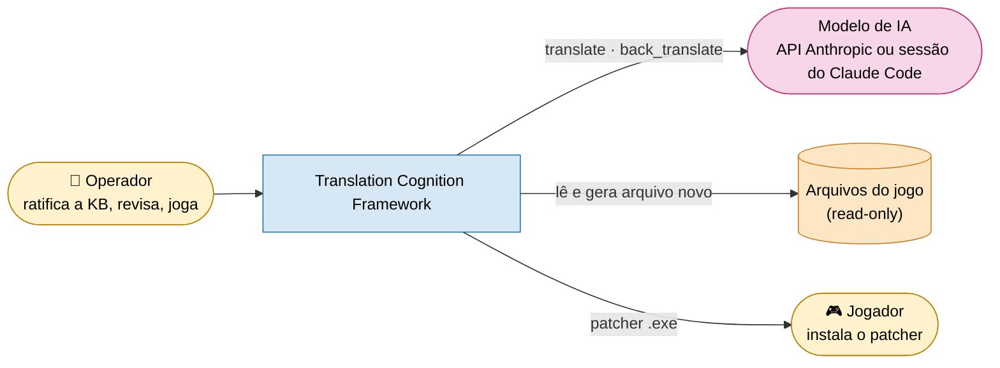
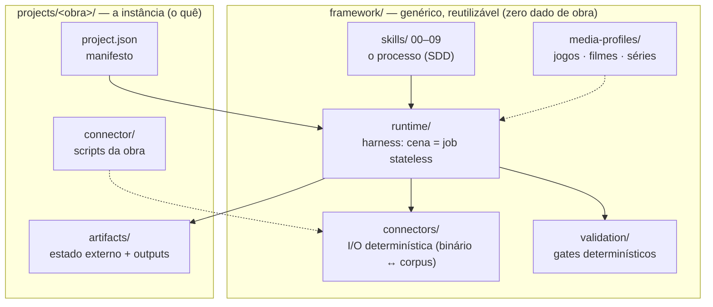
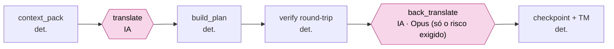
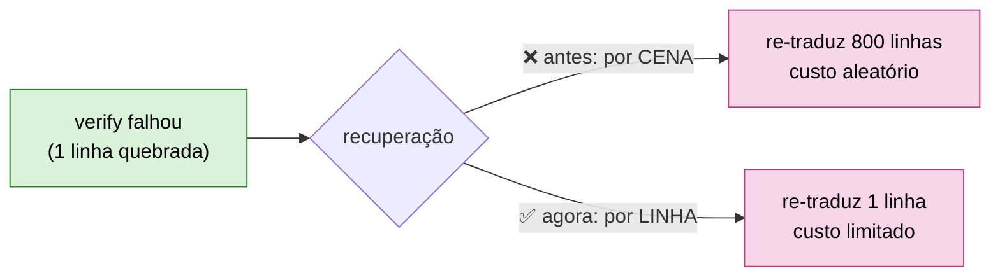

# Arquitetura — Translation-Cognition Framework

Framework spec-driven (SDD) para localização baseada em cognição narrativa. Separa **entender → estruturar → reger →
planejar → executar → validar** para preservar identidade, tom e consistência em obras longas (jogos, filmes, séries). Este
documento descreve a arquitetura **alvo** e o estado atual.

## Princípio central

> A LLM faz **só** o que exige IA: **traduzir** e **verificar alto risco**. Todo o resto (estado, memória, governança,
> checkpoints, métricas, controle de fluxo, montagem de contexto) é **determinístico e externo** à janela do modelo.

A regra existe por uma razão medida: o que estourava a sessão **não** era a tradução nem a governança, e sim o **modo de
execução**, com a tradução cognitiva feita inline, turno a turno, numa sessão longa que acumulava todo o histórico
(ver [`adr/0002-stateless-scene-jobs.md`](adr/0002-stateless-scene-jobs.md)).

## Contexto (C1)



## Organização do framework (C2)

> **Eixo diferente das 4 camadas.** Isto é a **organização do código** (genérico reutilizável vs. instância da obra), não as
> **4 camadas conceituais** de responsabilidade (Cognição / Estado / Execução / Validação), descritas no
> [README raiz](../README.md#a-arquitetura-em-4-camadas). Uma pasta pode implementar mais de uma camada (`runtime/` cobre Estado + Execução + Cognição).

| Pasta | Papel |
|---|---|
| `framework/skills/` | O PROCESSO (como). Genérico. Nunca contém dados de obra. |
| `framework/media-profiles/` | A CATEGORIA (jogos/filmes/séries): formato, tokens, timing. |
| `framework/connectors/` | A I/O (código determinístico): extração/reinserção meio↔corpus. |
| `framework/runtime/` | O HARNESS: orquestração determinística + interface de modelo. |
| `framework/validation/` | Os GATES (código determinístico): schemas, naturalidade, custo. |
| `framework/distribution/` | A ENTREGA: `build_package` (deltas bsdiff + manifest), `patcher`, `build_exe` (.exe de um clique). |
| `docs/` | Arquitetura + ADRs + ROADMAP (fora de `framework/`). |
| `projects/<título>/` | A INSTÂNCIA (o quê): manifesto + perfil + artefatos + conector do título. |



## O alvo: "uma cena = um job stateless e limitado" (C3)

Cada cena é um **job resumível** cujo contexto é **O(cena)**, não O(histórico). O orquestrador determinístico
(`framework/runtime/run_scene.py`) encadeia:

```
run_scene(cena)
  0. connector_gate + kb_gate (bloqueiam antes de qualquer chamada de modelo)
  1. context_pack  → pacote LIMITADO (doutrina cacheável + glossário-subset + voice cards dos
                     falantes + decisões relevantes + hits de TM + linhas+budgets) → scene_prompt.md
  2. translate ............................► [IA: tradutor] (única parte não-determinística)
  3. build_plan_chapter (valida cobertura/tokens/risk_notes) → approved_<scene_id>.csv
  4. verify_chapter (round-trip byte-idêntico + ponteiros within-file)
  5. risco exigido? back_translate ........► [IA: Opus]     (padrão high+critical; o projeto restringe, ADR 0022)
  6. checkpoint (run_state.json) + state_index (TM cresce)
```



> As **duas únicas** caixas de IA (rosa) são `translate` e `back_translate`. Todo o resto é determinístico, e é isso que torna
> o custo previsível e os **gates** reprodutíveis.
>
> **Reprodutível com asterisco:** a **tradução em si** (saída do LLM) é **estocástica**: re-rodar uma cena NÃO produz os mesmos
> bytes de tradução. O que é determinístico é **a orquestração + os gates**: dado um `translations_*.json` fixo, `context_pack`
> (`pack.json` byte-idêntico), `build_plan`, `verify` (round-trip byte-idêntico) e a reinserção rodam igual toda vez.
> **O veredito é reproduzível; a geração não.** Por isso o `translations_*.json` é o artefato caro/estocástico (guardado como
> dado do projeto; no repo público o `content_guard.py` o barra por conter fala do jogo) e o `pack.json` é regenerável.

### Dois caminhos, um núcleo

Os dois executam este mesmo fluxo e compartilham o núcleo (`pack_render.py`, `translation_rules.py`):

- **API** (`model_api.py`): cliente, streaming, retry, batch.
- **Sessão** (`model_session.py`): sem rede; a IA da sessão do Claude Code escreve o `translations_*.json`. O `session_lot.py` junta várias cenas num prompt só.

Uma **onda** é um lote de cenas do caminho de sessão: o `wave.py` roda os passos mecânicos, e o `rodar_ondas.ps1` /
`lancar_lote.ps1` (em `framework/skills/operacao/rodar-onda/`) dispara o lote fora do Claude Code, com estimativa de tempo, espera de
cota e conferência de conformidade no fim.

**Reconferência barata.** Ao fechar `verified`, o `run_scene` grava em `run_state.json` o `t_hashes` (impressão digital por
fala, `runtime/touched.py`) junto com `connector_hash`/`doctrine_hash`. Numa nova rodada, cena `verified` sem fala tocada
(mesma doutrina e mesmo conector) é pulada; `--full` força a reconferência. Texto repetido entre cenas é traduzido uma vez
(`runtime/scene_dedup.py`), e o `runtime/wave.py` junta os passos mecânicos (run_scene, scene_dedup, glossary_lint,
quality_gate, cost_report, obs_report) num comando só, com a saída longa em `artifacts/wave_last.log`.

**Estado externo consultável** (não na janela): `glossary.csv`, `state/translation_memory.jsonl`, `state/voice_cards.json`,
`state/decision_index.json`, `translation_status.json`, `run_state.json`.

## Determinismo vs IA (mapa)

| Responsabilidade | Veredito | Onde |
|---|---|---|
| Parser / extração / reinserção | Determinístico | `connector/` |
| Orquestração / controle de fluxo | Determinístico | `runtime/run_scene.py` |
| Interface do conector (subprocess, hash, stale) | Determinístico | `runtime/connector_mgr.py` |
| Montagem de contexto | Determinístico | `runtime/context_pack.py` |
| Memória / consistência (TM, vozes, decisões) | Determinístico | `runtime/state_index.py` |
| Checkpoints | Determinístico | `run_state.json` |
| Validação (gates de qualidade/custo/kb) | Determinístico | `runtime/` (`quality_gate.py`, `kb_gate.py`, `kb_review.py`) |
| Constantes, TypedDicts de contrato | Determinístico | `runtime/config.py` |
| Preços, ledger de gasto | Determinístico | `runtime/cost.py` |
| Cliente HTTP / retry / batch | Determinístico | `runtime/llm_client.py` |
| Prompt de tradução (render do pacote) | Determinístico | `runtime/pack_render.py` |
| Regras compartilhadas (quebra, bytes, tokens, dedup) | Determinístico | `runtime/translation_rules.py` |
| Onda de cenas (mecânica, fechamento, conformidade) | Determinístico | `runtime/wave.py`, `session_lot.py`, `onda_fim.py` |
| Reconferência só do que mudou | Determinístico | `runtime/touched.py` |
| Humano no laço (fila, ratificação por termo) | Determinístico | `runtime/hitl.py` |
| Eventos, alertas, observabilidade | Determinístico | `runtime/events.py`, `alerts.py`, `obs_report.py` |
| Cota, estimativa e espera do lote | Determinístico | `runtime/cota_uso.py`, `estimar_lote.py`, `espera_reset.py`, `lote_status.py` |
| **Tradução** | **IA** | `runtime/model_api.py` (API) e `model_session.py` (sessão), via fachada `model.py` |
| **Back-translation (risco exigido)** | **IA** | `runtime/back_translate.py` |

A única fronteira não-determinística é `model.py` (fachada de `model_api.py`/`model_session.py`) + `back_translate.py`; por
isso são finas e isoladas. Ver [`MODEL_INTERFACE.md`](MODEL_INTERFACE.md).

> **Divisão de out/2026 (Onda 4, ADR 0019):** `model.py` virou fachada de `model_api.py` e `model_session.py`; o `render_prompt`
> saiu do `context_pack.py` para `pack_render.py` (uma função por seção) e as regras comuns aos dois caminhos foram para
> `translation_rules.py`. O `test_layering.py` barra import cruzado entre núcleo, sessão e API, e o `perf_ab.py` mede o A/B de
> desempenho do guardrail.
>
> **Estrutura pós-refatoração (jun/2026):** `model.py` era um god-module. Extraído para módulos folha sem deps circulares:
> `config.py` (constantes + TypedDicts) ← `cost.py` (ledger) ← `llm_client.py` (HTTP) ← `back_translate.py` ←
> `model.py` (translate + re-export). O `model` importa e re-exporta os nomes públicos de cada submódulo para
> compatibilidade com os call-sites existentes.

## Por que isto escala e roda em Sonnet

- **Contexto constante por execução:** a janela não cresce com o nº de capítulos (mata o estouro).
- **Doutrina cacheável (~2,2K tok)** (estimativa por caracteres, 7,5 mil, não medida no tokenizer) cobrada ~1× via prompt caching, não a cada cena.
- **Consistência vem do store** (TM/glossário/voice cards), não da memória do chat.
- **Model-mix** (caminho de API): Sonnet traduz; Opus verifica alto risco e re-traduz só o resíduo de fitting (ver `validation/cost_model.py`). No **caminho de sessão** (ondas do Prelude): a janela principal roda em Sonnet; o subagente `scene-translator` traduz em Haiku (benchmark de cota, ~65% mais barato, sem diferença detectável de qualidade); as falas `critical` são retraduzidas em Sonnet (passo 5d, ADR 0023); a retrotradução fica em Opus, só nos níveis de `back_translation_risk` do projeto (ADR 0022).

Resultado: Sonnet passa a ser o default de tradução, com contexto pequeno e curado. Ver
[`adr/0004-model-agnostic-interface.md`](adr/0004-model-agnostic-interface.md) e a seção *Sonnet Readiness* do [`ROADMAP.md`](ROADMAP.md).

A alavanca de custo mais sutil é a **recuperação por linha**: quando o `verify` reprova por 1 linha (cobertura, paridade de
quebra, byte budget), re-traduzir a **cena inteira** transformava variância do LLM (aleatória) em custo aleatório. Agora o
retry é proporcional às linhas quebradas:



## Estado atual (junho 2026) — obra de referência completa

> Retrato do marco de conclusão do Utawarerumono (capítulos, custo e linhas são daquele momento, não atualizados depois).
> Números de testes/CI mudam com frequência: estado corrente em
> [`framework/README.md`](../framework/README.md).

O harness entregou uma obra inteira: **os 16 capítulos do jogo (11–23 + 30, 31, 39) traduzidos e verificados ponta a ponta**
(round-trip byte-idêntico, resíduo 0, + back-translation de alto risco), **146 cenas, ~45.100 linhas**, em capítulos inteiros
**via Batch API**. O que foi comprovado vivo, além do alvo acima:

- **Estouro de sessão morto:** o contexto por execução é O(cena); a sessão de chat só lança o driver (`run_chapter.py`) e lê o resumo, com footprint constante.
- **Custo medido e controlado:** Sonnet aprovado por benchmark (nível Opus-à-mão em comédia/registro); gasto real acumulado **~R$ 338,46** (Sonnet R$ 260,17 · Opus R$ 40,01 · Haiku R$ 38,28), **R$ 0 desperdiçado**. Alavancas codadas: Batch API **−50%**, **tiering** por complexidade (Haiku simples, Sonnet multi-linha, Opus na back-translation e no último degrau de fitting), **dedup por TM**, **back-translation em batch**.
- **Custo previsível:**
  - **Recuperação por linha:** quando o `verify` reprova por cobertura/paridade/budget, o re-translate manda **só as linhas quebradas**. Vale no interativo (`model._api_translate`), no batch (rodada >0 re-batcha só `missing|bad_par`) e no fitting (`retranslate_offsets`).
  - **Estimativa pré-voo + teto duro:** o `run_chapter` imprime o custo esperado (linhas × faixa medida) ANTES de gastar e **só compromete ao batch as cenas cujo custo pessimista cabe no `--max-usd`** (`_fit_budget`), adiando o resto (resumível). O gasto de pior caso é **conhecido e ≤ teto**.
- **Telemetria de gasto-verdade:** `api_ledger.jsonl` registra TODA chamada cobrada (inclusive as que falham depois) e o `cost_report.py` agrega. Permite auditar *onde* o dinheiro vai (1º passe vs re-tradução vs back); foi assim que a re-tradução caiu de 58% para ~4%.
- **Cognição cabeada no runtime:** **gate de fonte de KB** (`kb_review.py` + `kb_phase.py`: entidade nova sem fonte declarada BLOQUEIA; `--strict` exige ratificação humana em `kb_ratified.csv`); **controle de spoiler/gênero** por ledger + filtro temporal (comprovado no reveal Ukon=Oshtor em `ch_13_08`).
- **Conector robusto:** transliteração **NFD** (canônica) dobra acento (á→a) mas **preserva glifos de compatibilidade do charset do jogo** (dígitos circulados ①②③ de sequências de puzzle; NFKD os corrompia); encaixe **in_place + relocação intra-arquivo**; round-trip byte-idêntico é o oráculo.
- **Humano no laço:** revisão única por **XLSX amigável** (`quality_review.py`); aplicação verbatim ($0) ou nota cirúrgica; **TM como coração**: o jogo não é re-traduzido inteiro após o QA.
- **Travas de qualidade:** os conectores rodam em jobs de CI separados (o basename `test_roundtrip.py` repetido colidiria numa coleta única do pytest). Determinismo, idempotência e um guard que barra texto da obra hardcoded em `.py`. Convenção de nomes em [`NAMING.md`](NAMING.md).
- **CI paralela:** 8 workflows no GitHub Actions. Só `quality.yml`, `test.yml` e `perf.yml` (tendência de performance, fora do agregador, não bloqueia) disparam em todo PR (e em push na `main`), sem nenhum `needs:` entre eles: checks independentes, falha nomeada por job, wall-clock = maior job. O `ml-coverage-optional.yml` roda também em PR e push na `main` (decisão de 2026-10-17), chamado por `test.yml` e portanto dentro do agregador obrigatório. `api-smoke.yml`, `dep-audit-optional.yml` e `branch-hygiene.yml` são cron/`workflow_dispatch`; `release.yml` dispara só em tag `v*.*.*`. Desenho em [`framework/README.md`](../framework/README.md).

## Estado atual (outubro 2026) — segunda obra fechada

O **Utawarerumono Prelude** foi traduzido de ponta a ponta pelo caminho de sessão (350 cenas, 23.982 falas), instalado e
fechado em 2026-10-25. Em relação ao marco de junho (detalhe em [`CHANGELOG.md`](CHANGELOG.md), v2.1.0 e v2.2.0):

- **Estado atômico e sob trava** (ADR 0017/0018): todo escritor grava com `atomic_write`; o gate da onda é por cena.
- **Custo e observabilidade** (Onda 3): teto de gasto por onda com parada dura, conciliação do ledger com a fatura, `run id` ligando ledger, eventos e métricas, alerta de falha de onda.
- **Lições do Prelude devolvidas ao framework** (v2.2.0): coluna `nl` na tabela de falas e `--precheck` na onda, fila de escalonamento agrupada por termo, `touched.drift`, coluna `forma_curta` no glossário (ADR 0024), passo 2c da extração (quem fala) e a retrotradução cega, medida e **não adotada** (ADR 0025).
- **Guard de conteúdo:** `content_guard.py` (hook local + job `Guard` da CI) impede versionar fala do jogo, binário e dado pessoal; `projects/*/artifacts/` é default-deny.

## Documentos relacionados

| Documento | O que traz |
|---|---|
| [`GOVERNANCE.md`](GOVERNANCE.md) | quem propõe, quem aprova, quem aplica; gates, fonte de KB e laço humano/TM |
| [`SECURITY.md`](SECURITY.md) | modelo de ameaças (API key, path traversal, conector, binário, supply chain) + resposta a incidentes |
| [`STATE_MANAGEMENT.md`](STATE_MANAGEMENT.md) | conhecimento permanente vs temporário; substrato de estado |
| [`MODEL_INTERFACE.md`](MODEL_INTERFACE.md) | contrato `translate`/`back_translate`; caminhos assinatura vs API |
| [`CAMINHOS_DE_USO.md`](CAMINHOS_DE_USO.md) | os dois métodos de uso (sessão × API) por dentro, com C4 e sequência |
| [`TRANSLATION_PIPELINE.md`](TRANSLATION_PIPELINE.md) | o fluxo de 1 cena ponta a ponta; checkpoint/resume |
| [`OBSERVABILITY.md`](OBSERVABILITY.md) | métricas a coletar |
| [`DIAGRAMAS.md`](DIAGRAMAS.md) | fluxo ponta a ponta, C4 (contexto, contêineres, componentes) do pipeline e do patcher, com sequências |
| [`CONCEPTS.md`](CONCEPTS.md), [`GLOSSARIO.md`](GLOSSARIO.md), [`NAMING.md`](NAMING.md) | vocabulário, termos do domínio e convenção de nomes |
| [`CONTEXT_PACK.md`](CONTEXT_PACK.md), [`PROMPTS.md`](PROMPTS.md), [`TOKEN_ECONOMY.md`](TOKEN_ECONOMY.md) | o pacote de contexto, os prompts e onde o custo é economizado |
| [`RAG_ARCHITECTURE.md`](RAG_ARCHITECTURE.md), [`STACK.md`](STACK.md) | memória semântica (sqlite-vec) e a pilha tecnológica |
| [`CONNECTORS.md`](CONNECTORS.md), [`NEW_PROJECT_ONBOARDING.md`](NEW_PROJECT_ONBOARDING.md) | como se escreve um conector e se abre um projeto novo |
| [`QA_REVIEW.md`](QA_REVIEW.md) | revisão humana e amostragem |
| [`DB_MIGRATION_ROADMAP.md`](DB_MIGRATION_ROADMAP.md) | migração do estado em arquivos para o banco do projeto |
| [`ARCHITECTURE_REVIEW_2026-06.md`](ARCHITECTURE_REVIEW_2026-06.md) | revisão datada (retrato de junho/2026, não atualizado) |
| [`benchmark_sessao/`](benchmark_sessao/) | PRD, HLD, FDD, auditoria e relatório do benchmark do caminho de sessão (encerrado em 2026-10-19) |
| [`ROADMAP.md`](ROADMAP.md) | backlog priorizado (P0–P3) + fases |
| [`adr/`](adr/) | decisões arquiteturais registradas |
