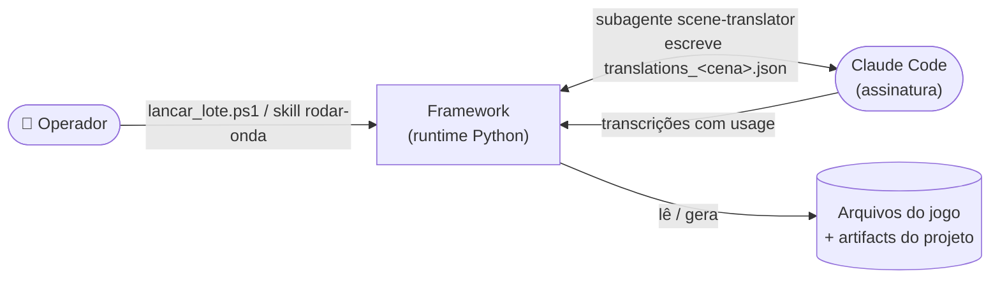
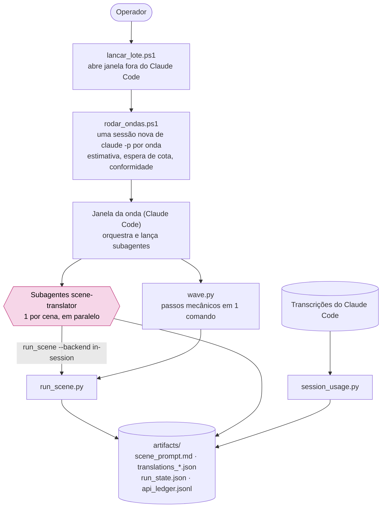
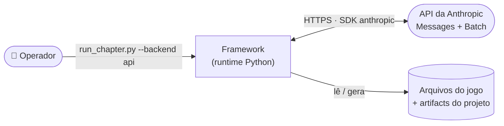
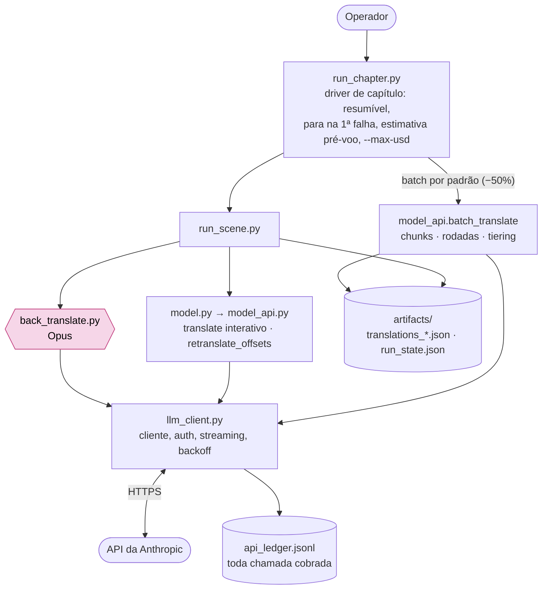
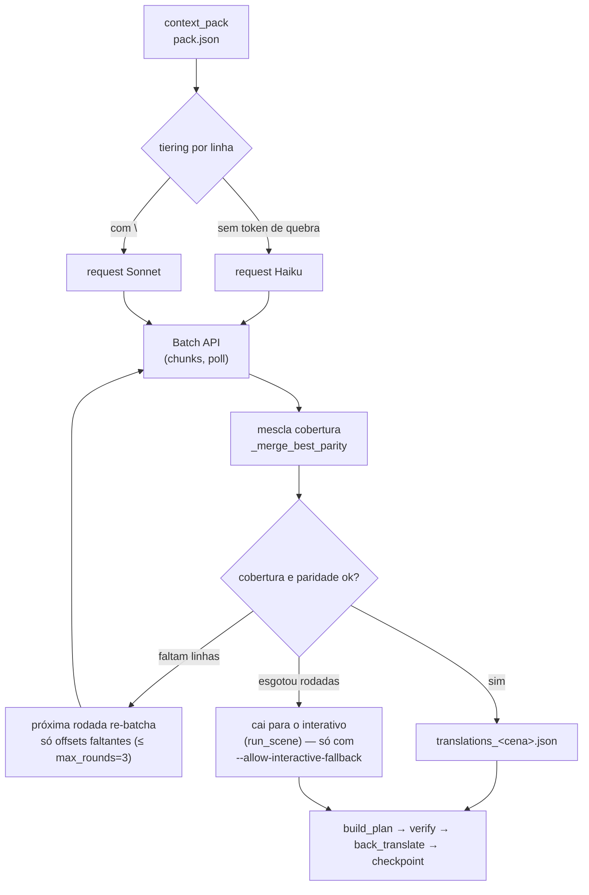
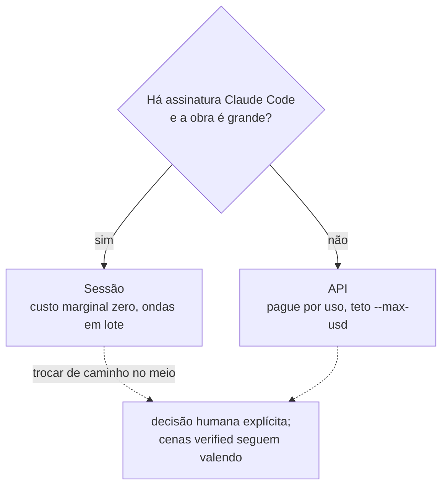

# Dois caminhos de uso — sessão e API

O framework traduz de duas formas. O **pipeline é o mesmo** (gates, round-trip, TM, checkpoint); muda **quem faz a chamada ao
modelo** e como o trabalho é disparado. A escolha é **um caminho por projeto**, feita no início (decisão humana, ver o fluxo em
[`DIAGRAMAS.md`](DIAGRAMAS.md)).

| | **Sessão** (`--backend in-session`) | **API** (`--backend api`, padrão do `run_scene`) |
|---|---|---|
| Quem traduz | um subagente `scene-translator` dentro do Claude Code | a API da Anthropic (SDK) |
| Custo | cota da assinatura; o equivalente em USD fica no ledger (`api_equiv_usd`) | pago por chamada; teto `--max-usd`; Batch API −50% |
| Rede / chave | nenhuma chamada do framework; só o Claude Code | `ANTHROPIC_API_KEY` (`.env`) |
| Como roda | ondas em lote: `wave.py`, `session_lot.py`, skill `rodar-onda` | `run_chapter.py <projeto> <cap> --backend api` |
| Retomada | rodar `run_scene` de novo (devolve `AGUARDANDO` até o arquivo existir) | checkpoint por cena; para na 1ª falha |
| Escala | limitada pela cota e pelo tempo de janela | limitada pelo teto de gasto |
| Quando usar | assinatura disponível, obra grande, custo marginal zero | automação headless, previsibilidade de tempo |

O que **não** muda: `context_pack` → tradução → `build_plan` → `verify` → retrotradução → checkpoint, os mesmos gates
([`GOVERNANCE.md`](GOVERNANCE.md)) e o mesmo contrato `translate`/`back_translate` ([`MODEL_INTERFACE.md`](MODEL_INTERFACE.md)).
A única fronteira com o modelo é a fachada `model.py`, que delega a `model_session.py` ou `model_api.py` (ADR 0019).

---

## Caminho de sessão

### C1 — Contexto



### C2 — Contêineres



### C3 — Componentes (uma cena)

```mermaid
sequenceDiagram
  autonumber
  participant S as Subagente scene-translator
  participant R as run_scene
  participant M as model.py → model_session.py
  participant C as Conector (build_plan / verify)
  S->>R: run_scene cena --backend in-session
  R->>R: connector_gate + kb_gate, context_pack (pack.json, scene_prompt.md)
  R->>M: translate
  M->>M: dedup por TM (_select_reuse); prompt reduzido às falas novas
  M-->>R: AWAITING (prompt, expected_output)
  R-->>S: AGUARDANDO tradução
  S->>S: escreve translations_cena.json (UTF-8, objeto lines)
  S->>R: run_scene de novo
  R->>M: translate → READY (arquivo lido e validado)
  R->>C: build_plan_chapter + verify_chapter
  C-->>R: exit 0 · VERIFY_STATUS (round-trip igual)
  R-->>S: AGUARDANDO back-translation (se o risco exigir)
  S->>R: run_scene de novo
  R->>R: checkpoint verified, state_index (TM cresce), métricas
```

**Pontos técnicos**
- `model_session.translate_in_session` **não usa rede nem importa** o cliente/SDK da API. Só garante o `scene_prompt.md` e confere se `translations_<scene_id>.json` existe: ausente → `AWAITING`, presente → `READY`. Arquivo ilegível (não UTF-8, JSON quebrado, sem `lines`) levanta `InvalidTranslationFile` com a instrução de correção.
- **Dedup por TM:** fala cuja fonte já foi traduzida em outra cena sai do prompt e é preenchida pela TM; o que o agente escreveu prevalece (só preenche offset ausente).
- **Lote:** `session_lot.py` (`plan`, `prompt`, `check`, `go`, `split`/`join`, `install`) junta várias cenas num prompt só, confere tokens, orçamento de bytes e cobertura, e fecha pelo `run_scene` com `--require-back`.
- **Onda em um comando:** `wave.py` encadeia `run_scene` → `scene_dedup copy` → `glossary_lint` → `quality_gate` → `session_usage rebuild` → `cost_report` → `obs_report`. Passo que falha para a onda; saída longa vai para `artifacts/wave_last_*.log`.
- **Medição:** o gasto vem das transcrições (`session_usage.py`). Subagente por cena = custo exato (`attribution: "agent"`); tradução na janela principal é aproximada (`"window"`). Linhas de sessão têm `cost_usd: 0` e `api_equiv_usd`.
- **Regra de operação:** a onda roda fora do Claude Code (`lancar_lote.ps1`), com a janela principal em Sonnet e a janela de cada onda em Haiku por padrão; `scene-translator` em Haiku, falas `critical` retraduzidas em Sonnet (ADR 0023), retrotradução em Opus.

---

## Caminho de API

### C1 — Contexto



### C2 — Contêineres



### C3 — Componentes (uma cena e o batch)



**Pontos técnicos**
- **Doutrina (Carta) no `system` com `cache_control`**: cobrada ~1× via prompt caching. Streaming para saídas longas, `json_schema` com `effort: low` e sem thinking na tradução; `effort: high` e thinking adaptativo só na retrotradução. `max_tokens = 64000`.
- **Guard no interativo:** quebra REAL no campo `t` ou offset faltando regenera antes de gravar (até 3 tentativas). Backoff exponencial em 429/500/timeout; falha vira checkpoint `api_translate_failed` (retomável).
- **Batch (padrão no `run_chapter`):** cada rodada submete em chunks; o que falta é re-batchado, convergindo a −50%. `custom_id = cena__tier` (a Batch API só aceita `[a-zA-Z0-9_-]{1,64}`). Se o batch em si falhar, aborta em vez de cair no interativo a preço cheio.
- **Recuperação por linha:** reprova de `verify` re-traduz só as linhas quebradas (`retranslate_offsets`), não a cena.
- **Custo previsível:** `run_chapter` imprime a estimativa antes de gastar e só compromete ao batch o que cabe no `--max-usd` (`_fit_budget`); `api_ledger.jsonl` registra toda chamada, inclusive as que falham.
- **Chave:** `ANTHROPIC_API_KEY` no ambiente ou `.env` na raiz (gitignored; `llm_client._load_dotenv` não sobrescreve variável já setada).

---

## Como decidir e como trocar



Os dois escrevem o mesmo `translations_<scene_id>.json` e passam pelos mesmos gates, então cenas já `verified` por um caminho
continuam válidas no outro. A troca é decisão do humano, registrada no ROADMAP do projeto. A comparação medida entre os
caminhos (não feita ainda num jogo menor) está em [`benchmark_sessao/`](benchmark_sessao/); o benchmark de cota da assinatura
já foi encerrado.

Detalhes relacionados: [`MODEL_INTERFACE.md`](MODEL_INTERFACE.md) (contrato e matriz de modelos),
[`TRANSLATION_PIPELINE.md`](TRANSLATION_PIPELINE.md) (fluxo da cena, onda, HITL),
[`OBSERVABILITY.md`](OBSERVABILITY.md) (ledger e métricas), [`TOKEN_ECONOMY.md`](TOKEN_ECONOMY.md) (onde o custo é economizado).
