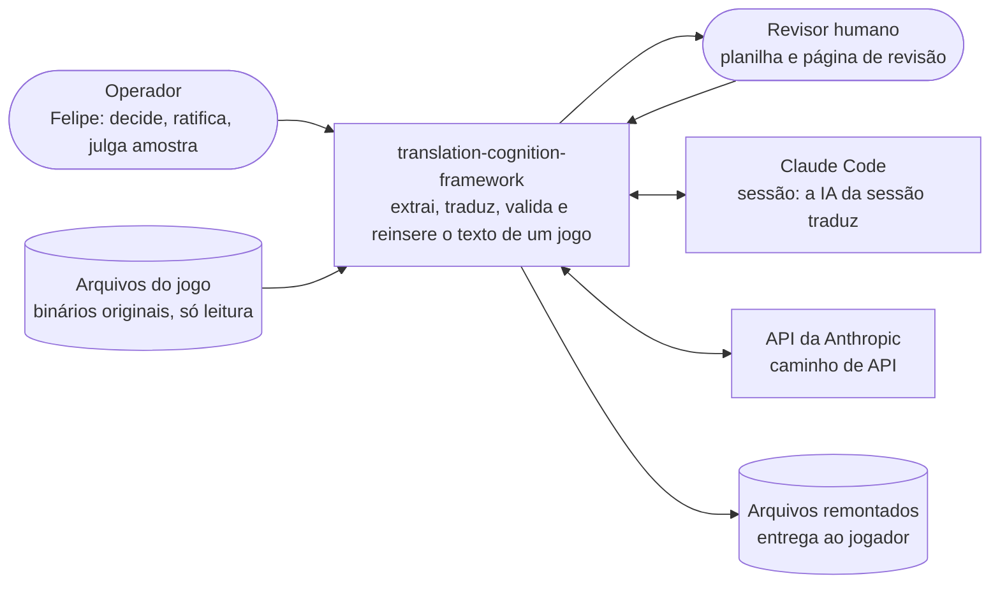
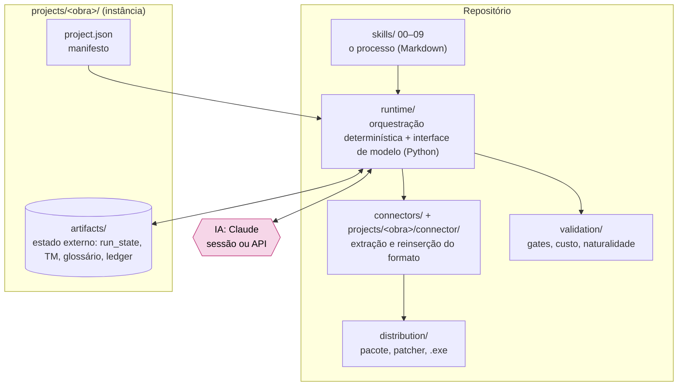
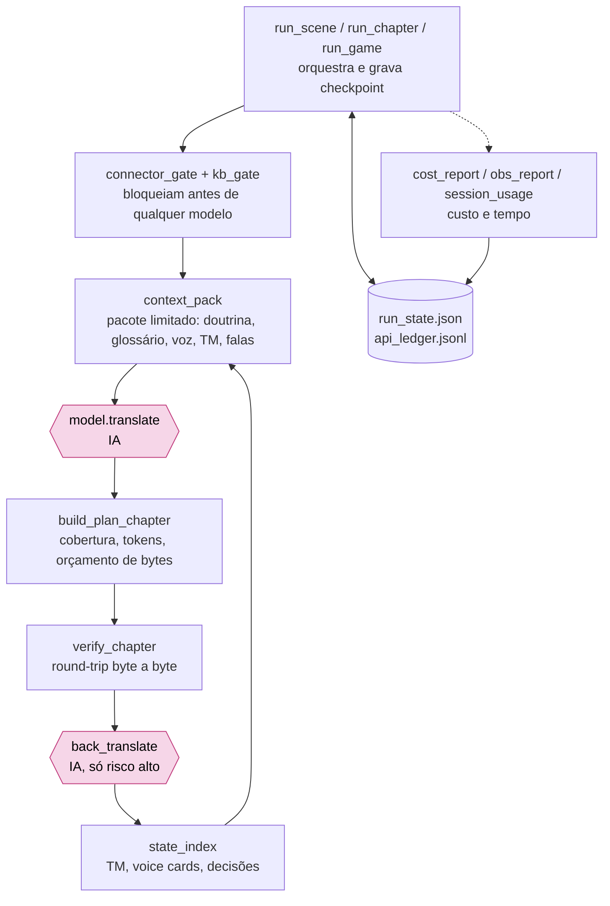
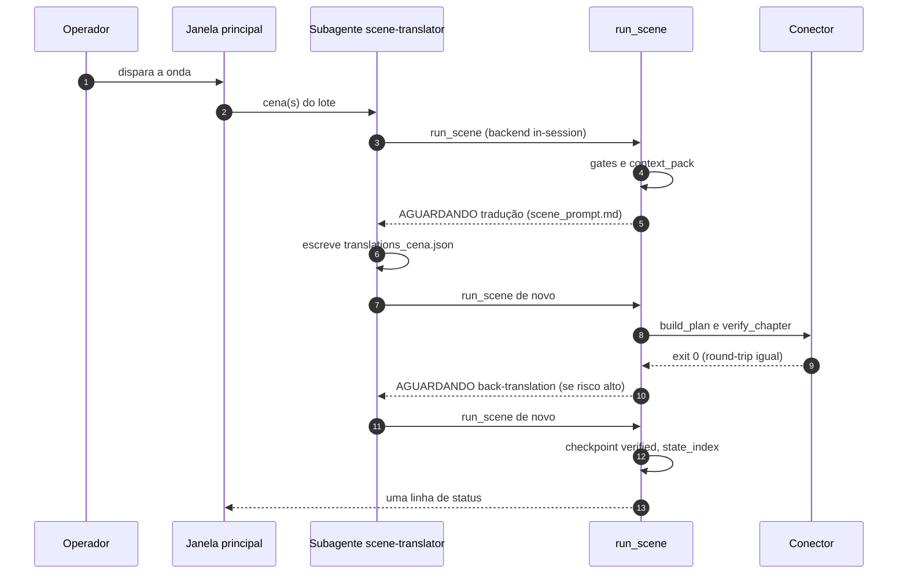
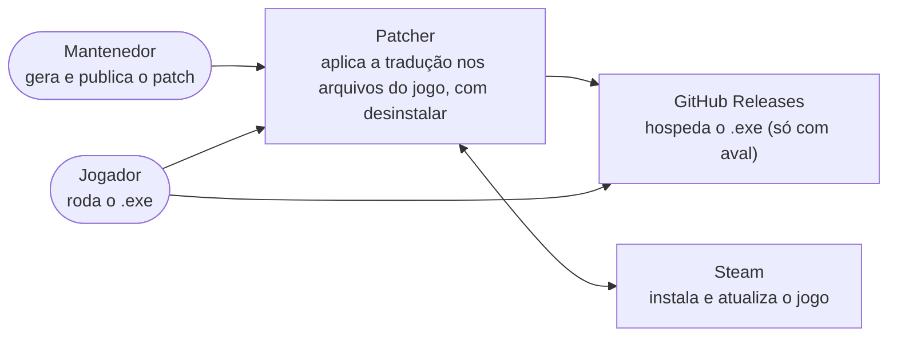
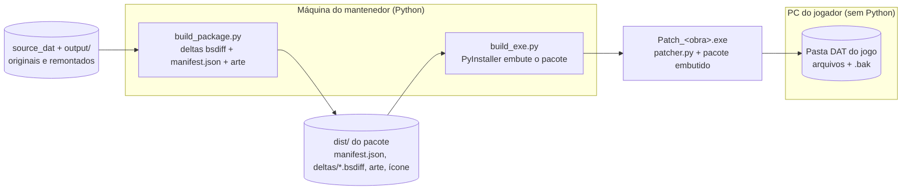
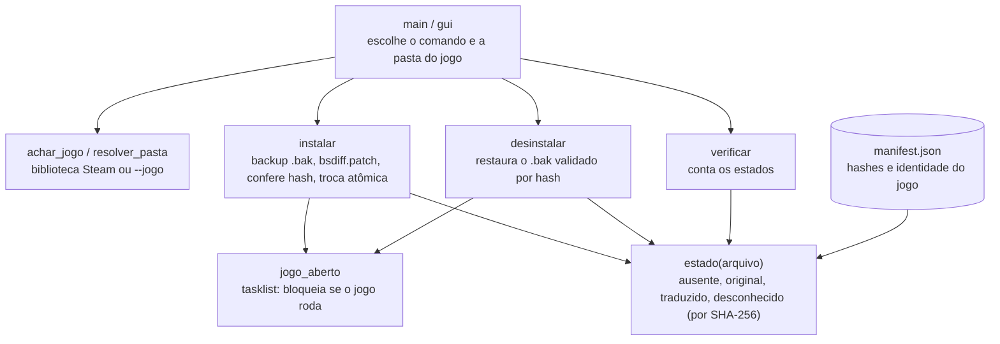
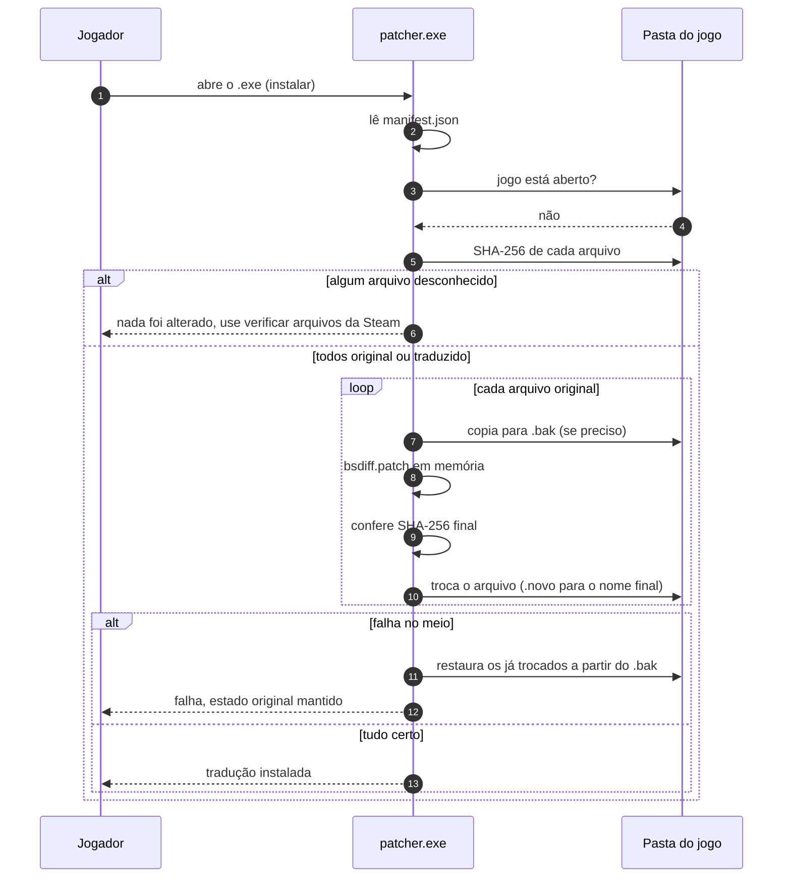
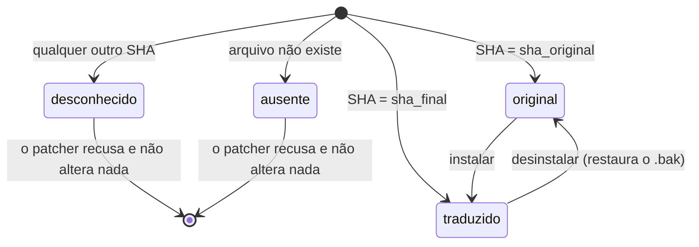

# Diagramas — C4 do pipeline e do patcher

Visão por níveis do modelo C4 (contexto, contêineres, componentes) mais um fluxo de sequência e um de estados.
Feitos a partir do código e de [`ARCHITECTURE.md`](ARCHITECTURE.md), [`SDD_RUNTIME.md`](../framework/SDD_RUNTIME.md)
e de `framework/distribution/`. Estão em `flowchart` do Mermaid (a sintaxe `C4*` do Mermaid ainda é experimental e
renderiza mal no GitHub). Nenhum diagrama traz fala de jogo.

## 1. Pipeline de tradução

### Nível 1 — Contexto

### Nível 2 — Contêineres

### Nível 3 — Componentes do `runtime/` (uma cena)

Ondas do caminho de sessão: `wave.py` encadeia `run_scene`, `scene_dedup`, `glossary_lint`, `quality_gate`,
`cost_report` e `obs_report` num comando só. `session_lot.py` monta o prompt de várias cenas.

### Sequência — uma cena no caminho de sessão

## 2. Patcher de distribuição

### Nível 1 — Contexto

### Nível 2 — Contêineres

### Nível 3 — Componentes do `patcher.py`

### Sequência — instalar

### Estados de cada arquivo

