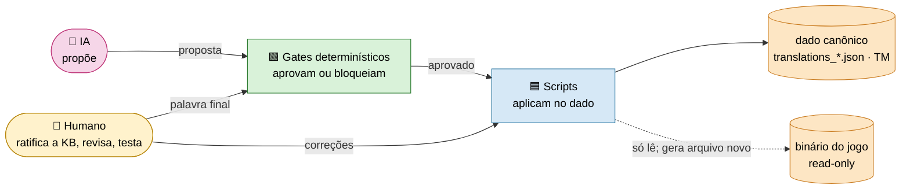
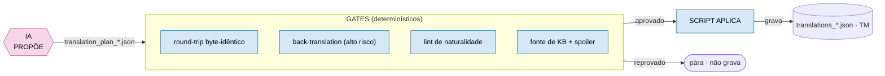
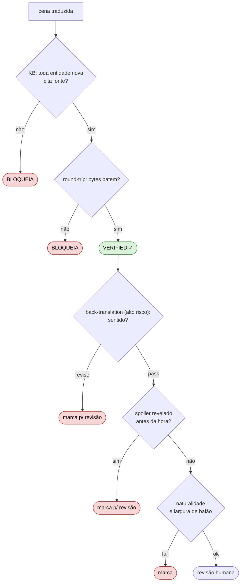
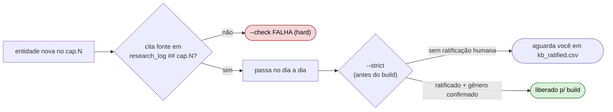
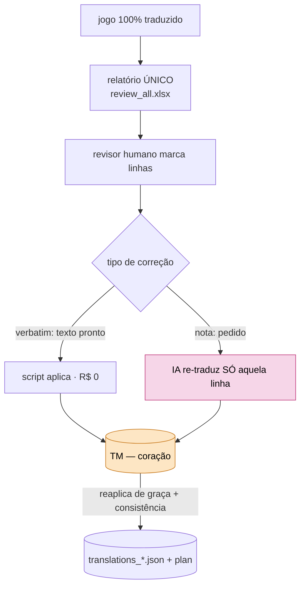
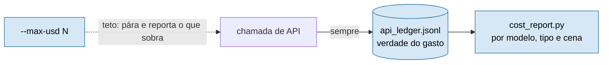

# Governança — quem decide o quê

> **Em 30 segundos.** A IA **nunca tem a palavra final**. Ela só **propõe**; **gates determinísticos** (round-trip,
> back-translation, lint, fonte da KB) **aprovam**; um **script** **aplica** no dado. O binário do jogo é **read-only**,
> nenhuma tradução é digitada à mão dentro dos dados, e **cada centavo cobrado pela API é registrado**, mesmo quando a chamada falha.

Os outros pilares têm casa própria: **arquitetura** (camadas e o "porquê" medido) em [`ARCHITECTURE.md`](ARCHITECTURE.md);
**engenharia** (módulos e alavancas de custo) em [`../framework/runtime/README.md`](../framework/runtime/README.md).
Este documento trata de **quem propõe, quem aprova, quem aplica e o que é imutável**.

## Os atores (C1)

## 1. O laço de ouro: propõe → aprova → aplica

Vale para **toda** mutação de dado. A IA escreve numa **proposta** (`translation_plan_*.json`); um **gate** decide; só então um
**script determinístico** grava no artefato canônico. Se o gate reprova, o dado não se move.

A parte estocástica fica **cercada**: o veredito é sempre de uma peça determinística e reproduzível, então um erro da IA não
vira dado ruim em silêncio; ele esbarra num gate. (O "reproduzível com asterisco" está em [`ARCHITECTURE.md`](ARCHITECTURE.md).)

## 2. As quatro invariantes (o que nunca pode acontecer)

| # | Invariante | Como é forçada |
|---|---|---|
| **I1** | **Binário read-only.** O `.sdat` do jogo nunca é editado à mão. | O conector só **lê**; a saída é um arquivo **novo** + patch `.ips`. O round-trip byte-idêntico é gate de regressão (`connector/test_roundtrip.py`). |
| **I2** | **Sem texto da obra em `.py`.** | Um teste data-driven varre os `.py` e **falha** se achar texto da obra. Os scripts leem dos artefatos. |
| **I3** | **A IA não grava no canônico.** | `translation_plan_*.json` (proposta) ≠ `translations_*.json` (canônico). `tm_correct.py` e `quality_review.py` aplicam; a IA não. |
| **I4** | **Todo gasto é visível.** | O `api_ledger.jsonl` registra **toda** chamada cobrada (inclusive as que falham depois); `cost_report.py` agrega. |

## 3. A pilha de gates

Cada cena atravessa uma pilha antes de virar `verified`. KB e round-trip **travam** a cena; os demais **marcam** para a revisão humana (report-only).

| Gate | Pergunta | Onde |
|---|---|---|
| **KB / fonte** | Toda entidade nova (`(cap.N)`) cita fonte no `research_log.md`? | `kb_review.py --gate` · `kb_phase.py --check` |
| **Spoiler** | Nome ou gênero revelado aparece antes do `reveal_timing`? | `spoiler_check.py` (`check` + `check_gender`); auditoria report-only ao fim do run |
| **Round-trip** | Extrair→reinserir regenera os bytes? (oráculo de correção) | `connector/verify_chapter.py` · `test_roundtrip.py` |
| **Back-translation** | A linha dos níveis exigidos (`back_translation_risk`) preserva o sentido? | `model.back_translate` (Opus) → `quality_gate.py` |
| **Lint** | pt-BR natural? Cabe no balão? | `naturalness_lint.py` · `quality_review` (largura) |
| **Conector completo** | Existem os scripts de build_plan/verify e ao menos 1 round-trip verde? | `connector_gate.py` (roda antes do `kb_gate` em todo `run_scene`; sem os scripts, bloqueia sem bypass) |
| **Schema** | `risk_level` é enum válido? `risk_notes` presente quando ≥ medium? Token de controle fora do lugar? | `validate.py`, auditoria 1×/capítulo (`run_scene._audit_schema`); erro de token numa cena com round-trip verde bloqueia o `verified` (status `schema_failed`) |
| **Humano no laço** | Escopo aceito, caminho escolhido e fila de escalonamento sem item aberto? (só com `"hitl": true`) | `hitl.py` (gate no CLI do `run_scene`; item aberto bloqueia o `quality_gate`) |

> **O round-trip prova bytes, não qualidade.** Ele garante que a tradução **reentra** no jogo sem corromper o arquivo, não que
> está *boa*. A qualidade vem dos outros gates e da revisão humana (§5).

## 4. Fonte obrigatória: a IA não se auto-aprova na lore

O elo mais fácil de corromper é a **base de conhecimento**: se a IA pesquisa *e* ratifica a própria pesquisa, ela pode inventar
um fato com confiança. O gate de KB corta isso com uma **âncora externa**.

- **Fonte (hard):** sem citação no `research_log.md`, `kb_phase --check` reprova. Toda decisão de lore é rastreável a uma fonte autorizada.
- **Proveniência:** `kb_gate.py` avisa quando `status: reconciled` e `human_input: pending` coexistem (o humano deu o input, mas o campo não foi atualizado).
- **Ratificação humana (`--strict`):** antes do build, **você** marca a entidade em `kb_ratified.csv` (só o humano edita), com gênero confirmado.
- **Gênero:** vira spoiler (`gender_quarantine`) **só com fonte confiável**, nunca fabricado.

## 5. O humano no centro: revisão única, TM como coração

Decisão travada do dono do projeto:

> **O jogo é processado pela IA UMA vez.** Depois do QA, as correções do revisor são aplicadas **cirurgicamente**; o jogo
> **nunca** é re-traduzido inteiro. *"Não vou pagar o processamento do jogo todo após o QA, me recuso."*

A **Translation Memory (TM)** torna isso possível: guarda cada decisão e a reaplica de graça, então corrigir uma linha custa **uma linha**.

- **Um relatório, não CSV cru:** `quality_review.py` gera um XLSX amigável (aba "Leia-me" e "Revisão", filtro, cor por severidade, colunas de input destacadas). Flags determinísticas pré-marcam o que merece olhar (alto risco, idêntico à fonte, largura de balão, suspeita de pt-PT…).
- **Aplicação barata:** `verbatim` custa **R$ 0**; `nota` dispara a IA **só naquela linha**.
- **TM = consistência e reuso:** reconstruída por `state_index` a partir das `base_translations`, garante o mesmo termo igual em todo lugar.

## 6. Custo é governado, não estimado por fé

- **Ledger de gasto-verdade:** toda chamada vai ao `api_ledger.jsonl` antes de qualquer merge, inclusive as que falham. O gasto desperdiçado é **medido**, não escondido.
- **Teto uniforme (`--max-usd`):** `run_chapter`, `quality_fix` e `quality_review` aceitam teto; ao atingi-lo, param e reportam quantas cenas/linhas sobraram.
- **Alavancas:** Batch API −50%, tiering (Haiku linha simples, Sonnet multi-linha, Opus na back-translation e no último degrau de fitting), dedup por TM, escalonamento cirúrgico de fitting.

## 7. Onde cada regra vive

| Quero entender… | Vá para |
|---|---|
| O laço propõe→aprova→aplica | `runtime/run_scene.py`, `tm_correct.py`, `quality_review.py` |
| O round-trip (oráculo de bytes) | `projects/<obra>/connector/verify_chapter.py`, `test_roundtrip.py` |
| O gate de fonte de KB | `runtime/kb_review.py`, `runtime/kb_phase.py`, `artifacts/kb_ratified.csv` |
| Controle de spoiler e gênero | `runtime/spoiler_check.py`, `artifacts/spoiler_ledger.json` |
| O relatório humano e a aplicação | `runtime/quality_review.py`, `runtime/quality_gate.py` |
| A verdade do gasto | `artifacts/api_ledger.jsonl`, `runtime/cost_report.py` |
| As decisões arquiteturais | [`adr/`](adr/) |

> **Filosofia:** determinístico por padrão, IA só onde exige IA, humano com a palavra final, e nada se move sem deixar rastro.
> É isso que torna auditável, por uma pessoa só, um projeto de ~45 mil linhas.
