# Guia — do jogo ao patch

Este guia conta o caminho inteiro, do jogo na mão até o patch instalado, e diz em cada etapa **o que acontece, o que
é decisão sua e onde cai cada arquivo**. Os comandos não estão aqui de propósito: ficam nos documentos de cada
etapa (links abaixo) e em `--help`, para este guia não ficar desatualizado.

Para ver o motor funcionando antes de mexer em jogo real, rode o exemplo fictício `projects/demo/` (veja "Começar"
no [README](../README.md)).

## O caminho inteiro

```mermaid
flowchart LR
  a["1. Preparar<br/>instalar e chave"]:::p --> b["2. Projeto novo<br/>scaffold"]:::p
  b --> c["3. Extrair<br/>jogo → texto"]:::p
  c --> d["4. Pesquisar<br/>obra e glossário"]:::p
  d --> e["5. Traduzir<br/>cena por cena"]:::p
  e --> f["6. Revisar<br/>gates e você"]:::h
  f --> g["7. Remontar<br/>texto → jogo"]:::p
  g --> h["8. Testar no jogo<br/>print e correção"]:::h
  h --> i["9. Patch<br/>deltas e .exe"]:::p
  classDef p fill:#d6e8f6,stroke:#1f6f9b,color:#000;
  classDef h fill:#fde6c4,stroke:#c97b1f,color:#000;
```



Azul = o framework faz. Laranja = a decisão é sua. Nenhuma etapa avança com a anterior incompleta: se um gate
bloquear, resolva a causa, não pule.

## Onde fica cada coisa

```
projects/<slug>/
  project.json     configuração (idioma, caminho de uso, largura de caixa…)      versionado
  connector/       extrai e remonta o texto deste jogo                            versionado
  profile/         vozes e termos                                                 versionado
  artifacts/       o que o pipeline gera (a maior parte fica fora do Git)         só o permitido
  source_dat/      cópia dos arquivos ORIGINAIS do jogo                           fora do Git
  output/          arquivos remontados com a tradução                             fora do Git
  dist/            pacote do patch                                                fora do Git
```

O repositório é público e guarda só o framework. O `content_guard` (hook local e job `Guard` da CI) barra, e
você não contorna: o jogo (original ou remontado), o roteiro extraído e a tradução, planilhas de revisão, prints,
qualquer imagem do jogo, o pacote do patch, `.env` e notas `*.local.md`.

## As etapas

**1. Preparar.** Instalar o framework e pôr a chave da API no `.env` (só o caminho de API usa). Passo a passo e
teste com o exemplo fictício: [README, "Começar"](../README.md).

**2. Criar o projeto.** O `scaffold_project.py` cria a estrutura acima. Nada nasce pronto para passar: glossário,
base de conhecimento e conector têm marcadores que os gates bloqueiam até você preencher.
→ [`NEW_PROJECT_ONBOARDING.md`](NEW_PROJECT_ONBOARDING.md)

**3. Extrair.** Copie os originais do jogo para `source_dat/` (nunca aponte o projeto para a pasta do jogo já
traduzida). O `discover.py` identifica o engine e indica ou gera o conector. A extração sai em
`artifacts/scenes/<cena>/` e o **round-trip** (extrair e remontar sem traduzir devolve arquivos byte a byte iguais)
é o gate mais importante: sem ele, nada seguinte vale. A pasta do jogo chega ao conector por variável de ambiente
ou `--dat-dir`, nunca gravada no `project.json`.
→ [`CONNECTORS.md`](CONNECTORS.md), [skill 00](../framework/skills/00_extraction.md).
**Sua decisão:** aceitar o corpus extraído (escopo).

**4. Pesquisar.** O tradutor só é bom se conhecer a obra: quem é quem, termos, tom. A etapa produz base de
conhecimento, glossário e registro de decisões. Nomes que **ficam em inglês** são decisão sua, registrada no
glossário, não no código.
→ [`CONCEPTS.md`](CONCEPTS.md), skills `01` a `05` em [`_index.md`](../framework/skills/_index.md).

**5. Traduzir.** **Sua decisão:** o caminho, sessão (dentro da assinatura do Claude Code; cobre diálogo e texto de
sistema) ou API (por token, só diálogo). Cada cena passa por gates: o plano cobre todas as falas e preserva as
quebras de linha, o round-trip da cena fecha, e as falas de risco alto voltam por retrotradução. Lotes longos rodam
fora do Claude Code (skill `rodar-onda`).
→ [`CAMINHOS_DE_USO.md`](CAMINHOS_DE_USO.md), [`TRANSLATION_PIPELINE.md`](TRANSLATION_PIPELINE.md)

**6. Revisar.** Aqui está a parte humana. Você responde a fila de escalonamento (item aberto bloqueia o gate),
marca a planilha de revisão (`artifacts/qa_revisao/`, fora do Git) e mede a taxa de erro numa amostra. Esse número
entra no texto da release.
→ [`QA_REVIEW.md`](QA_REVIEW.md), [`GOVERNANCE.md`](GOVERNANCE.md)

**7. Remontar.** As falas aprovadas viram os arquivos traduzidos em `output/`, com o mesmo nome do original, sem
nunca gravar sobre ele. Texto que não cabe é encurtado de forma determinística; o modelo só entra no resíduo. O
script do conector é executado, nunca refeito, e ninguém grava bytes à mão. Se o projeto tem texto de sistema ou
rótulos em imagem, a skill `08b` roda junto.
→ [skill 08](../framework/skills/08_reinsertion.md), [skill 08b](../framework/skills/08b_system_text_labels.md)

**8. Testar no jogo.** Instale com o jogo fechado e com backup, jogue o trecho do piloto e tire **prints**, que vão
em `artifacts/qa_revisao/teste_ingame/prints/` (ignorada pelo Git; o agente não captura a tela, depende dos seus
prints). Descreva o que viu; a causa raiz é corrigida, a remontagem é refeita e você testa de novo. O comando de
instalação de ensaio do framework casa só arquivos `*.DAT` (conector Capcom DAT); para outro formato, instale por
uma cópia do jogo com o patcher da etapa 9.
→ [skill 08c](../framework/skills/08c_ingame_test.md)

**9. Gerar o patch.** Depois do round-trip verde, a tradução sai como **delta** (só a diferença entre original e
traduzido), nunca como arquivo do jogo remontado: pacote com deltas e manifesto de hashes, depois o `.exe` de um
clique, testado numa cópia dos originais e como usuário sem Python. As dependências do patch (`bsdiff4`,
`pyinstaller`, `Pillow`) não vêm na instalação padrão: instale à mão. O `distribution.json` do projeto define
título, autor, pasta do jogo, processos que travam os arquivos e aviso mostrado ao usuário.
→ [skill 09](../framework/skills/09_distribution.md), [`TRANSLATION_PIPELINE.md`](TRANSLATION_PIPELINE.md#distribuição-frameworkdistribution-skill-09_distribution)

O patcher só toca arquivo cujo hash bate com o original, guarda `.bak`, confere o hash final, desfaz tudo se algo
falhar e recusa com o jogo aberto. "Verificar arquivos" da Steam devolve o jogo ao original.

**10. Publicar.** O `.exe` e o hash vão numa release; o pacote nunca entra no Git. No texto da release confira o
aviso de não afiliação, "exige cópia legítima do jogo", os limites conhecidos e a taxa de erro medida. Os riscos de
publicar são decisão do dono do projeto.

## Onde ficam as imagens

| Imagem | De onde vem | Onde fica | Vai ao Git? |
|---|---|---|---|
| Arte do painel do instalador e ícone | argumentos `arte` e `capa` do pacote; o ícone é um recorte (`icone_recorte` no `distribution.json`) | resultado em `dist/arte.png` e `dist/icone.ico`; a **imagem de origem** fica fora de `dist/`, porque o PyInstaller embute o `dist` inteiro | Não |
| Prints do jogo | você tira | `artifacts/qa_revisao/teste_ingame/prints/` | Não |
| Rótulos em imagem do jogo | tabela `image_labels` no `project.json` (só texto); a folha remontada sai pelo conector | `output/` | Só a tabela de texto curto |
| Diagramas da documentação | mermaid dentro do `.md` | no próprio texto | Sim |

A arte do painel é conteúdo de terceiros se vier da capa ou de arte oficial. Use por sua conta e risco, ou troque
por arte própria.

## Quando algo trava

| Sintoma | Causa provável | O que fazer |
|---|---|---|
| Round-trip falha na extração | o conector não cobre um trecho do formato | diff binário entre original e saída: offset da primeira diferença e tamanho dos dois arquivos |
| `connector_gate` ou `kb_gate` bloqueia | placeholder do scaffold intacto | preencher o conector ou a base de conhecimento; não usar bypass |
| `build_plan_failed` | o plano não cobre todas as falas ou perdeu uma quebra de linha | corrigir a tradução da cena e rodar de novo |
| `verify_failed` | texto maior que o espaço original | encurtar a fala; o orçamento de bytes está no `dialogs.csv` |
| Round-trip falha em todas as cenas depois de instalar | o projeto aponta para a pasta do jogo já traduzida | apontar de volta para `source_dat/` |
| `content_guard` bloqueou o commit | arquivo de jogo, de tradução ou de imagem | resolver a causa; nunca contornar |

## Para ir além

[`../README.md`](../README.md) · [`CONCEPTS.md`](CONCEPTS.md) · [`ARCHITECTURE.md`](ARCHITECTURE.md) ·
[`TOKEN_ECONOMY.md`](TOKEN_ECONOMY.md) · [skills do processo](../framework/skills/_index.md) ·
[exemplo real completo: bof4](../projects/bof4/README.md)
