# Guia — do jogo ao patch, passo a passo

Este guia leva uma pessoa do zero até o patch de tradução instalado no jogo. Ele conta a história inteira e, em
cada etapa, aponta para o documento que explica o detalhe. Ele não repete esses documentos.

Para ver o motor funcionando antes de mexer em jogo real, rode o exemplo fictício (`projects/demo/`, cinco falas
inventadas, sem direitos autorais): os comandos abaixo valem para ele também.

## O caminho inteiro

```mermaid
flowchart LR
  a["1. Preparar<br/>instalar e chave"]:::p --> b["2. Projeto novo<br/>scaffold"]:::p
  b --> c["3. Extrair<br/>jogo → texto"]:::p
  c --> d["4. Pesquisar<br/>obra e glossário"]:::p
  d --> e["5. Traduzir<br/>cena por cena"]:::p
  e --> f["6. Revisar<br/>gates e você"]:::h
  f --> g["7. Remontar<br/>texto → jogo"]:::p
  g --> h["8. Testar no jogo<br/>print e correção"]:::h
  h --> i["9. Patch<br/>deltas e .exe"]:::p
  classDef p fill:#d6e8f6,stroke:#1f6f9b,color:#000;
  classDef h fill:#fde6c4,stroke:#c97b1f,color:#000;
```



Azul = o framework faz. Laranja = a decisão é sua. Nenhuma etapa avança com a anterior incompleta: se um gate
bloquear, resolva a causa, não pule.

## Antes de começar: o que nunca vai para o Git

O repositório é público e guarda só o framework. O `content_guard` (hook local e job `Guard` da CI) barra, e
você não contorna:

- o jogo, original ou remontado (`source_dat/`, `output/`, `manual_tests/`, `.dat`, `.sdat`, `.pak`, `.exe`);
- o roteiro extraído e a tradução (`dialogs.csv`, `translations_*.json`, `approved_*.csv`, memória de tradução);
- planilhas de revisão, prints e qualquer imagem do jogo;
- o pacote do patch (`dist/`, `*.bsdiff`);
- `.env` e notas `*.local.md`.

Essas pastas já estão no `.gitignore`. O guia diz, a cada etapa, **em que pasta cai cada arquivo**.

## 1. Preparar a máquina

```bash
git clone https://github.com/scudellerlemos/translation-cognition-framework
cd translation-cognition-framework
pip install .                         # inclui a busca semântica (~1 GB)
cp .env.example .env                  # coloque a sua chave em ANTHROPIC_API_KEY
tcf translate projects/demo demo01    # teste: traduz a cena fictícia de 5 falas
```

A chave só é necessária no caminho de API. No Windows, use `chcp 65001` (ou `PYTHONIOENCODING=utf-8`) para os
scripts auxiliares não quebrarem com acento.

## 2. Criar o projeto

```bash
python framework/runtime/scaffold_project.py projects/<slug> --title "Título da obra"
```

Isso cria `project.json` (a configuração central), `artifacts/`, `profile/` e `connector/`. Nada vem pronto para
passar: o glossário, a base de conhecimento e o conector nascem com marcadores que os gates bloqueiam até você
preencher. Detalhe: [`NEW_PROJECT_ONBOARDING.md`](NEW_PROJECT_ONBOARDING.md).

```
projects/<slug>/
  project.json     ← configuração (idioma, caminho, largura de caixa…)       versionado
  connector/       ← extrai e remonta o texto deste jogo                      versionado
  profile/         ← vozes e termos                                           versionado
  artifacts/       ← o que o pipeline gera (a maior parte fica fora do Git)  default-deny
  source_dat/      ← cópia dos arquivos ORIGINAIS do jogo                     fora do Git
  output/          ← arquivos remontados com a tradução                       fora do Git
  dist/            ← pacote do patch                                          fora do Git
```

## 3. Extrair o texto do jogo

1. **Copie os arquivos originais do jogo** para `projects/<slug>/source_dat/`. Eles servem de referência para
   confrontar a remontagem e para gerar o patch. Nunca aponte o projeto para a pasta do jogo já traduzida.
2. **Descubra o engine:** `python framework/connectors/discover.py <pasta do jogo>`. Se o engine já é conhecido,
   o comando indica o conector de referência para copiar. Se não, `--generate-stub` gera um par
   `extract.py` + `reinsert.py` de partida. Se o formato for cifrado ou comprimido, está fora do escopo do
   framework.
3. **Confira a cobertura:** `python framework/connectors/coverage_gate.py <candidato.py> <pasta do jogo>`.
4. **Diga ao conector onde está o jogo.** Cada projeto declara em `project.json` → `connector.data_dir_env` o nome de
   uma variável de ambiente (no bof4, `BOF4_DAT_DIR`). A pasta **nunca** é gravada no `project.json`. Aponte para
   `source_dat/` (os originais), não para a pasta do jogo instalada:
   ```bash
   export BOF4_DAT_DIR=projects/bof4/source_dat      # PowerShell: $env:BOF4_DAT_DIR = "projects\bof4\source_dat"
   ```
   Se preferir, passe a pasta no comando com `--dat-dir`, como abaixo.
5. **Extraia:**
   ```bash
   tcf extract projects/<slug> --dat-dir projects/<slug>/source_dat
   # equivale a: python framework/skills/s00_extraction.py projects/<slug> --dat-dir projects/<slug>/source_dat
   ```
   Roda o `connector/extract.py` do projeto (limite de 300 s) e confere que o corpus foi gerado; sai com erro se
   faltar a pasta do jogo. Saem um `dialogs.csv` por cena em `artifacts/scenes/<cena>/`, com o orçamento de bytes
   de cada fala, e um `extraction_log.md` com as anomalias encontradas (idiomas misturados, truncamento).
6. **Escopo:** `python framework/connectors/scope_scan.py projects/<slug> <pasta do jogo>` lista o que existe além
   do diálogo (menu, ajuda, rótulos). Define se o projeto é só diálogo ou `completo` (`extraction_scope`).
7. **Round-trip:** extrair e remontar sem traduzir tem de devolver arquivos **byte a byte iguais** ao original.
   É o gate mais importante da etapa: sem ele, nada seguinte vale. O comando da remontagem é o da etapa 7.

Conector novo é a parte difícil. Leia [`CONNECTORS.md`](CONNECTORS.md) e
[`../framework/skills/00_extraction.md`](../framework/skills/00_extraction.md).

**Sua decisão:** `python framework/runtime/hitl.py accept-scope <projeto> --reviewer "SEU NOME"` aceita o corpus
extraído (quantas cenas, quantas falas).

## 4. Pesquisar a obra e montar o glossário

O tradutor só é bom se conhecer a obra. Esta etapa produz a base de conhecimento (quem é quem, termos, tom).

- `kb_fetch.py` transforma uma fonte (URL, PDF, `.docx`, arquivo) em texto limpo.
- `kb_phase.py <projeto> <capítulo>` aponta o que falta pesquisar antes de traduzir aquele trecho
  (`--check` só confere).
- `glossary_lint.py` confere o glossário contra as traduções.
- Nomes e termos que **ficam em inglês** são decisão sua; registre no glossário, não no código.

Resultado em `artifacts/`: `research_log.md`, glossário, `decision_log.md`. Detalhe:
[`CONCEPTS.md`](CONCEPTS.md) e as skills `01` a `05` em [`../framework/skills/`](../framework/skills/_index.md).

## 5. Traduzir

**Escolha o caminho** (decisão sua, fica registrada): `hitl.py choose-path <projeto> in-session|api`.

| | Sessão (assinatura do Claude Code) | API |
|---|---|---|
| Custo | dentro da assinatura | por token, com `--max-usd` como teto |
| Cobre | diálogo e texto de sistema | só diálogo |

Comparação completa: [`CAMINHOS_DE_USO.md`](CAMINHOS_DE_USO.md).

```bash
python framework/runtime/run_scene.py <projeto> <cena> --backend in-session
```

No caminho de sessão o comando **para** e aponta o `scene_prompt.md`; o modelo responde e gera
`translations_<cena>.json`; você roda o mesmo comando de novo e ele segue. Para muitas cenas, use
`wave.py` (uma onda num comando). Para lotes longos, a skill `rodar-onda`, que roda **fora do Claude Code**
(`lancar_lote.ps1`). Fluxo de uma cena: [`TRANSLATION_PIPELINE.md`](TRANSLATION_PIPELINE.md).

Cada cena passa por gates: o plano cobre todas as falas e preserva as quebras de linha, o round-trip da cena
fecha, e as falas de risco alto voltam por **retrotradução** para conferir o sentido.

## 6. Revisar (a parte humana)

- **Fila de escalonamento:** falas em que o modelo ficou em dúvida. Você responde e `hitl.py resolve` fecha. Item
  aberto bloqueia o `quality_gate`.
- **Planilha de revisão** (`artifacts/qa_revisao/para_revisar/`, fora do Git): você marca o que está errado e
  devolve em `devolvido/`.
- **Medida de qualidade:** `quality_sample.py export` sorteia pares únicos; você marca `ok` ou `erro`; `score`
  calcula a taxa de erro. Esse número entra no texto da release.

Detalhe: [`QA_REVIEW.md`](QA_REVIEW.md) e [`GOVERNANCE.md`](GOVERNANCE.md).

## 7. Remontar o jogo

A reinserção pega as falas aprovadas (`approved_*.csv` de cada cena) e grava os arquivos traduzidos em
`projects/<slug>/output/`, com o mesmo nome e a mesma extensão do original. Nunca grava sobre o original.

```bash
python framework/skills/s08_reinsertion.py projects/<slug> --dat-dir projects/<slug>/source_dat
```

- Roda o `connector/reinsert.py` do projeto (limite de 600 s) e lista o que saiu em `output/`. Sai com erro se o
  script falhar. O script é **executado, nunca refeito**: ninguém grava bytes à mão.
- O mesmo comando, antes de traduzir qualquer coisa, serve para o round-trip da etapa 3. Compare `output/` com
  `source_dat/`.
- Texto maior que o espaço do original é encurtado por uma cascata determinística (cabe direto, reaponta o
  ponteiro, corta). O modelo só entra no resíduo que nada resolve.
- Antes de gravar, o script aborta se alguma tradução tiver caractere que a tabela do jogo não codifica.
- Se o projeto tem texto de sistema ou rótulos em imagem, a skill
  [`08b`](../framework/skills/08b_system_text_labels.md) roda junto desta etapa.
- Se o `reinsert.py` ainda não existe, o agente avisa e só cria com a sua permissão, a partir de
  `framework/connectors/_skeleton/reinsert.py`.

## 8. Testar no jogo

1. **Instale** com o jogo fechado:
   ```bash
   python framework/runtime/session_lot.py projects/<slug> install projects/<slug>/output projects/<slug>/source_dat "<pasta DAT do jogo>"          # ensaio: só lista
   python framework/runtime/session_lot.py projects/<slug> install projects/<slug>/output projects/<slug>/source_dat "<pasta DAT do jogo>" --go     # instala
   ```
   Copia só os arquivos de `output/` que diferem do original, guarda `<arquivo>.bak` (só de arquivo idêntico ao
   original, e só se o `.bak` ainda não existe) e confere a cópia no fim. Atenção: esse comando casa `*.DAT`, ou
   seja, serve ao conector Capcom DAT. Para outro formato de arquivo, use o patcher da etapa 9 numa cópia do jogo,
   ou adapte o comando.
2. Jogue o trecho do piloto. Tire **prints** e coloque-os em
   `projects/<slug>/artifacts/qa_revisao/teste_ingame/prints/` (a pasta existe só para isso; o conteúdo é ignorado
   pelo Git). O agente não captura a tela: ele depende dos seus prints.
3. Descreva o que viu (caixa estourada, caractere errado, texto cortado). A causa raiz é corrigida, a remontagem
   é refeita e você testa de novo (skill [`08c`](../framework/skills/08c_ingame_test.md)).

Largura de caixa e códigos de controle ficam em `project.json`
(`line_width`, `connector.control_codes`): ver [`TRANSLATION_PIPELINE.md`](TRANSLATION_PIPELINE.md).

## 9. Gerar o patch

Depois do round-trip verde, a tradução sai como **delta** (só a diferença entre original e traduzido), nunca como
arquivo do jogo remontado. Skill [`09`](../framework/skills/09_distribution.md).

```bash
cd projects/<slug>
# 1) pacote: deltas + manifest.json (hashes). Arte e ícone entram só aqui.
python -I ../../framework/distribution/build_package.py distribution.json source_dat output dist <versao> [arte [capa]]
# 2) o .exe de um clique (sai em output/, nunca dentro de dist/)
python ../../framework/distribution/build_exe.py dist
# 3) teste numa cópia dos originais, depois o .exe como usuário sem Python
python ../../framework/distribution/patcher.py verificar --jogo <cópia> --pacote dist
python ../../framework/distribution/verificar_exe.py <exe> dist source_dat
```

Dependências do patch (`bsdiff4`, `pyinstaller`, `Pillow`) não vêm no `pip install .`: instale à mão.

### Onde ficam as imagens

| Imagem | De onde vem | Onde fica | Vai ao Git? |
|---|---|---|---|
| Arte do painel do instalador e ícone | `arte` e `capa` na linha do `build_package.py`; o ícone é um recorte (`icone_recorte` no `distribution.json`) | resultado em `dist/arte.png` e `dist/icone.ico`; a **imagem de origem** fica fora de `dist/` (o PyInstaller embute o `dist` inteiro) | Não |
| Prints do jogo | você tira | `artifacts/qa_revisao/teste_ingame/prints/` | Não |
| Rótulos em imagem do jogo | tabela `image_labels` no `project.json` (só texto); a folha remontada sai pelo conector | `output/` | Só a tabela de texto curto |
| Diagramas da documentação | mermaid dentro do `.md` | no próprio texto | Sim |

A arte do painel é conteúdo de terceiros se vier da capa ou de arte oficial: use por sua conta e risco, ou
troque por arte própria.

### Configurar `distribution.json`

Título, autor, nome do `.exe`, pasta do jogo na Steam, processos que travam os arquivos (o patcher recusa com o
jogo aberto), aviso mostrado ao usuário e recorte do ícone. Modelo: o de `projects/bof4/distribution.json`.

### Regras do patcher

Só toca arquivo cujo hash bate com o original do manifesto; guarda `.bak`; confere o hash final; desfaz tudo se
algo falhar; recusa com o jogo aberto. "Verificar arquivos" da Steam devolve o jogo ao original.

## 10. Publicar

O `.exe` e o hash vão numa release. **O pacote nunca entra no Git** (o guard barra `dist/` e `*.bsdiff`). Antes de
publicar, confira no texto da release: aviso de não afiliação, "exige cópia legítima do jogo", limites conhecidos
e a taxa de erro medida. Quem é o responsável e quais riscos aceitou é decisão do dono do projeto.

## Quando algo trava

| Sintoma | Causa provável | O que fazer |
|---|---|---|
| `round-trip` falha na extração | conector não cobre um trecho do formato | diff binário entre original e saída: offset da primeira diferença e tamanho dos dois arquivos |
| `connector_gate` / `kb_gate` bloqueia | placeholder do scaffold intacto | preencher o conector ou a base de conhecimento; não usar bypass |
| `build_plan_failed` | plano não cobre todas as falas ou perdeu uma quebra de linha | corrigir a tradução da cena e rodar de novo |
| `verify_failed` | texto maior que o espaço original | encurtar a fala; o orçamento de bytes está no `dialogs.csv` |
| Round-trip falha em todas as cenas depois de instalar | o projeto aponta para a pasta do jogo já traduzida | apontar de volta para `source_dat/` (originais) |
| `content_guard` bloqueou o commit | arquivo de jogo, de tradução ou de imagem | resolver a causa; nunca contornar |

## Para ir além

- Visão geral e conceitos: [`../README.md`](../README.md), [`CONCEPTS.md`](CONCEPTS.md).
- Arquitetura: [`ARCHITECTURE.md`](ARCHITECTURE.md), [`DIAGRAMAS.md`](DIAGRAMAS.md).
- Custo e economia de tokens: [`TOKEN_ECONOMY.md`](TOKEN_ECONOMY.md).
- Todas as skills do processo: [`../framework/skills/_index.md`](../framework/skills/_index.md).
- Exemplo real completo: [`../projects/bof4/README.md`](../projects/bof4/README.md).
