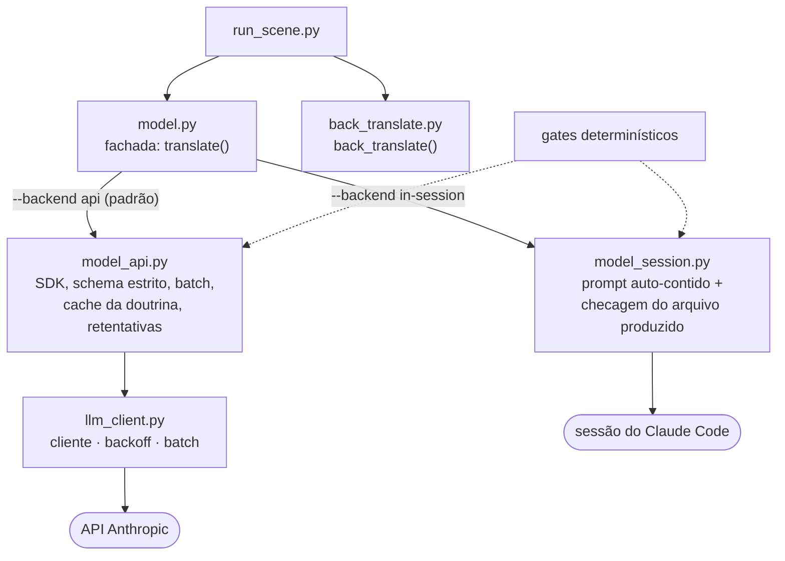

# Model Interface — como a IA é chamada

O pipeline não sabe qual modelo rodou. Toda chamada à IA passa por **uma única fronteira**, `framework/runtime/model.py`
(mais `back_translate.py` para a revisão), e o mesmo `run_scene` roda com qualquer modelo ou caminho.

## Estrutura (C3)

Desde a Onda 4 ([ADR 0019](adr/0019-divisao-de-model-e-context-pack-com-guardrail-de-paridade.md)) o `model.py` é uma **fachada**: reexporta a API pública e delega a um
módulo por caminho. Quem importa `model` não percebe a divisão.



O `test_layering.py` trava as camadas e o `test_model_golden.py` trava o prompt.

## Contrato

```
translate(root, scene, *, backend, model, budget_tolerance)        -> {status, path|prompt, scene_id, n_lines}
back_translate(root, scene, high_lines, *, backend, model)         -> {status, path|prompt, reviewed}
```

Só dois papéis de IA existem:

- **translate:** traduz a cena a partir do pacote limitado (`context_pack`).
- **back_translate:** pt-BR → EN para checar sentido, voz e ambiguidade, nas falas dos níveis de `back_translation_risk` do
  projeto (padrão `high` e `critical`), mais uma amostra de 5% das demais nas cenas vindas do batch.

## O formato da resposta

A tradução usa saída estruturada estrita: um array com uma entrada por fala; a API rejeita o que sair do schema
(`_TRANSLATION_SCHEMA` em `model_api.py`).

```json
{"lines": [{
  "offset": "0x1A2B",
  "speaker": "Ryu",
  "tone_register": "informal",
  "intent": "pergunta direta",
  "risk_level": "low",
  "risk_notes": "",
  "t": "Para onde você quer ir?"
}]}
```

Os valores são ilustrativos.

| Campo | Para que serve |
|---|---|
| `offset` | liga a resposta à linha de origem no binário |
| `t` | a tradução |
| `speaker`, `tone_register`, `intent` | o que o modelo entendeu da fala; ficam para revisão e alimentam exemplos de voz |
| `risk_level` | `low`, `medium`, `high` ou `critical`; decide se passa pela back-translation |
| `risk_notes` | o motivo do risco, quando houver |

Esses campos explicam a média de **66 tokens de saída por fala**. Cortar `tone_register` e `intent` para economizar foi
avaliado e rejeitado: o gate de qualidade depende deles.

Depois da resposta, o código confere por fala, sem modelo: todo `offset` pedido voltou (cobertura), a contagem do
marcador de quebra bate com a da fonte, e os tokens de formatação foram preservados. A fala que falha volta sozinha na nova tentativa.

## Os dois caminhos

```mermaid
flowchart LR
  subgraph S["in-session (assinatura, opt-in)"]
    p["scene_prompt.md<br/>auto-contido e limitado"] --> aw{"translations_&lt;cena&gt;.json existe?"}
    aw -->|"não"| w["status: awaiting<br/>operador responde numa sessão limpa"]
    aw -->|"sim"| r["status: ready"]
  end
  subgraph A["api (escala headless, padrão)"]
    sys["doutrina no system<br/>com cache_control"] --> call["streaming + json_schema"]
    call --> guard["guard: quebra real e cobertura<br/>até 3 tentativas"]
  end
  r --> g(["gates"])
  guard --> g
```

### `in-session` (`--backend in-session`)

Não chama rede. Garante o `scene_prompt.md` e checa se o chat já produziu `translations_<scene_id>.json`:
ausente → `awaiting`; presente → `ready`. Como o prompt é pequeno, o contexto nunca acumula: sem estouro e sem conta de API.
Falas cuja fonte já foi traduzida em outra cena saem do prompt e são preenchidas pela TM (`_select_reuse`); numa
reconferência sem mudança, o `pack.json` gravado é reaproveitado (`saved_pack`). É resumível: rode `run_scene` de novo.

**Medição de tokens.** No Claude Code, cada cena é traduzida por um subagente dedicado; a transcrição dele só tem aquela
cena, então `session_usage.py` registra o gasto exato no `api_ledger.jsonl` (`source: "session"`, `attribution: "agent"`).
Tradução feita na sessão principal também é medida, mas a divisão por cena é aproximada (`attribution: "window"`); o resto vai
para a cena `_session`.

### `api` (padrão)

Anthropic SDK (import preguiçoso; erro claro se faltar `anthropic` ou `ANTHROPIC_API_KEY`):

- **Doutrina (Carta) no `system` com `cache_control`:** cobrada ~1× via prompt caching, não a cada cena.
- **Model-mix** (cenário `mix` do `cost_model.py`): tradução em Sonnet, back-translation em Opus.
- **Streaming** para saídas longas; `json_schema` com `effort: low` e sem thinking na tradução; `effort: high` e thinking
  adaptativo só na back-translation.
- **`max_tokens = 64000`** (o antigo 16k truncava cenas grandes).
- **Guard do token de quebra e da cobertura**, com retry corretivo (até 3): se o modelo emitir quebra REAL no campo `t`
  (em vez do literal `\n`) ou faltar offset, regenera, antes de gravar.
- **Backoff** exponencial em 429/500/timeout; falha de tradução vira checkpoint `api_translate_failed` (retomável).

**Como ligar:** `pip install anthropic` e `ANTHROPIC_API_KEY` no ambiente ou num `.env` na raiz (carregado por
`llm_client._load_dotenv`; `.env` está no `.gitignore`, veja `.env.example`). Driver de capítulo:
`run_chapter.py <projeto> <cap> --backend api` (resumível, para na 1ª falha). Métricas por cena em `artifacts/metrics.jsonl`
([`OBSERVABILITY.md`](OBSERVABILITY.md)). Benchmark: `bench_translate.py` grava `translations_<scene_id>.<tag>.json` sem
tocar nas aprovadas.

## Matriz de modelos (defaults)

| Papel | Modelo | Constante | Razão |
|---|---|---|---|
| Tradução | `claude-sonnet-4-6` | `MODEL_TRANSLATE` | barato e suficiente com contexto curado |
| Tradução (tier barato) | `claude-haiku-4-5` | `MODEL_TRANSLATE_CHEAP` | linhas single-line no batch (−67%/linha); medido em [`TOKEN_ECONOMY.md`](TOKEN_ECONOMY.md) |
| Back-translation | `claude-opus-4-8` | `MODEL_BACK` | raciocínio para ambiguidade e duplo sentido |

Trocar de modelo é trocar a string; nenhuma outra parte do harness sabe qual rodou.

## O que a produção ensinou (2026-06)

O caminho API foi endurecido contra o SDK vivo (`anthropic` 0.109.x) e rodado de verdade. A 1ª rodada expôs 4 problemas
que só aparecem em produção, todos corrigidos:

| # | Achado | Correção |
|---|---|---|
| 1 | Saída estrita exige `additionalProperties:false`; mapa `{offset:{}}` (chaves dinâmicas) é rejeitado | schema virou **array de entradas** com `offset` por item; conversão array→mapa depois (`_to_map`) |
| 2 | `effort:high` + thinking estourou o custo ~5× (thinking conta como saída): 37 linhas → 20k tokens | `EFFORT_TRANSLATE="low"` e `THINK_TRANSLATE=False`; só a back-translation mantém thinking |
| 3 | Em cena nova, o modelo colapsa o `\n` numa quebra REAL (3 retries não corrigem) | normalização determinística `_norm_t`: quebra real → token literal `\n` |
| 4 | O aviso de charset fazia o modelo remover acentos do `t` canônico | prompt: escreva `t` COM acentos; a transliteração ASCII é do `reinsert` |

**Veredito: Sonnet aprovado como `MODEL_TRANSLATE`.** Em cena de comédia fora da TM (ch_12_03, 408 linhas), registro e humor
no nível da versão feita à mão em Opus; em cena coberta por TM (ch_12_01), 37/37 `t` idênticos ao gold. Cobertura 100%,
0 quebras reais residuais. Opus fica só na back-translation.

| Cena | Linhas | Tokens out | Tempo | ~Custo |
|---|---|---|---|---|
| ch_12_01 (TM) | 37 | 2.529 | 43 s | ~$0,06 |
| ch_12_03 (nova) | 408 | 27.000 | 432 s | ~$0,45 |

~66 tokens/linha (bate o `cost_model`) → ~$1,1 por 1k linhas → jogo ~$36 antes do bundle de custo. Com `effort:high` e
thinking seria ~5× (~$285). Ver [`OBSERVABILITY.md`](OBSERVABILITY.md).

## Por que isso viabiliza o Sonnet

Sonnet não precisava de mais "inteligência": precisava de **contexto pequeno e certo**. Com o `context_pack` entregando só o
relevante e a doutrina cacheada, a tradução por linha cabe em Sonnet; Opus fica para a verificação de alto risco.
Decisão: [`adr/0004-model-agnostic-interface.md`](adr/0004-model-agnostic-interface.md).
