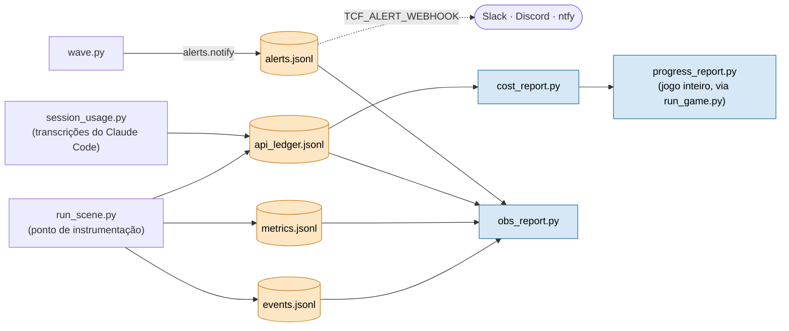

# Observability — métricas do harness

Estado: **implementado** (não mais só especificação). O `run_scene` é o ponto de instrumentação por cena (`metrics.jsonl`,
`api_ledger.jsonl`); `cost_report.py` agrega o gasto por capítulo; `progress_report.py` cobre a camada agregada do JOGO INTEIRO
(% concluído, linhas/min, ETA, taxa de falha), chamado por `run_game.py`. Este doc define o que coletar e onde, para validar o
diagnóstico (custo está na tradução ou na governança?) com número.

## Visão geral



## Onde instrumentar

`framework/runtime/run_scene.py`, emitindo `artifacts/metrics.jsonl` (1 linha por cena). A chamada de IA passa por `model.py`,
e é lá que tokens in/out são conhecidos (backend `api`). No `in-session` os tokens vêm das transcrições do Claude Code
(`session_usage.py`): linhas `source: "session"` no ledger, com entrada, saída, cache lido e cache escrito por requisição,
`cost_usd: 0` (assinatura) e `api_equiv_usd` (o que custaria na API). `cost_report.py` separa API e sessão e mostra a parcela
de cache de cada uma.

## Métricas por cena (consumo)

| Métrica | Como | Uso |
|---|---|---|
| tokens_in / tokens_out | resposta da API (`usage`) | custo |
| **segmentação**: tradução / governança / revisão | por etapa ([2] vs [3-4] vs [5]) | responde "tradução vs governança" |
| custo_cena / custo_capítulo | tokens × pricing (`runtime/cost.py`, batch a 0,5×) | $/1k linhas real |
| cache_hits (doutrina) | `usage.cache_read_input_tokens` | prova o ganho do caching |

A proporção a mirar é **tradução : governança ≈ 70:30 ou melhor** (governança é a doutrina cacheada ~2,2K tok (estimativa) + as
gates determinísticas, que custam ~0 em tokens de IA).

## Métricas por cena (qualidade)

| Métrica | Fonte | Uso |
|---|---|---|
| cobertura | build_plan (linhas traduzidas / total) | completude |
| preservação de tokens/tags | `validate.py` | regressão de formatação |
| consistência terminológica | TM/glossário hits vs divergências no pack | drift de termo |
| **taxa de retrabalho** | linhas reprovadas no QA / total | qualidade do 1º passe |
| back-translation pass-rate | `back_translation_<scene_id>.json` (pass/revise) | risco real pego |
| resíduo | `verify_chapter` | overflow não resolvido (deve ser 0) |

## Log de eventos e visão única

`framework/runtime/events.py` grava `artifacts/events.jsonl` (fora do git): uma linha JSON por acontecimento, com `t`, `run`
(id da execução, herdado pelos processos filhos via `TCF_RUN_ID`), `scene`, `stage`, `result` e, quando medido, `dur_s`. Só
contagem, status e duração; nenhum texto do jogo.

| `stage` | Quem emite | O que traz |
|---|---|---|
| `gate.connector`, `gate.kb`, `gate.kb_phase`, `gate.hitl` | os gates (`gate.hitl` só em projeto com `"hitl": true`) | `pass`/`block`, nº de problemas e avisos |
| `pack`, `translate`, `build_plan`, `verify`, `back_translate`, `state_index` | `run_scene` | duração; no `verify`, as contagens do `VERIFY_STATUS` (overflow, falhas) |
| `quality` | `run_scene` | linhas, alto risco, pass-rate da back-translation, gates ignorados |
| `scene` | `run_scene` | status final e duração total, inclusive quando para num gate ou estoura exceção (`result: "error"`) |
| `audit.spoiler`, `audit.schema` | `run_scene` (entry point) | contagem de achados |
| `alert` | `alerts.notify` (chamado pelo `wave.py`) | passo, resultado (`failed`, `timeout`, `blocked`) e código de saída |

```bash
python framework/runtime/obs_report.py <projeto> [--scene CENA] [--json] [--all]
```

`--all` mostra a tabela com todas as cenas; o padrão é enxuto. O relatório junta tudo por cena: status, linhas, pass-rate,
overflow, nº de execuções, falhas de verify, tempo por etapa, tempo de espera da sessão, tokens e valor; mais o último
resultado de cada gate e a lista de falhas e bloqueios.

### Schema, indicadores e alerta (Onda 3)

- **Schema:** `events.validate(rec)` exige `t` (número), `run`, `stage`, `result` (texto) e `scene` (texto ou null); `stage` tem de estar em `events.ETAPAS` ou numa família `gate.*`/`audit.*`; todo valor é escalar e nenhum texto passa de 200 caracteres (evento não carrega fala). O `emit` avisa e mantém o evento se violar; o `test_observability_onda3.py` falha se o código emitir uma etapa fora do schema. O `obs_report` mostra quantos eventos do projeto estão fora dele.
- **Indicadores:** *taxa de sucesso da onda* = execuções de cena que terminaram verified/planned ÷ as que terminaram (as paradas em AGUARDANDO não entram); *custo por cena* = gasto (API paga + equivalente de sessão) ÷ cenas verified. Saem no `obs_report` (texto e `--json`).
- **Alerta:** passo de onda que falha (rc ≠ 0), estoura o `--step-timeout` ou é barrado na entrada chama `alerts.notify`: grava o evento `alert`, uma linha em `artifacts/alerts.jsonl` (fora do git) e, se a variável de ambiente `TCF_ALERT_WEBHOOK` apontar para um endereço http(s) (Slack, Discord, ntfy…), faz um POST JSON com projeto, cena, passo, resultado e código, sem texto do jogo. Webhook fora do ar só avisa no stderr. O `obs_report` lista os últimos alertas.

O `metrics.jsonl` ganhou `t` e `run`, e uma reexecução que não muda nada não anexa linha nova. O `wave.py` termina cada onda com
`cost_report.py --summary` e `obs_report.py`.

A segmentação tradução:governança vale também para o `in-session`: cada linha de sessão do ledger traz `phase` (`translate`,
`back` = governança, `other`), pelo que o último `run_scene` ficou aguardando. O `cost_report.py` imprime a proporção
(`trad:gov`).

## Sinais de saúde da arquitetura (o que validar)

- **Contexto por execução constante** (não cresce com o nº de capítulos): medir tokens_in do pack por cena ao longo do jogo; a curva deve ser plana, não crescente. É a prova de que o estouro morreu.
- **Reprodutibilidade:** qualquer cena reexecutável a partir dos artefatos sem o chat.
- **Custo previsível:** `$/1k linhas` medido bate (ordem de grandeza) com `cost_model` cenário `mix_cache`.

## Benchmark de modelos (P1) — proposto, não implementado

Nenhum script grava `model_benchmark.md` hoje; a escolha de modelo por papel vem de `runtime/config.py`.

Suite fixa de cenas-gold (com tradução de referência aprovada). Para cada modelo (Opus 4.8 / Sonnet 4.6 / Haiku 4.5) rodar o
mesmo `context_pack` e comparar: back-translation pass-rate (fidelidade), naturalness_lint hits (naturalidade), preservação de
tokens, taxa de retrabalho, custo/1k. Saída: `artifacts/model_benchmark.md`. Decide o default por papel (tradução vs
back-translation).
