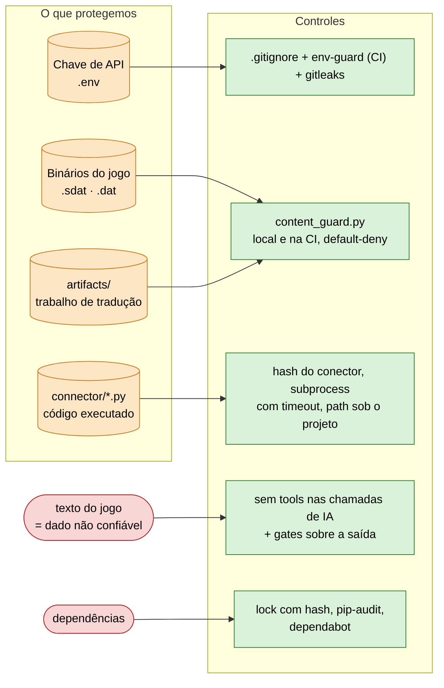
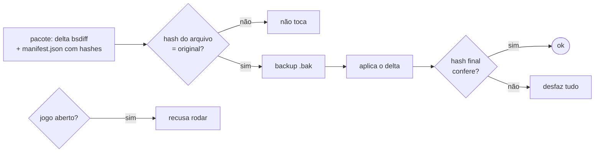

# Security — Translation Cognition Framework

> Threat model e controles do harness. Última revisão: 2026-10-25.

## Perfil de uso

Ferramenta de desenvolvedor individual, operada localmente. Não é serviço web, não processa dados de usuários, não tem
operadores concorrentes. O perfil de ameaça é restrito de acordo.

**O que o projeto NÃO é:** não é serviço web (sem OWASP top 10, CORS, injeção de SQL); não processa dados de usuários (sem
LGPD/GDPR, PII); não tem múltiplos operadores (sem autenticação, autorização, multi-tenancy).

## Mapa de ameaças

| Ativo | Risco se comprometido |
|---|---|
| Chave de API Anthropic (`.env`) | Custo ilimitado; acesso a modelos pela conta do operador |
| Binários do jogo (`*.sdat`, `*.dat`) | Material com copyright; vazamento viola a licença do jogo |
| Artefatos de tradução (`artifacts/`) | Perda de trabalho; retradução custosa |
| Scripts de conector (`connector/*.py`) | Execução de código arbitrário se adulterado |

## 1. Chave de API

**Ameaça:** chave vazada para o git, com uso não autorizado e custo.

**Controles**
- `.env` em `.gitignore` (com comentário de aviso); `.env.example` é o que vai para o repositório.
- A CI confere (`git ls-files --error-unmatch .env`, job `env-guard` de `test.yml`) que `.env` não está rastreado.
- `_load_dotenv` em `llm_client.py` lê a variável de ambiente ou o `.env` local.

**Rotação (runbook):**
1. Criar a chave nova na console Anthropic.
2. Gravar no `.env` local (ou na variável de ambiente) e rodar uma cena de teste.
3. Revogar a chave antiga na console.
4. Conferir `gitleaks` (CI) e `git log -S<prefixo da chave antiga>` para garantir que nunca entrou no histórico.

Se a chave vazou para o git, siga a tabela de incidentes, com a **revogação ANTES de limpar o histórico**. Rotacione sempre
que um `.env` for apagado, copiado para outra máquina ou aparecer em log ou print.

**Gap residual:** a rotação é manual e do operador; a detecção de chave no diff e no histórico é do gitleaks, na CI.

## 2. Texto do jogo como dado não confiável (prompt injection)

**Ameaça:** o texto extraído do jogo (ou de wiki pesquisada) pode conter frases que parecem ordens ("ignore as regras", "rode
este comando"). Um modelo com ferramentas poderia obedecer.

**Controles**
- Toda chamada de API que lê texto do jogo (tradução, retrotradução, batch) é feita **sem `tools`**: o modelo só devolve texto/JSON, que passa pelos gates determinísticos antes de qualquer gravação.
- A triagem de risco roda `claude -p --allowedTools ''` (sem ferramenta), com timeout.
- O agente `scene-translator` tem só `Read, Write, Edit, Bash` (o mínimo para ler o prompt, gravar a tradução e rodar o `run_scene`); a saída é validada pelos mesmos gates.
- A saída do modelo nunca é executada nem interpolada em comando de shell.
- `framework/runtime/test_untrusted_text_boundary.py` falha se uma chamada ganhar `tools`/`tool_choice`, se a triagem perder `--allowedTools ''` ou se as ferramentas do tradutor forem alargadas.

**Gap residual:** o agente in-session tem `Bash` (necessário ao fluxo); a defesa ali é o gate sobre a saída e o operador revisar o diff. Texto malicioso pode, no máximo, degradar uma tradução, e o gate/QA pega.

## 3. Path traversal

**Ameaça:** argumento `scene` malformado (`../etc/passwd`) acessando arquivo fora de `artifacts/`.

**Controles**
- `_validate_scene_arg` em `run_scene.py` exige que o caminho resolvido esteja sob `artifacts/scenes/`.
- `paths.require_project` sai com código 2 quando a pasta não tem `project.json` (o gate não "passa" sobre pasta errada).
- `_connector_script` exige que o script do conector esteja sob o diretório do projeto.
- Testes: `test_run_scene_rejects_path_traversal_scene`, `test_connector_sandbox_blocks_external_path`.

## 4. Execução de scripts de conector

**Ameaça:** script de conector adulterado executa código arbitrário quando o pipeline roda.

**Controles**
- Scripts rodam em subprocess isolado, com timeout de 300 s.
- `connector_hash` (SHA1 dos scripts) é gravado no `run_state.json` após cada verify bem-sucedido; `_warn_if_connector_stale` avisa se o hash mudou desde então.
- O caminho do script é verificado contra o diretório do projeto antes de executar.
- `connector_gate.py` bloqueia a tradução se faltarem os scripts obrigatórios (build_plan/verify) ou se nunca houve round-trip verde: conector incompleto não chega perto de dado real.
- `coverage_gate.py` (dry-run de cobertura de um engine desconhecido) carrega o candidato via `importlib` **no mesmo processo**, para inspecionar `iter_string_offsets`/`decode_string`/`load_table`. O risco de executar código não confiável é **aceito de propósito**: o candidato é sempre um arquivo que o operador já ia copiar para `projects/<jogo>/connector/` e rodar via `connector_smoke.py`/round-trip; o `coverage_gate` só antecipa essa execução, não abre superfície nova.

**Gap residual:** sem verificação de integridade ANTES da primeira execução (só auditoria posterior por hash) e sem assinatura de código. Aceitável para uso pessoal.

## 5. Binários do jogo

**Ameaça:** arquivo `.sdat`/`.dat` malformado causa comportamento inesperado no conector.

**Controles**
- `*.sdat` e `*.dat` em `.gitignore` (nunca versionados).
- `.claude/hooks/content_guard.py` (hook local nos comandos `git add/commit/push` do agente, mais um job de `test.yml`) barra binário do jogo, roteiro/tradução de cena, planilha de revisão e e-mail pessoal nos commits. Falha fechado, e `projects/*/artifacts/` é default-deny: só o que está na allowlist do guard é versionado.
- `game_dat_dir` nunca é gravado no `project.json` (vem pela CLI).
- O gate de round-trip (byte-idêntico) rejeita qualquer modificação que altere bytes não traduzidos.

**Gap residual:** parsing de binário arbitrário (heurística + ASCII%) sem fuzzing formal.

## 6. Patcher distribuído (`framework/distribution/`)

**Ameaça:** o `.exe` do jogador altera arquivos do jogo; pacote adulterado ou falha no meio deixaria o jogo quebrado.

**Controles**
- O pacote leva **delta** (bsdiff) e `manifest.json` com hashes, nunca o DAT remontado nem o original.
- Só toca arquivo cujo hash bate com o original; guarda backup `.bak`, confere o hash final e desfaz tudo se falhar.
- Recusa rodar com o jogo aberto (confere os processos do `distribution.json`).
- `build_exe.py` recusa saída dentro de `dist/`; o `.exe` e o hash vão só em release do GitHub, e `dist/` e `output/` ficam fora do git.

**Gap residual:** o `.exe` não é assinado (o Windows pode avisar na primeira execução); a conferência é o hash publicado.

## 7. Dependências (supply chain)

- `requirements-dev.txt` é lock com hash (`uv pip compile requirements-dev-src.txt --universal --generate-hashes`): o pip recusa pacote adulterado, e um teste em `test_docs_integrity.py` garante hash em todas as linhas e que as fontes estão no lock. `requirements-kb.txt` e `-ml.txt` seguem com faixas (`~=`).
- `pip-audit` roda em `quality.yml` (job `deps`) sobre `requirements-dev`.
- `dependabot.yml` abre PRs automáticos de atualização.
- `gitleaks` roda em `quality.yml` (job `secrets`) no diff e no histórico.

**Gap residual:** só o lock de desenvolvimento tem hash; as dependências opcionais (`requirements-kb.txt`, `requirements-ml.txt`) são auditadas por CVE (`dep-audit-optional.yml`), sem hash. Aceitável para ferramenta pessoal.

## Resposta a incidentes

| Incidente | Ação imediata |
|---|---|
| Chave de API vazada para o git | Revogar e rotacionar na console Anthropic, depois `git filter-repo` para tirar do histórico |
| Binário do jogo commitado | `git rm --cached` + `git filter-repo`; verificar se foi para o remoto |
| Script de conector adulterado | Comparar com backup/histórico do git; não executar até verificar; resetar o `connector_hash` no `run_state.json` |
