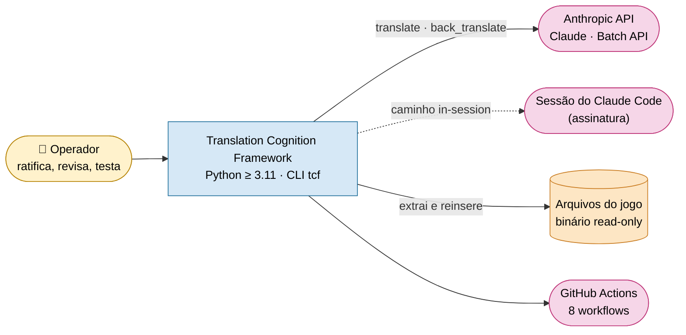
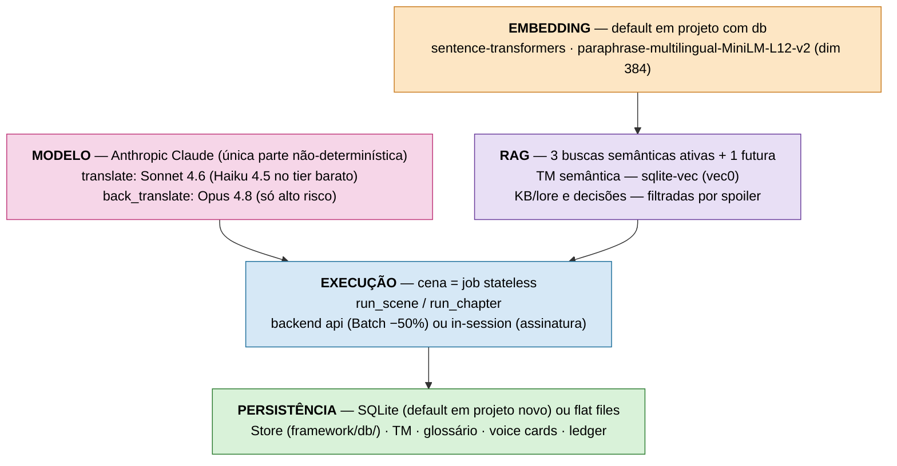
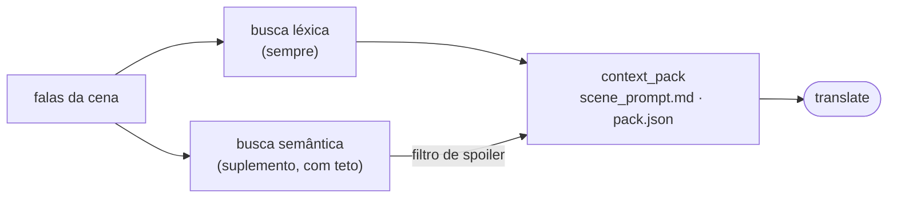
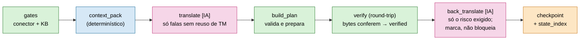
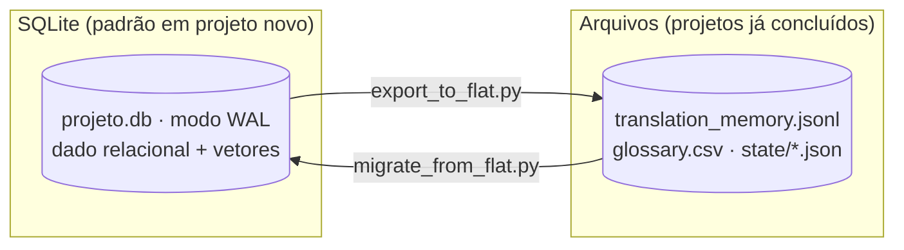

# Stack técnica — modelo, embedding, RAG, execução

Visão geral da tecnologia para quem nunca viu o projeto: o que cada camada faz, com qual biblioteca e por quê. Cada seção
aponta para o documento que aprofunda o assunto.

## O sistema em um parágrafo

O framework traduz o texto de jogos (e, no futuro, legendas) e o devolve ao arquivo original. O fluxo: extrair as falas do
binário para um CSV, traduzir cena por cena com um LLM e reinserir a tradução no binário respeitando o espaço em bytes de
cada fala. **O LLM é a única parte não determinística.** Todo o resto (montar o contexto, validar, reinserir, controlar custo)
é Python comum, testado e reprodutível.

## Visão de contexto (C1)

## Resumo da stack (C2)

| Camada | Tecnologia | Papel |
|---|---|---|
| Linguagem | Python ≥ 3.11 | todo o framework; sem serviço externo além da API do LLM |
| LLM | Anthropic Claude, SDK `anthropic` | traduz e faz a verificação por back-translation |
| Embedding | `sentence-transformers`, modelo `paraphrase-multilingual-MiniLM-L12-v2` (384 dimensões), local | transforma texto em vetor para a busca por similaridade |
| Índice vetorial | `sqlite-vec` (tabela virtual `vec0`) | guarda e consulta os vetores dentro do próprio SQLite |
| Persistência | SQLite (biblioteca padrão, modo WAL) ou arquivos JSON/CSV | memória de tradução, glossário, base de conhecimento, estado do run |
| Execução | CLI `tcf` + Message Batches API da Anthropic | uma cena por job; lote assíncrono com 50% de desconto |
| Distribuição | `bsdiff4` (delta binário), PyInstaller (`.exe` único), Pillow (arte/ícone do pacote); `framework/distribution/` | patcher de um clique para o jogador, sem conteúdo do jogo (só diferenças); dependências fora dos `requirements*.txt` |
| Qualidade | pytest, Hypothesis, ruff, mypy, bandit, pip-audit, gitleaks | 8 workflows no GitHub Actions; cobertura mínima de 90% |

## Onde está o detalhe

| Tema | Documento |
|---|---|
| Como o prompt de cada cena é montado | [`CONTEXT_PACK.md`](CONTEXT_PACK.md) |
| Contrato do modelo, formato da resposta, benchmarks | [`MODEL_INTERFACE.md`](MODEL_INTERFACE.md) |
| Busca semântica: dados, indexação, recuperação, calibração | [`RAG_ARCHITECTURE.md`](RAG_ARCHITECTURE.md) |
| Onde o custo é cortado e a origem de cada número | [`TOKEN_ECONOMY.md`](TOKEN_ECONOMY.md) |
| Conector, round-trip e falta de espaço | [`CONNECTORS.md`](CONNECTORS.md) |
| Passos do pipeline e checkpoints | [`TRANSLATION_PIPELINE.md`](TRANSLATION_PIPELINE.md) |
| Revisão humana | [`QA_REVIEW.md`](QA_REVIEW.md) |
| Jogo novo | [`NEW_PROJECT_ONBOARDING.md`](NEW_PROJECT_ONBOARDING.md) |

## Vocabulário

| Termo | O que é |
|---|---|
| **Cena** | unidade de trabalho: um bloco de falas do jogo (dezenas de linhas). Cada cena é traduzida em uma chamada. |
| **Conector** | código específico de um jogo que extrai o texto do binário e o reinsere. Fica em `projects/<jogo>/connector/`. |
| **Pacote de contexto** | o prompt montado para uma cena: as falas, mais só os trechos de memória, glossário e lore relevantes. Gerado por `context_pack.py`. |
| **TM** (translation memory) | pares fonte→tradução já aprovados, para reusar e manter consistência. |
| **KB** (knowledge base) | pesquisa sobre o universo do jogo (personagens, termos, lore), feita antes de traduzir. |
| **Voice card** | ficha de como cada personagem fala (registro, tratamento, bordões). |
| **Decisão** | escolha de tradução registrada para valer no resto do projeto (ex.: como traduzir um título). |
| **Round-trip** | teste determinístico: reinserir a tradução no binário, extrair de novo e conferir byte a byte. |
| **Back-translation** | segunda chamada de LLM que traduz de volta para a língua de origem, para detectar perda de sentido. |
| **Gate** | verificação que bloqueia o run (ou marca a cena para revisão) quando uma condição falha. |
| **`verified`** | estado da cena que passou no round-trip. Só cenas `verified` alimentam a TM. |

---

## Pacote de contexto — a peça central

Um jogo tem milhares de falas, um glossário de centenas de termos e um histórico de decisões que só cresce. Pôr tudo em cada
prompt custa caro e estoura a janela. O `framework/runtime/context_pack.py` monta, para cada cena, um prompt com **só o que
aquela cena precisa**: o tamanho do prompt depende da cena, não do projeto.

`build_pack(projeto, cena)` é uma função pura sobre arquivos: lê as falas e as fontes do projeto, seleciona um subconjunto de
cada fonte e grava dois arquivos no diretório da cena: `pack.json` (estruturado, usado pelo backend `api`) e `scene_prompt.md`
(o mesmo conteúdo como prompt pronto, usado pelo backend `in-session`).

A seleção é **léxica** (por termo, nome de falante e hash do texto), sem embedding: determinística (mesma cena, mesmo prompt,
byte a byte), auditável e gratuita. Regras, tetos e a chave da TM exata → [`CONTEXT_PACK.md`](CONTEXT_PACK.md).

---

## Modelo (LLM)

Família **Claude**, pelo SDK oficial `anthropic`. Há **só duas chamadas de IA**: `translate` e `back_translate`. O modelo de
cada papel é uma constante em `framework/runtime/config.py`; trocar de modelo é trocar a string.

| Papel | Modelo | Constante | Quando |
|---|---|---|---|
| Tradução (padrão) | `claude-sonnet-4-6` | `MODEL_TRANSLATE` | maioria das linhas |
| Tradução (tier barato) | `claude-haiku-4-5` | `MODEL_TRANSLATE_CHEAP` | linhas de uma só linha de texto, no caminho de lote (−67% por linha) |
| Verificação | `claude-opus-4-8` | `MODEL_BACK` | back-translation das linhas dos níveis de risco exigidos (`back_translation_risk`; mais uma amostra de 5% das demais nas cenas de lote); último degrau da re-tradução por estouro de espaço |

Decisões de engenharia:

- **Roteamento por complexidade.** O modelo mais caro só vê o que precisa dele. O contexto curado deixa Sonnet e Haiku traduzirem; Opus verifica.
- **Saída estruturada.** A tradução volta em JSON validado por schema (`json_schema`), com tradução, falante, registro, intenção e risco por fala ([`MODEL_INTERFACE.md`](MODEL_INTERFACE.md#o-formato-da-resposta)).
- **Prompt caching.** A doutrina (o `system` prompt, igual em todas as cenas) leva `cache_control`. O efeito medido é pequeno, porque o custo está na saída (ver [`TOKEN_ECONOMY.md`](TOKEN_ECONOMY.md)).
- **Sem thinking na tradução.** `effort: low` e thinking desligado; ligar custou cerca de 5× na medição. A back-translation mantém thinking, porque ali o raciocínio pesa.
- **Dois backends, um contrato.** `api` (padrão) chama a API com streaming e backoff exponencial em 429/500/timeout. `in-session` não faz chamada de rede: gera o prompt em arquivo para ser respondido numa sessão de assinatura, e o run retoma depois.
- **Re-tradução por estouro de espaço.** Se a tradução não cabe nos bytes da fala, só as linhas que estouraram são re-traduzidas, escalando de modelo (`MODEL_ESCALATION`).

Contrato, formato, backends e benchmarks → [`MODEL_INTERFACE.md`](MODEL_INTERFACE.md). Cliente HTTP, streaming e backoff → `framework/runtime/llm_client.py`.

---

## Embedding

Embedding converte texto em vetor, de modo que textos de sentido parecido fiquem próximos. Aqui serve para achar falas
**parecidas** (não idênticas) entre as já traduzidas.

- **Modelo:** `paraphrase-multilingual-MiniLM-L12-v2`, via `sentence-transformers`, **384 dimensões**. Roda **local**: sem chamada de API nem custo por token.
- **Normalização:** vetores com norma 1 (`normalize_embeddings=True`); a distância L2 do `sqlite-vec` converte direto em cosseno: `cos = 1 − L2²/2`.
- **Hardware:** CPU por padrão; GPU se houver torch com ROCm (Linux/AMD). No Windows fica em CPU, o que basta para milhares de linhas (poucos minutos).
- **Código:** `framework/db/embedder.py` (`Embedder.encode`, `index_project`, `search`).
- **Modelo fixado por índice:** a tabela de metadados grava o modelo de cada vetor; trocar exige reindexar, de forma explícita.
- **Um processo por projeto:** sem serviço compartilhado; o modelo é recarregado a cada processo (9 a 12 s) e o download fica em cache (ADR 0015).

### É o padrão em projeto com banco

Todo projeto com `db` no `project.json` usa busca semântica por padrão. A stack entra no `pip install .` (o `pyproject.toml`
lê os pins de `requirements.txt` + `requirements-ml.txt`).

- **Sem a stack instalada, o run bloqueia.** O `kb_gate` para antes de qualquer chamada de modelo e diz como instalar. (Antes, a busca voltava vazia sem aviso e o projeto parecia usar RAG sem usar.)
- **Desligar é explícito:** `"db": {..., "semantic": false}` no `project.json` faz o gate virar aviso e o pacote usar só a busca léxica.
- **Projeto sem `db`** (arquivos JSON/CSV) não é afetado.
- **Instalação:** `pip install .` já traz. Em checkout de desenvolvimento, `pip install -r requirements-ml.txt` (de 700 MB a 1,5 GB, por causa do torch). Para indexar um corpus existente: `python framework/cli.py db index <projeto>.db <project_id>`.
- **No CI:** os testes de push/PR (`test.yml`) não instalam torch, pelo custo. Rodam com `TCF_ALLOW_NO_ML=1` (setado no `conftest.py` da raiz), que rebaixa o bloqueio a aviso. A stack real é testada sem mock em todo PR, em push na main e uma vez por semana (`ml-coverage-optional.yml`, piso de 85% de cobertura em `embedder.py` e `validate_model.py`) e auditada por CVE (`dep-audit-optional.yml`).

---

## RAG (recuperação semântica)

RAG é buscar informação relevante e colocá-la no prompt, em vez de esperar que o modelo a saiba. O [pacote de contexto](CONTEXT_PACK.md)
já faz isso de forma **léxica**. A busca **semântica** é um **suplemento** por cima: entra em seções separadas e rotuladas do
prompt, com tamanho limitado, e nunca substitui a seleção léxica. Arquitetura completa → [`RAG_ARCHITECTURE.md`](RAG_ARCHITECTURE.md).

| Busca | O que recupera | Como | Estado |
|---|---|---|---|
| **TM semântica** | falas já traduzidas parecidas com as da cena; viram a seção "falas SIMILARES (adapte)" | `Embedder.search()` sobre `tm_vectors` | ativa; serve à consistência, não à economia ([detalhe](RAG_ARCHITECTURE.md#para-que-serve-a-tm-semântica)) |
| **KB / lore** | seções da base relevantes para a cena | léxica (`select_kb`, pelo título da seção citado na cena) + semântica (`_load_kb_semantic`, sobre `kb_vectors`), sem duplicar | ativa; a parte semântica só devolve seção com marca de revelação |
| **Decisões** | decisões de tradução relacionadas ao conteúdo da cena | `_load_decisions_semantic`, sobre `decision_vectors`, além do índice léxico | ativa |
| **Entre jogos da mesma série** | TM compartilhada por franquia | mesma infraestrutura | futura |

### Onde está a economia de tokens

A busca semântica não reduz tokens; ela acrescenta, com teto. A economia vem de outro lugar:

| Técnica | Efeito medido |
|---|---|
| Reuso exato de TM (a fala repetida não vai ao modelo) | −24% de custo em 10 cenas |
| Thinking desligado na tradução | cerca de 5× menos custo |
| Haiku para falas de uma linha, no lote | −67% por fala roteada |

Mecanismo e origem de cada número → [`TOKEN_ECONOMY.md`](TOKEN_ECONOMY.md). Implementação, laço de reuso e calibração do `rag_min_score` → [`RAG_ARCHITECTURE.md`](RAG_ARCHITECTURE.md).

---

## Conector e round-trip — a garantia de que o jogo não quebra

Traduzir é metade do problema; a outra metade é devolver o texto a um binário que o jogo consiga ler. Essa parte é
**determinística**, específica de cada jogo, e é o que o conector resolve.

O conector é um conjunto de scripts por jogo (`extract`, `build_plan`, `reinsert`, `verify`). O `verify` reconstrói o arquivo
sem tradução e exige o original byte a byte; depois aplica a tradução e a relê. Se não cabe, o run re-traduz só as falas que
estouraram, com orçamento mais apertado. Contrato e falta de espaço → [`CONNECTORS.md`](CONNECTORS.md).

---

## Verificações antes e depois da tradução

Três mecanismos cercam a chamada do modelo, além do round-trip.

### Gates: bloqueio antes de gastar

Dois gates rodam no início de `run_scene` e `run_chapter`, sem rede e sem modelo: falhar antes do primeiro token pago.

| Gate | Bloqueia quando |
|---|---|
| `connector_gate` | faltam os scripts de plano ou de verificação; eles ainda são a cópia intocada do esqueleto; ou nenhuma cena do projeto jamais passou no round-trip |
| `kb_gate` | a pesquisa do universo não foi revisada e marcada como conciliada; glossário, KB ou voice cards estão vazios; a cena está além do ponto da história que a pesquisa cobre (`kb_frontier`); ou o projeto tem banco e a stack de embedding não está instalada |

O `connector_gate` não tem bypass: a primeira cena passa por `run_scene.py` com verify e registra o round-trip. No `kb_gate`,
parte das condições é dura e parte aceita a flag explícita `--skip-kb-gate`.

### Back-translation: verificação de sentido

O round-trip prova que os **bytes** estão certos, não o **sentido**. Para isso há uma segunda chamada (`back_translate.py`):

- **O que faz:** o Opus traduz a versão em português de volta para o inglês e compara com a fonte; devolve, por fala, `pass` ou `revise` e uma nota curta.
- **Em que falas:** nas dos níveis de `back_translation_risk` do projeto (padrão `high` e `critical`; o Prelude usa só `critical`, ADR 0022) e numa amostra de 5% das demais, determinística (`sha1(seed|cena|offset)`: duas rodadas escolhem as mesmas falas).
- **Não bloqueia:** marca a fala para revisão humana. Divergência de sentido é julgamento, e travar o run trocaria um problema de qualidade por um de disponibilidade.
- **Invalidação:** se a fala é re-traduzida depois do veredito, o veredito vence e ela é julgada de novo.
- **Custo:** no lote, um passo único no fim do capítulo, pela Batch API.

### Filtro de spoiler

Um tradutor que sabe o fim pode entregá-lo sem querer (nome verdadeiro antes da revelação, pronome que denuncia). O mesmo vale
para o modelo, se o prompt trouxer informação do futuro.

O controle é por **posição na história**: o id da cena vira tupla numérica (`12_03` → `(12, 3)`) e todo conteúdo sensível
carrega uma marca `reveal` com a cena em que é revelado.

| Fonte | Regra |
|---|---|
| KB e decisões recuperadas por busca semântica | só entram com `reveal` já ultrapassado; sem marca, não entram (default-deny) |
| Decisões selecionadas por termo | entram, a menos que tenham `reveal` no futuro |
| Fatos do registro de spoilers | se o fato ainda não foi revelado e um gatilho dele aparece na cena, o prompt recebe a instrução de como manter a ambiguidade |

Quando a posição não pode ser comparada (id sem número), o conteúdo é tratado como futuro: o erro seguro é esconder demais.
Detalhe → [`RAG_ARCHITECTURE.md`](RAG_ARCHITECTURE.md) e [`TRANSLATION_PIPELINE.md`](TRANSLATION_PIPELINE.md).

---

## Execução

Cada cena roda como um **job independente e limitado**: o prompt contém o contexto daquela cena, não o histórico do projeto,
e não cresce com o número de cenas já traduzidas.

- **`run_scene.py`** orquestra uma cena. **`run_chapter.py`** roda um capítulo inteiro, em loop retomável.
- **Lote por padrão.** No backend `api`, o `run_chapter` envia as cenas pela Message Batches API: 50% de desconto, processamento assíncrono (até cerca de 1 h por corpus). Tempo real só com `--no-batch` ou via `run_scene`, para piloto e depuração.
- **Teto de gasto.** `--max-usd` é limite duro: o run estima o custo antes de enviar e aborta se passar. Se o lote falhar, o padrão é abortar em vez de cair calado no caminho mais caro.
- **Retomada.** `run_state.json` guarda o estado por cena; uma queda na cena 40 não perde as 39 anteriores.
- **Custo auditável.** `api_ledger.jsonl` registra toda chamada cobrada, inclusive as que falharam. A recuperação de erro é por fala, não por cena, então o custo de um retry é proporcional ao que quebrou.
- **Ordem de grandeza.** O gasto real acumulado do projeto Utawarerumono, somado pelo ledger, foi de cerca de R$ 338 (Sonnet R$ 260, Opus R$ 40, Haiku R$ 38).

Detalhe e medições → [`ARCHITECTURE.md`](ARCHITECTURE.md) e [`TRANSLATION_PIPELINE.md`](TRANSLATION_PIPELINE.md).

---

## Persistência

Dois modos, escolhidos por projeto: com `db` no `project.json`, SQLite; sem, arquivos.

- **SQLite** (`framework/db/store.py`, classe `Store`): um `.db` por projeto, modo WAL, sem servidor. Schema único em `framework/db/schema.sql`: `projects`, `scenes`, `translations`, `scene_lines`, `kb`, `glossary`, `entities`, `voice_cards`, `decisions`, `spoiler_entries`, `research_log`, `kb_ratified`, `back_translations`, `jobs`, `metrics`, `warnings`, `qa_effectiveness`, mais as tabelas de embedding. É o modo que permite a busca semântica (os vetores moram no mesmo arquivo). **Padrão de projeto novo**: o banco é criado sozinho no primeiro run.
- **Arquivos** (`translation_memory.jsonl`, `glossary.csv`, `state/*.json`): modo original, versionável e legível em diff. Os projetos já concluídos seguem nele.
- **Ponte:** `migrate_from_flat.py` e `export_to_flat.py` convertem nos dois sentidos, e a paridade é verificada por teste. Durante o run, cada cena grava no banco por `sync_translations_db` (ao montar o plano) e `state_index.approve_scene_db` (ao aprovar).

Por que SQLite e não um banco vetorial dedicado: o corpus de um jogo cabe em milhares de linhas, um arquivo local dispensa
infraestrutura, e dado relacional e vetor no mesmo arquivo eliminam a sincronização entre dois sistemas. Detalhe →
[`STATE_MANAGEMENT.md`](STATE_MANAGEMENT.md).

---

## Qualidade e CI

O código determinístico é a maior parte do sistema e é testado como software comum. São 8 workflows no GitHub Actions:

| Workflow | Quando roda | O que verifica |
|---|---|---|
| `test.yml` | PR e push no `main` | guarda de conteúdo e de `.env` (`env-guard`); mypy; pytest com cobertura mínima de 90%; os testes de cada conector em job separado; testes dos hooks |
| `quality.yml` | PR e push no `main` | ruff (lint), bandit (segurança no código), pip-audit (CVE nas dependências), gitleaks (credenciais vazadas) |
| `perf.yml` | PR e push no `main` | benchmarks de `append_line`, `build_pack` e `state_index_tm` contra o baseline; regressão de mais de 2× vira aviso (não bloqueia) |
| `api-smoke.yml` | semanal e manual | uma cena mínima enviada de verdade à Batch API, para detectar mudança de contrato antes de um capítulo pago |
| `ml-coverage-optional.yml` | PR, push na main e semanal | os testes da stack de embedding sem mock, com piso de 85% |
| `dep-audit-optional.yml` | semanal | pip-audit nas dependências de ML e de pesquisa |
| `branch-hygiene.yml` | semanal | branches já incorporadas ao `main` |
| `release.yml` | tag de versão | gera a release |

Dois pontos de desenho:

- **O binário do jogo não vai para o repositório**, então o round-trip real não roda no CI. Para cobrir a lógica mesmo assim, cada conector tem um `test_roundtrip_synthetic.py`: o Hypothesis gera textos aleatórios, o teste codifica e decodifica numa tabela sintética em memória e exige o texto e o tamanho em bytes de volta, exatos.
- **Os testes de PR não chamam a API nem carregam o modelo de embedding.** As duas dependências externas são exercitadas de verdade nos workflows semanais.

---

## Onde cada projeto está hoje

| Projeto | Persistência / RAG | Modelo | Estado |
|---|---|---|---|
| `utawarerumono` | arquivos | Sonnet/Opus (API) | concluído — 16 capítulos, Batch API |
| `bof4` | **SQLite + busca semântica** (obrigatória) | modelo da sessão (`in-session`) | traduzido e instalado — 305 cenas `verified` (27.021 falas); patcher em beta, release pendente; conector de referência Capcom e fixture de testes. Substituiu `breath_of_fire_4` (arquivos, 125 cenas), removido do repositório |
| `souldiers` | arquivos | Haiku/Sonnet/Opus (Batch API) | concluído — 470 cenas, terceira engine (Unity Addressables) |
| `utawarerumono_prelude` | arquivos | modelo da sessão (`in-session`), onda em lote | concluído e instalado — 350 cenas `verified` (23.982 falas); patcher de um clique |
| `trails_sky_sc` | arquivos | — (ainda não traduzido pelo framework) | em andamento — quarta engine (Falcom); 71 cenas extraídas, cena-piloto com round-trip fechado |
| `demo` | SQLite, busca semântica desligada (`semantic: false`) | — | exemplo sintético do README |
