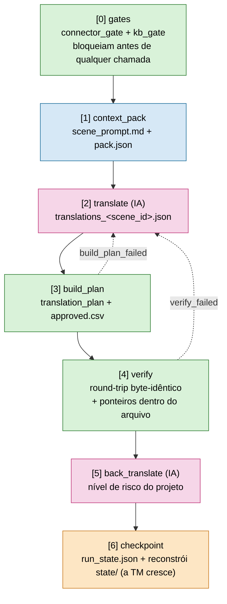
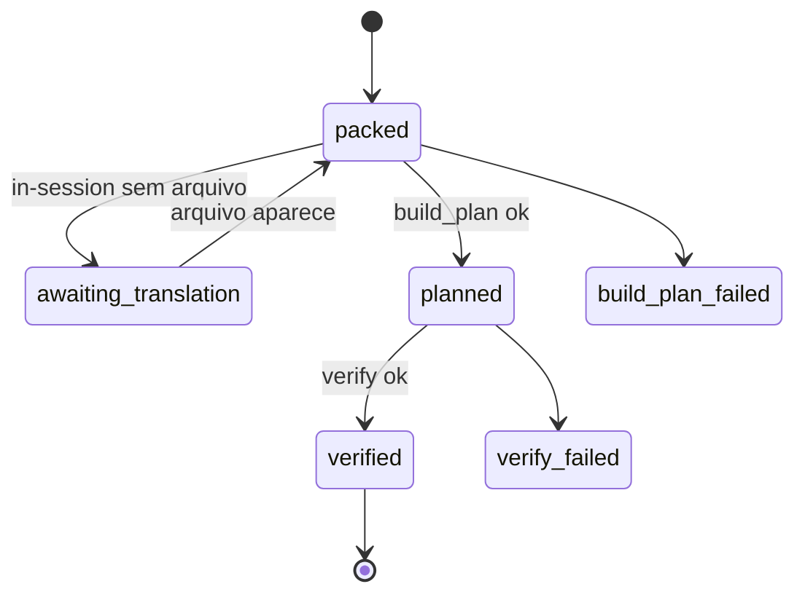
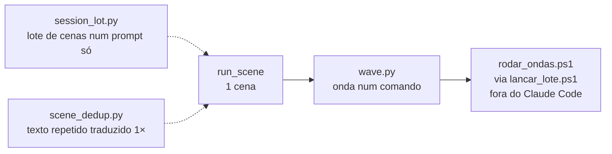
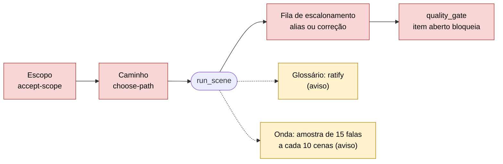
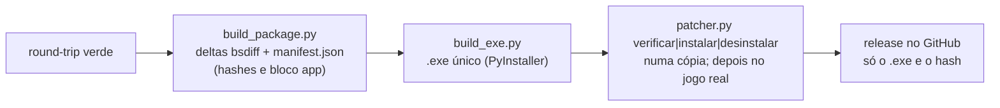

# Translation Pipeline — o fluxo de uma cena

O `framework/runtime/run_scene.py` executa uma cena como um **job determinístico e resumível**. Este documento mostra a
sequência, os artefatos e os pontos de retomada, e depois os mecanismos em volta (onda, lote, humano no laço, distribuição).

## O fluxo de 1 cena

```bash
python framework/runtime/run_scene.py <projeto> <cena> [<cena> ...] [--backend in-session|api] [--require-back] [--no-verify] [--jobs N] [--full]
```



`<scene_id>` é o nome da cena sem o prefixo `ch_` (`ch_12_01` → `12_01`). Os artefatos ficam em `artifacts/scenes/<cena>/`.

### Estados e retomada

`status` por cena: `packed` → `planned` → `verified` (ou `*_failed`, `awaiting_*`).



O harness é idempotente: rode de novo a qualquer momento e ele recomputa o pacote e retoma na etapa pendente. No
`in-session` reusa o `translations_<scene_id>.json` existente; no `api`, cena não-`verified` é re-traduzida. Um crash entre
cenas não perde nada: o estado vive nos artefatos, não na sessão.

### Reconferir só o que mudou (`touched.py`)

Ao fechar `verified`, o `run_scene` grava no `run_state` uma impressão digital por fala. Cena `verified` sem fala nova ou
alterada, com a mesma doutrina e o mesmo conector, é **pulada** (`[skip] ... use --full para reconferir`); `--full` força a
passada completa (`--clean` também reconfere).

`python framework/runtime/touched.py <projeto>` lista o **drift**: cena `verified` cujo texto mudou depois do fechamento
(sai com código 1 se houver), para flagrar arquivo alterado à mão. `touched.origem(root, cena)` conta as falas por `intent`
(padrão `traducao`). `--jobs N` roda N cenas ao mesmo tempo, cada uma em seu processo (reconferência; o `run_state` tem
trava); a TM só cresce entre cenas em fila, então para traduzir em sequência use 1.

## Os gates

| Gate | Confere | Falha → |
|---|---|---|
| **[3] build_plan_chapter** | cobertura total, token `\n` preservado, interjeição ≠ source, `risk >= medium` exige `risk_notes` | `build_plan_failed` |
| **[4] verify_chapter** | round-trip idêntico (approved={}), cada offset lido == approved transliterado, **resíduo 0**, ponteiros dentro do arquivo | `verify_failed` |
| **[5] back-translation** | veredito nas falas dos níveis de `back_translation_risk` (padrão `["high","critical"]`; o Prelude usa `["critical"]`, [ADR 0022](adr/0022-retrotraducao-por-nivel-de-risco-configuravel.md)), mais 5% das demais em cenas do batch | reportada; com `--require-back` bloqueia até existir `back_translation_<scene_id>.json` |

O `quality_gate` acusa `SEM COBERTURA` quando falta veredito de fala de nível exigido e lista as cenas pendentes.
A variante **cega** (`"back_translation_cega": true`: passagem A só com o target, juiz B com o source) existe, mas foi medida
e **não adotada** ([ADR 0025](adr/0025-retrotraducao-cega-em-duas-passagens.md)): fica desligada.

A **conferência visual no jogo** acontece na Fase 2 (piloto): o humano vê o trajeto do piloto instalado antes de escalar. O
fechamento não repete uma passada pelo jogo inteiro; depois do piloto, a conferência é por print a cada instalação. Vale para os dois caminhos.

## Da cena à onda e ao lote



### Onda num comando (`wave.py`, caminho de sessão)

`python framework/runtime/wave.py <projeto> [cena ...] [--backend in-session|api] [--require-back]` roda em sequência:
`run_scene` (se houver cenas), `scene_dedup copy` (se alguma cena repete outra) e o `run_scene` das cópias, `glossary_lint`,
`quality_gate`, `session_usage rebuild`, `cost_report --summary` (mais `--by-scene` no log) e `obs_report`.

- A linha de custo traz o equivalente de API da sessão por fase e o erro do medidor (a sessão não paga API, então "$0" sozinho esconderia o gasto).
- O escopo é só das cenas pedidas (sem cena, roda só gates e relatórios).
- Para no primeiro passo que falhar, grava a saída em `artifacts/wave_last.log` (`wave_last_<cena>.log` para uma cena só, assim subagentes em paralelo não se sobrescrevem) e devolve uma linha por passo.
- `--precheck` confere a cena **sem gravar nada**: chave de offset desconhecida, contagem do token de quebra (coluna `nl`) e orçamento de bytes. É o que o `scene-translator` roda antes de cada rodada.
- `--max-usd` é o teto de gasto da onda (parada dura); `--step-timeout` limita cada passo. `obs_report` é enxuto por padrão (`--all` = todas as cenas).

### Onda no lote (skill `rodar-onda`)

A skill `.claude/skills/rodar-onda/` orquestra uma onda de ponta a ponta. **A onda de tradução roda via `lancar_lote.ps1`
fora do Claude Code**, nunca dentro dele: a janela da conversa só propõe, confere e relata.

| Passo | O que acontece |
|---|---|
| 1 | propor cenas (`panorama-ondas`) |
| 2 | levantar o lore (`kb_phase.py ... onda`) |
| 3 | um `scene-translator` (Haiku) por cena ou grupo de cenas curtas |
| 4 | esperar os relatórios (são dado, não aval) |
| 5 | conferir no disco com o `wave.py` |
| 5a | escalonamentos em lote |
| 5c | retrotradução em Opus dos níveis exigidos |
| 5d | retradução em Sonnet das falas `critical` ([ADR 0023](adr/0023-5d-so-critical-high-fica-no-haiku.md): as `high` ficam com o Haiku) |
| 5e | `revise` na retrotradução: a tradução é revista, nunca o veredito editado ([ADR 0021](adr/0021-revise-diferido-reescrita-automatica-e-espera-do-reset.md)) |
| 6 a 9 | custo · `levantar-melhorias` · atualizar a "Retomada" do ROADMAP · fechar |

No lote, o `rodar_ondas.ps1` roda cada onda numa janela `claude -p` (Haiku por padrão; `-Modelo sonnet|opus` só por pedido),
estima o tempo antes (`estimar_lote.py`), espera o reset quando bate o limite de cota (`cota_uso.py`, `espera_reset.py`) e, no
fim, `onda_fim.py` e `conformidade_onda.py` conferem o lote. `lote_status.py` mostra a situação numa tela e o `vigia_lote.sh`
alimenta o Monitor. Fila de escalonamento e lore novo seguem o modo diferido (`"hitl_fila": "diferida"`,
[ADR 0020](adr/0020-fila-de-escalonamento-diferida-e-lore-novo-automatico.md)): a onda não para por eles e o humano responde no fim do lote.

### Texto repetido entre cenas (`scene_dedup.py`, os dois caminhos)

Cenas com a mesma sequência da coluna de texto-fonte (`text_source`; `text_en` no bof4) formam um grupo: só a primeira
(representante) é traduzida. `plan` lista grupos e falas poupadas; `copy [CENA ...]` leva tradução e retrotradução verificadas
do representante às cópias ainda não `verified` (sem CENA = todas), remapeando os offsets por **posição**, também dentro do
JSON parseado. A cópia não pula gate: o `run_scene` passa cada uma por eles.

### Caminho de sessão em lote (`session_lot.py`)

A IA da sessão traduz um lote de cenas num prompt só e o `run_scene` fecha cada uma:

- `plan`: lotes de até 150 falas, texto repetido só 1×.
- `prompt`: junta os `scene_prompt.md` em `tools_local/lot_<id>.md`.
- `check`: tokens, orçamento de bytes e cobertura.
- `go`: converte o TSV, replica falas deduplicadas e roda `run_scene --backend in-session --require-back`.
- `split`/`join` e `install` (copia os `.DAT` remontados para o jogo).

A conta de bytes vem de `budget.py` (fonte única: UTF-8 real quando o conector não translitera, forma transliterada senão;
exceção de +1 byte decidida pelo humano em `byte_budget_exceptions` no `project.json`). Os arquivos de trabalho ficam em
`projects/<p>/tools_local/` (gitignored: trazem fala do jogo).

## Humano no laço (`hitl.py`)

Projeto com `"hitl": true` no `project.json` (projeto novo já nasce com a chave). Toda decisão fica em
`artifacts/hitl_log.jsonl` (quem, quando, o quê, sem o texto da fala). `hitl.py status <projeto>` mostra tudo.



| Ponto | O que o humano faz | Bloqueia? |
|---|---|---|
| **Escopo** | aceita o corpus extraído (`accept-scope`); re-extração que muda cenas/linhas reabre o aceite | Sim (CLI do `run_scene`) |
| **Caminho** | escolhe sessão ou API (`choose-path`) | Sim (CLI do `run_scene`) |
| **Fila de escalonamento** | responde `alias` (a forma passa a valer: vira regra no glossário) ou `correcao` (texto certo) e roda `hitl.py resolve` | Sim (`quality_gate`) |
| **Glossário** | ratifica os 30 termos mais frequentes (`ratify`, grava em `kb_ratified.csv`) | Não (aviso) |
| **Onda** | vê a amostra de 15 falas em `qa_revisao/para_revisar/onda_amostra.csv` (`ack`) | Não (aviso) |

Só bloqueia o que é decisão de verdade. Ratificar e dar visto em série não achavam problema; o que rende é a fila.

- **Decisão na conversa:** quando o humano decide conversando, o assistente roda o comando com `--quote "frase literal do humano"`; o log guarda `via=conversa` e a frase. Sem frase literal não há registro: aviso de sistema ou relatório de agente não é decisão.
- **Fila de escalonamento:** entra a fala em que a forma do glossário não entrou, ou que o tradutor marcou com `escalate`, em `qa_revisao/para_revisar/escalonamento.csv`. Correção do `quality_review apply` que diverge do glossário também cai aqui. O `status` agrupa **por termo** e `hitl.py resolve <projeto> --termo X --alias Y` responde o grupo inteiro (as duas flags andam juntas).
- **Triagem de risco** (`risk_triage.py`, só caminho de sessão): antes da QA humana, um juiz barato lê os pares únicos fonte+tradução de risco baixo e devolve só os ids que merecem segundo olhar; `apply` sobe essas falas para `high`, e a retrotradução (`--require-back`) e o `quality_review export` cuidam delas. `risk_triage_run.py <projeto>` orquestra os lotes do `export` (uma chamada headless `claude -p` por lote, em paralelo, até 3 tentativas). Cada chamada **é paga**, então sem `--go` o comando só lista os lotes.
- **Medida de qualidade** (`quality_sample.py`, $0): `export` sorteia 200 pares únicos do jogo inteiro e mistura os apontados pelo juiz, sem dizer a origem; o humano marca `ok`/`erro`; `score` calcula a taxa de erro com IC de 95%, a taxa da triagem e o acerto do juiz (precisão e alcance), e grava em `qa_effectiveness.jsonl`.

## Sessão: contexto e medição de custo

Regra, não sugestão:

- **`/compact` nunca à mão.** A compactação fica com a automática. Medido em 62 compactações: cada uma custa a reescrita do resumo no cache, e compactar antes da hora paga isso mais vezes do que economiza.
- **`/clear` em toda virada de fase, e só nela.** Antes: tudo o que a fase decidiu está em disco (ROADMAP do projeto, `decision_log.md`, `hitl.py status`). Depois: o primeiro comando é `python framework/runtime/session_usage.py mark <projeto> <fase>`, que fecha a fase anterior no ledger e carimba a nova; é essa marca que faz o `cost_report` mostrar o custo **por fase** sem adivinhar.
- O ROADMAP de cada projeto tem a seção **"Retomada"**: o que uma sessão sem contexto precisa para continuar (passo atual, bloqueios, aprovações pendentes, comandos e ferramentas locais). Atualizar antes do `/clear`.
- Ao fechar uma medição: `session_usage.py rebuild <projeto>` refaz as linhas de sessão a partir das transcrições inteiras. Saída de mensagem sem `usage` final é estimada pelo conteúdo e o relatório diz quanto do total é estimativa.

## Acompanhamento do projeto (skills)

Skills do projeto, versionadas em `.claude/skills/`, valem para qualquer jogo; nenhuma altera o runtime.

- **`panorama-ondas`** (`panorama.py projects/<p> [n_ondas]`): progresso real (falas e cenas `verified` sobre o total do `dialogs.csv`), ordem dos capítulos (`artifacts/ordem_cenas.txt`, gravado pelo `extract.py` do conector; sem ele usa ordem numérica e avisa "NÃO CONFIRMADA") e plano das próximas ondas. Grava o completo em `artifacts/panorama_ondas.md` (local: `artifacts/` é default-deny). Todo relato de progresso traz o total do jogo. `extrai_ordem.py` é só o extrator de ordem do conector Utawarerumono.
- **`levantar-melhorias`**: ao fim de cada onda (no lote, a cada 3), compara os erros vividos na sessão principal com a seção "Melhorias para o framework" do `ROADMAP.md` do projeto e acrescenta só o que é novo ou parcial, com evidência e data. Não implementa conserto: isso é decisão separada (PATCH/MINOR/MAJOR, ADR se couber). No fechamento do projeto, essa seção é a fonte do levantamento de lições.

## Detalhes do prompt e do extrator

O `scene_prompt.md` traz a tabela de falas com a coluna `nl` (quantas vezes o token de quebra aparece no source; o `t` repete exatamente essa quantidade) e, na seção de glossário, a coluna `forma curta` quando algum termo da cena a tem ([ADR 0024](adr/0024-glossario-coluna-forma-curta.md): forma menor aceita quando a canônica estoura o orçamento de bytes; o `glossary_lint` a trata como alias válido). O `speaker` vem do extrator quando o formato traz o falante; senão é inferência do tradutor, e o passo 2c da skill `00_extraction` pede ao conector que diga onde o falante está. `scene_scope.py` reporta quantas falas têm falante extraído (`FALANTE: X de N`).

## Troca de caminho (sessão ↔ API)

A troca é a flag `--backend` do `run_scene`/`wave`; artefatos, gates, banco e humano no laço são os mesmos. Toda execução abre
dizendo o caminho e o escopo (`caminho: api | escopo do projeto: completo`) e confere:

- **Escopo:** a API só traduz diálogo. Cena em `system_scenes` no `project.json` (texto de sistema, que só existe com `"extraction_scope": "completo"`) é recusada com `--backend api`; vai pela sessão.
- **Chave:** `--backend api` sem `ANTHROPIC_API_KEY` no ambiente para antes de qualquer chamada. Crédito esgotado só aparece na primeira chamada (`ERRO na traducao (api)`).
- **Um projeto, um caminho:** com humano no laço, o caminho é decisão registrada (`hitl.py choose-path <projeto> in-session|api --reviewer NOME`). Sem decisão o `run_scene` não roda; pedido no outro caminho é recusado até um humano trocar pelo mesmo comando (a troca fica no `hitl_log.jsonl`).
- **Mistura:** cena já traduzida pelo outro caminho não bloqueia, mas sai um `AVISO` com a lista: tradutor e modelo mudam (a API usa o ranqueamento de modelos; a sessão usa o modelo da janela), então o estilo pode variar. A origem de cada cena fica em `metrics.jsonl` (`source`) e no `cost_report`.

### Caminho assinatura, passo a passo

1. `run_scene <projeto> <cena> --backend in-session` → para em `awaiting_translation` e aponta o `scene_prompt.md` (pequeno, auto-contido).
2. Numa **sessão limpa**, o modelo responde o prompt e produz `translations_<scene_id>.json`.
3. O mesmo comando de novo → segue build_plan → verify → checkpoint.

Como cada cena é uma sessão independente e limitada, o contexto **nunca acumula** entre cenas.

## Convenções de conector (por projeto)

O `run_scene` invoca os scripts do conector do projeto por convenção: `<projeto>/connector/build_plan_chapter.py` e
`verify_chapter.py` (override em `project.json` → `connector.build_plan_script` / `connector.verify_script`). São
determinísticos, read-only no binário, e nunca contêm texto da obra.

## Largura de caixa e tabela de opcodes (`project.json`)

- `"line_width": "derive"`: o limite é o maior segmento visível do **inglês** das falas que o autor quebrou em 2+ linhas (`box_width.py`); `"line_width_max": N` fixa o valor (vence); sem nenhum, vale 62. `python framework/runtime/box_width.py <projeto>` mostra o limite.
- `connector.control_codes` aceita, além de `"01": "newline"`, `{"name", "params", "width", "values"}`: `params` = tokens `[xx]` colados que são valor do código (não quebram nem contam como código), `width` = glifos que a variável ocupa na tela, `values` = valores possíveis (`opcodes.py` valida e mede por isso). `name` `newline`, `page_break` e `choice_start` (abre o menu) quebram a caixa; qualquer outro não quebra.
- `pattern_lint.py <projeto>` roda antes da amostra de qualidade (`quality_sample.export` recusa se reprovar): `largura` e `parametro` bloqueiam; `pt-PT?` (regex `quality_review._PTPT`: 2ª pessoa de verbo e `tem de` + verbo) e `identico-fonte` só são contados.

## Distribuição (`framework/distribution/`, skill `09_distribution`)

Depois do round-trip verde, a tradução sai como **delta**, nunca como DAT remontado. Config por projeto em
`projects/<p>/distribution.json` (título, autor, pasta do jogo, processos que travam os arquivos, aviso, recorte do ícone).



1. `python -I framework/distribution/build_package.py distribution.json source_dat output dist <versao> [arte [capa]]` (de dentro do projeto). Arte e ícone só no pacote.
2. `python framework/distribution/build_exe.py dist [saida]`. Sem `saida`, grava em `<projeto>/output/` (ignorada no git); recusa saída dentro de `dist/` (o PyInstaller embute o `dist` inteiro) e deixa `work/`/`spec` numa pasta temporária.
3. Teste: `patcher.py verificar|instalar|desinstalar --jogo <pasta> --pacote dist` numa cópia dos originais; depois o `.exe` no jogo real.
4. Publicar: release no GitHub (só o `.exe` e o hash) + guia na comunidade Steam. `dist/` está no `.gitignore`.

Regras do patcher: só toca arquivo com hash original, backup `.bak`, confere hash final, desfaz tudo se falhar, recusa com o
jogo aberto (confere os processos do `distribution.json` via `tasklist`, tolerante a saída fora do UTF-8). Dependências
(`bsdiff4`, `pyinstaller`, `Pillow` só para arte/ícone) não estão nos `requirements*.txt`: instalar à mão.

## Verificação ponta a ponta

```bash
pytest framework/runtime/ framework/validation/ projects/<projeto>/connector/   # tudo verde
python framework/runtime/context_pack.py <projeto> <cena>                        # roda 2x → pack.json idêntico
python framework/runtime/state_index.py <projeto>                                # idempotente
python framework/runtime/run_scene.py <projeto> <cena-já-traduzida>              # dry-run: round-trip ok
```
