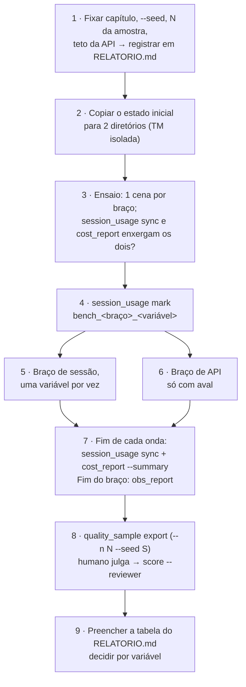

# FDD — Benchmark do caminho de sessão: protocolo de execução

Versão: 0.1 (rascunho) · Data: 2026-10-14 · Responsável: Felipe (decisão); execução pelo agente

Requisitos em [`PRD.md`](PRD.md); arquitetura da medição em [`HLD.md`](HLD.md).

---

## 1. Contexto

O HLD define dois braços medidos pelos mesmos módulos. Este documento fixa o protocolo: o que roda, em que ordem, o que se
registra e quando o resultado vale.

**Atores:** operador (Felipe), agente da sessão, subagentes `scene-translator`, humano que julga a amostra.

## 2. Objetivos técnicos

- Os dois braços partem do mesmo estado (TM, glossário, decisões de voz) e do mesmo recorte.
- Cada requisição de modelo entra uma só vez na contabilidade (invariante do `session_usage`).
- Erro do medidor impresso no relatório (`out_est` sobre a saída total).
- Amostra de qualidade com a mesma semente e o mesmo N nos braços.

## 3. Escopo

| Incluído | Excluído |
|---|---|
| Protocolo, variáveis do braço de sessão, relatório | Código novo de medição (só se faltar um número no `obs_report`) |
| | Mudança de gates, prompts ou doutrina durante a rodada |

---

## 4. Fluxo



**Passos**
1. Definir capítulo, semente (`--seed`), N da amostra e teto de gasto da API. Registrar em `RELATORIO.md`.
2. Copiar o estado inicial para dois diretórios de trabalho (um por braço). TM isolada.
3. Ensaio: uma cena por braço; conferir que `session_usage sync` e `cost_report` enxergam os dois.
4. `session_usage.py mark <projeto> bench_<braço>_<variável>` antes de cada rodada.
5. Braço de sessão, por variável (uma de cada vez):

   | Variável | O que muda |
   |---|---|
   | V0 base | ~13 comandos por onda |
   | V1 | `wave.py` (um comando por onda) |
   | V2 | ondas menores com `/clear` entre elas |
   | V3 | Sonnet traduz, Opus retrotraduz (já é o padrão do bof4: serve de controle) |
   | V4 | Haiku só para rótulo curto |
   | V5 | lote de correção automático |

   **Rodada de cota da assinatura Pro** (recorte de 6 cenas, 267 falas, `--seed 42`, cada braço em `output/bench_<braço>/`,
   cópia do estado B2 com série de TM própria):

   | Variável | O que muda |
   |---|---|
   | V0a e V0b | nada muda, rodado duas vezes (erro do medidor) |
   | V6 | cenas curtas agrupadas por subagente (≤ 60 falas, soma ≤ 150) |
   | V7 | roteiro de poucas voltas por cena (JSON uma vez, conferência por script) |
   | V8 | `scene_prompt` enxuto (glossário e vozes só do que aparece na cena) |
   | V9 | Haiku nas falas curtas de baixo risco |

   Cota real: `/usage` lido antes e depois de cada braço (sem medidor automático).
6. Braço de API: `run_chapter.py <projeto> <cap> --backend api`, só com aval.
7. Ao fim de cada onda: `session_usage.py sync`, `cost_report.py --summary`; ao fim do braço: `obs_report.py`.
8. `quality_sample.py export <projeto> --n N --seed S` por braço; o humano julga; `score --reviewer NOME`.
9. Preencher a tabela do `RELATORIO.md`; decidir por variável.

**Exceções**
- Gate bloqueou: resolver a causa (nunca flag de bypass); a cena fica registrada como retrabalho.
- Cena que não fecha: falha registrada; não sai do recorte.
- Segunda rodada: inverter a ordem dos braços.

Diagramas C4 e a sequência de uma cena no caminho de sessão: [`../DIAGRAMAS.md`](../DIAGRAMAS.md).

---

## 5. Contratos públicos

**Medidores** (já existentes; CLI)

```bash
python framework/runtime/session_usage.py mark|sync <projeto> [<fase>]
python framework/runtime/cost_report.py <projeto> [--by-scene] [--json] [--summary]
python framework/runtime/obs_report.py <projeto> [--json] [--scene CENA]
python framework/runtime/quality_sample.py export <projeto> [--n 200] [--seed q1]
python framework/runtime/quality_sample.py score <projeto> --reviewer NOME [planilha.csv]
```

**Tabela do relatório (modelo)**

| Variável | Erro (IC 95%) | Tokens/USD equiv. | Tempo | Retrabalho | Erro do medidor | Decisão |
|---|---|---|---|---|---|---|
| V0 … V5, API | — | — | — | — | — | entra / não entra |

## 6. Erros, exceções e fallback

- Falha de ambiente (comando sai ≠ 0): parar e resolver; não seguir com medida parcial.
- Transcrição ausente: custo incompleto; declarar no relatório.
- IC largo: ampliar N e reamostrar antes de concluir.
- **Invariantes:** braços isolados; semente e N fixos; gates fechados em todas as cenas contadas.

## 7. Observabilidade

- **Métricas:** tokens por categoria, USD equivalente, tempo por etapa, reprovas e retraduções por cena, taxa de erro com IC.
- **Logs:** `events.jsonl`, `api_ledger.jsonl`, `phase_marks.jsonl`, `qa_effectiveness.jsonl`.
- **Tracing:** não se aplica. **Dashboards:** `obs_report.py` por braço.

## 8. Dependências e compatibilidade

| Componente | Versão mínima | Observações |
|---|---|---|
| Claude Code | atual | formato da transcrição lido pelo `session_usage` |
| `anthropic` (SDK) | conforme `requirements*.txt` | só o braço de API |
| Python | o do CI | — |

Mesmo contrato `translate`/`back_translate` nos dois braços ([`../MODEL_INTERFACE.md`](../MODEL_INTERFACE.md)).

## 9. Critérios de aceite técnicos

- Todas as cenas do recorte `verified` nos dois braços, ou falha registrada.
- `session_usage sync` rodado ao fim de cada onda; o total por sessão confere com a transcrição.
- Relatório com todas as colunas da tabela preenchidas e o erro do medidor declarado.
- `content_guard` OK no commit do relatório.

## 10. Riscos e mitigação

| Risco | Prob. | Impacto | Mitigação | Contingência |
|---|---|---|---|---|
| Variáveis misturadas numa mesma rodada | média | não dá para atribuir o ganho | uma variável por rodada; marca de fase própria | refazer a rodada isolando a variável |
| Gasto da API acima do previsto | baixa | custo real | teto definido antes; `budget.py` ligado; ensaio de uma cena | parar o braço e relatar o que foi medido |
