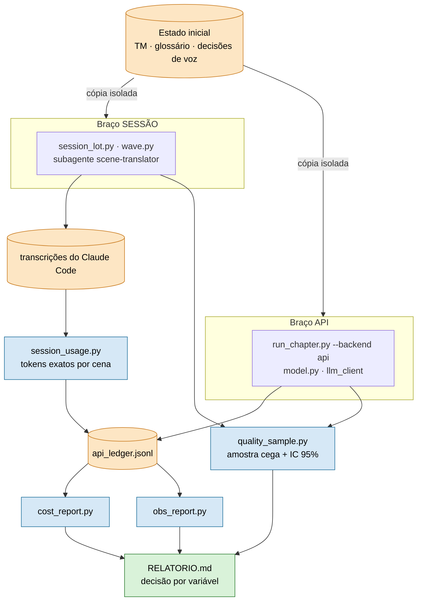

# HLD — Benchmark do caminho de sessão

Versão: 0.1 (rascunho) · Data: 2026-10-14 · Responsável: Felipe (decisão); execução pelo agente

Requisitos em [`PRD.md`](PRD.md); protocolo em [`FDD.md`](FDD.md).

---

## Objetivo técnico

Comparar, sobre o mesmo recorte de um projeto novo, o caminho de sessão (a IA da sessão traduz) e o caminho de API,
medindo qualidade, custo, tempo e retrabalho com os medidores que o framework já tem.

**Dependências com outros sistemas**
- Claude Code (transcrições em `~/.claude/projects/…`, de onde o `session_usage` lê o `usage` exato).
- API da Anthropic (braço de API; gasto real em `api_ledger.jsonl`).
- Projeto novo do framework com Fase 0 e glossário prontos.

---

## Arquitetura geral

Dois braços isolados, mesma fonte, mesma medição. **Nada novo no caminho de produção: o benchmark só lê.**

**Ambiente:** local, na máquina do operador; sem serviço.
**Tecnologias:** Python (módulos de `framework/runtime/`) e arquivos JSONL/CSV em `projects/
/artifacts/`.
**Padrões:**
- Medição read-only e idempotente (cursor por transcrição no `session_usage`).
- Só contador, nome de modelo e id de cena saem das transcrições; texto de fala não é copiado.

---

## Componentes e responsabilidades

| Componente | Responsabilidades | Dependências |
|---|---|---|
| Braço sessão (`session_lot.py`, `wave.py`, subagente `scene-translator`) | traduzir o recorte e fechar os gates sem API | `run_scene`, transcrições do Claude Code |
| Braço API (`run_chapter.py --backend api`) | traduzir o mesmo recorte com `model.py` | `ANTHROPIC_API_KEY`, `llm_client` |
| `session_usage.py` | tokens reais da sessão por cena, janela e overhead; marcas de fase | transcrições, `phase_marks.jsonl` |
| `cost_report.py` | gasto de API e desperdício por cena | `api_ledger.jsonl`, `run_state.json` |
| `obs_report.py` | visão por cena: estado, qualidade, tempo, retrabalho, gasto | `events.jsonl`, `metrics.jsonl` |
| `quality_sample.py` | amostra cega, taxa de erro com IC 95%, acerto da triagem | planilha julgada pelo humano |
| Relatório (`docs/benchmark_sessao/RELATORIO.md`) | tabela por braço e por variável, decisão | saída dos medidores |

---

## Fluxo de requisições e de dados

**Requisição:** fixar capítulo, semente e teto de gasto da API → copiar o estado inicial para cada braço → rodar o braço →
`session_usage sync` e `cost_report` por onda → `quality_sample export` → humano julga → `score` → relatório.

**Dados:**
- transcrição do Claude Code → `session_usage` → `api_ledger.jsonl` (`source: "session"`) → `cost_report` / `obs_report`
- chamada de API → `model.log_api_call` → `api_ledger.jsonl` → `cost_report`
- tradução verificada → `quality_sample export` → planilha cega → `score` → `qa_effectiveness.jsonl`

---

## Modelo de dados (alto nível)

- **Entidades:** braço (sessão ou API), onda, cena, linha do `api_ledger`, marca de fase, registro de qualidade.
- **Relações:** uma onda tem várias cenas; cada requisição pertence a uma cena (`agent`), a uma janela (`window`) ou ao overhead.
- **Fonte de verdade:** gasto de API em `api_ledger.jsonl`; gasto de sessão na transcrição do Claude Code; qualidade na planilha julgada.

## Interfaces públicas

| Nome | Tipo | Protocolo | Exposição | SLAs/Limites |
|---|---|---|---|---|
| CLIs dos medidores | linha de comando | argv | local | sem rede, exceto o braço de API |
| `api_ledger.jsonl` | arquivo | JSONL | local | uma linha por chamada concluída |
| `phase_marks.jsonl` | arquivo | JSONL | local | uma marca por virada de fase |

## Escalabilidade e disponibilidade

- Um capítulo por rodada; retomável cena a cena.
- Cursor por transcrição; `--jobs N` no `run_scene` quando o braço permitir.
- Meta de disponibilidade: não se aplica (execução manual pontual).

## Segurança

| Tema | Tratamento |
|---|---|
| Autenticação | chave da API só em `.env` (gitignored) |
| Autorização | braço de API só com aval explícito e teto de gasto |
| Proteção de dados | amostras, planilhas e traduções ficam gitignored; relatório versionado sem fala do jogo |
| Segredos | `.env`; nunca no repo |

## Observabilidade

- **Logs:** `events.jsonl` por cena e etapa.
- **Métricas:** tokens por categoria (`agent`/`window`/`overhead`), USD equivalente, erro do medidor (`out_est`), taxa de erro com IC.
- **Tracing:** não se aplica.
- **Dashboards:** `obs_report.py` e `cost_report.py --summary`.

---

## Riscos arquiteturais e mitigação

| Risco | Prob. | Impacto | Mitigação | Contingência |
|---|---|---|---|---|
| Atribuição `window` aproximada distorce o custo por cena | média | custo por cena impreciso (o total por sessão segue exato) | comparar totais por braço e por onda, não por cena; preferir subagente por cena no braço de sessão | declarar o erro no relatório |
| Transcrição apagada do disco | baixa | custo da onda incompleto | `session_usage sync` ao fim de cada onda | repetir a onda |

## ADRs e próximos passos

- **ADR associado:** `docs/adr/0004-model-agnostic-interface.md` (interface de modelo).
- **Pendente:** capítulo do recorte e teto de gasto da API (dependem do projeto novo).
- **Próximos passos:** escolher o projeto novo; ensaio de uma cena por braço; rodar o recorte; escrever `RELATORIO.md`.
