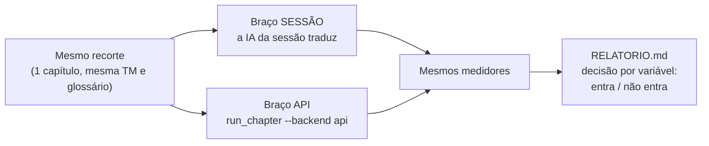

# PRD — Benchmark do caminho de sessão

Versão: 0.1 (rascunho) · Data: 2026-10-14 · Responsável: Felipe (decisão); execução pelo agente

Origem: item 3 do "Pós-bof4" em `docs/ROADMAP.md` e bloco 3 do levantamento em `projects/bof4/ROADMAP.md`.
Texto de fala do jogo não entra aqui nem em nenhum artefato versionado do benchmark.

Documentos irmãos: [`HLD.md`](HLD.md) (arquitetura da medição) e [`FDD.md`](FDD.md) (protocolo de execução).

---

## Resumo

O bof4 foi traduzido pelo caminho de sessão (a IA da sessão traduz, sem API): 305 cenas, 27.021 falas, $0 de API
(equivalente a $239). Esse caminho nasceu junto com o processo, então **não há medida limpa dele contra o caminho de API**.
O benchmark roda o mesmo recorte pelos dois caminhos num projeto novo e mede qualidade, custo, tempo e retrabalho.
**Só entra no framework o que o benchmark mostrar ganho.**

---

## Contexto e problema

**Público-alvo**
- Quem opera o framework num projeto novo e escolhe o caminho (assinatura/sessão ou API).
- Quem mantém o framework e decide o que sobe do bof4.

**Cenários de uso**
- Escolher o caminho do projeto novo com número, não com impressão.
- Decidir se uma otimização do bof4 (onda em um comando, `/clear` entre ondas, modelos por papel) vale levar.

**Onde roda:** medição fora do pipeline de produção, com scripts de leitura sobre os artefatos do projeto novo. Nenhum passo do pipeline muda por causa do benchmark.

**Problemas priorizados**

| Prioridade | Problema |
|---|---|
| Alta | Sem comparação limpa entre os caminhos: o bof4 construiu o processo enquanto traduzia; $227 dos $239 foram orquestração e construção. |
| Alta | O gargalo no Pro é a orquestração na janela principal: ~13 comandos por onda, cada um relê o contexto. |
| Média | Qualidade medida só no bof4: 14,5% de erro na amostra antes das correções (26,1% pesada por repetição). |

---

## Objetivos e métricas

| Objetivo | Métrica | Meta |
|---|---|---|
| Comparar qualidade entre caminhos | taxa de erro da amostra cega (`quality_sample`), com IC 95% | sessão não pior que API além do IC |
| Comparar custo | tokens lidos da transcrição (sessão) vs `api_ledger` (API), em USD equivalente | relatar; ganho exigido só para o que for levado |
| Medir o gargalo de orquestração | tokens de `overhead` e `window` por onda (`session_usage`) | queda mensurável com onda em um comando |
| Comparar tempo e retrabalho | `events.jsonl` por etapa; reprovas e retraduções por cena | relatar |
| Declarar o erro da medição | `out_est` / total de saída (erro do medidor) | impresso no relatório |

---

## Escopo

**Incluso**
- Um recorte (um capítulo) do projeto novo, traduzido do zero pelos dois caminhos, com a mesma TM e o mesmo glossário no início.
- Variáveis do caminho de sessão: um comando por onda (`wave.py`) vs ~13; ondas menores com `/clear` entre elas; Sonnet traduz e Opus retrotraduz; Haiku só para rótulo curto; lote de correção automático.
- Relatório com os números e a decisão por variável (entra / não entra).

**Fora de escopo**
- Mudar o pipeline, os gates ou o prompt durante a rodada.
- Tradução do jogo inteiro pelos dois caminhos.
- Benchmark de modelo da API (já feito: `docs/MODEL_INTERFACE.md`, Sonnet aprovado).
- Qualquer bypass de gate para ganhar tempo.

---

## Requisitos funcionais

### BS-1 Recorte comparável (prioridade alta)
Mesmo capítulo, mesmo estado inicial, nos dois caminhos.

- **Fluxo:** fixar o capítulo e a semente da amostra (`--seed`) antes de começar; copiar o estado inicial (TM, glossário, decisões de voz) para cada braço; rodar cada braço até todas as cenas `verified`.
- **Exceção:** a cena que não fecha num braço fica registrada como falha; não é trocada nem retirada.
- **Erro previsto:** TM contaminada entre braços (um braço escreve na TM do outro).

### BS-2 Medição de custo e tempo (prioridade alta)
- **Fluxo:** marcar a fase de cada rodada (`session_usage.py mark <projeto> <fase>`); `session_usage.py sync` e `cost_report.py` ao fim de cada onda; `obs_report.py` ao fim do braço.
- **Exceção:** mensagem de subagente sem `usage` final tem saída estimada (`_OUT_FIT`); o relatório mostra o erro.
- **Erro previsto:** transcrição de sessão antiga apagada do disco deixa o custo daquela onda incompleto (declarar).

### BS-3 Qualidade cega (prioridade alta)
- **Fluxo:** `quality_sample.py export` por braço, com a mesma `--seed` e o mesmo N; o humano julga sem saber o braço; `quality_sample.py score` grava a taxa de erro com IC 95%.
- **Erro previsto:** amostra pequena demais para separar os braços (IC largo): ampliar N antes de concluir.

### BS-4 Relatório e decisão (prioridade média)
- **Fluxo:** tabela por braço e por variável (erro, custo, tempo, retrabalho, erro do medidor); decisão registrada por variável; o que ganhar sobe para o framework, o resto vira nota.

---

## Requisitos não funcionais

| Tema | Requisito |
|---|---|
| Performance | O benchmark não pode acrescentar passo ao caminho medido. |
| Segurança | O braço de API gasta dinheiro: só roda com aval explícito do Felipe e teto de gasto definido antes. |
| Observabilidade | Só contadores, nomes de modelo e ids de cena saem das transcrições (regra do `session_usage`). |
| Confiabilidade | Execução resumível; `session_usage` é idempotente por cursor. |
| Compliance | Relatório e artefatos versionados sem fala do jogo; amostras e planilhas ficam gitignored. |

---

## Arquitetura e abordagem

Reaproveitar o que já mede: `session_usage`, `cost_report`, `obs_report`, `quality_sample`, `wave`. **Não escrever medidor
novo**; se faltar um número, acrescentar ao `obs_report`.

- **Braço sessão:** `session_lot.py` + `wave.py` + subagentes `scene-translator`.
- **Braço API:** `run_chapter.py --backend api`.
- **Medição:** ver [`HLD.md`](HLD.md).

### Decisões e trade-offs

| Decisão | Justificativa | Trade-off |
|---|---|---|
| Um capítulo, não o jogo | O braço de API custa dinheiro e o de sessão custa cota; um capítulo já separa as variáveis. | Um capítulo pode não representar o jogo (gêneros de cena, repetição). |
| Medir com o que existe | Menos código novo, números comparáveis com o bof4. | A atribuição `window` é aproximada. |

---

## Dependências

- **Projeto: instância nova do framework**, com Fase 0 (extração) e glossário prontos. Ainda não existe; sem ele o benchmark não começa.
- **Humano: julgamento da amostra.** Quem julga a amostra cega é o Felipe (ou revisor indicado); sem isso não há número de qualidade.

---

## Riscos e mitigação

| Risco | Prob. | Impacto | Mitigação | Contingência |
|---|---|---|---|---|
| Ruído maior que a diferença entre braços | média | conclusão sem base | mesmo recorte e semente, N para IC estreito, declarar o IC no relatório | repetir com outro capítulo antes de decidir |
| Aprendizado do braço rodado primeiro contamina o segundo | alta | o segundo braço parece melhor | estado inicial copiado e isolado por braço; ordem alternada numa segunda rodada | relatar o viés de ordem |

---

## Critérios de aceitação

- Os dois braços com todas as cenas do recorte `verified` (ou falha registrada).
- Qualidade, custo, tempo e retrabalho por braço e por variável, com o erro do medidor declarado.
- Decisão registrada por variável; item 3 do ROADMAP marcado `[x]` com link para o relatório.
- `content_guard` OK; nada de fala do jogo versionado.

## Testes e validação

- Os testes existentes dos módulos de medição seguem verdes; nenhum módulo novo sem teste.
- Ensaio curto (uma cena por braço) antes da rodada completa, para conferir que o medidor enxerga os dois caminhos.
