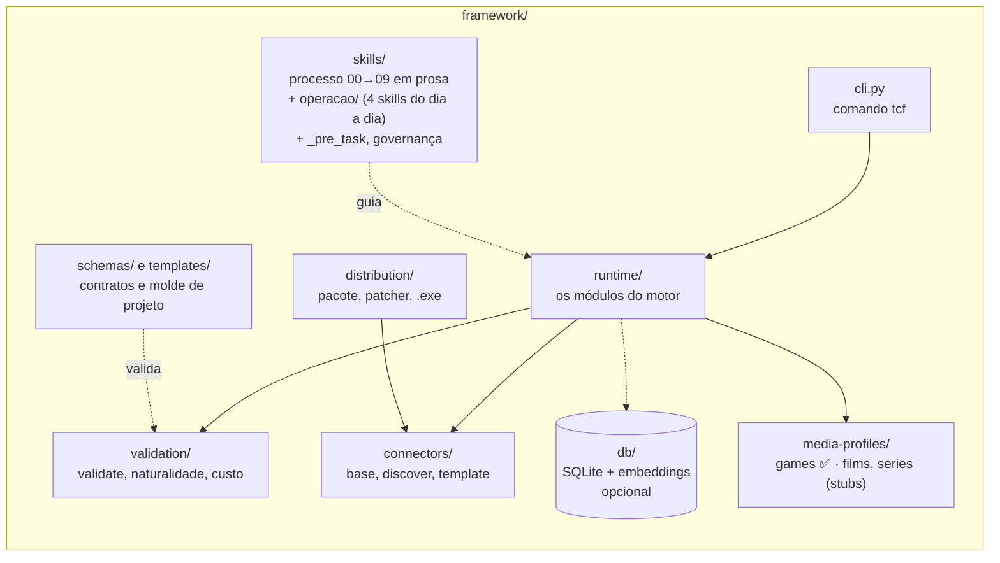
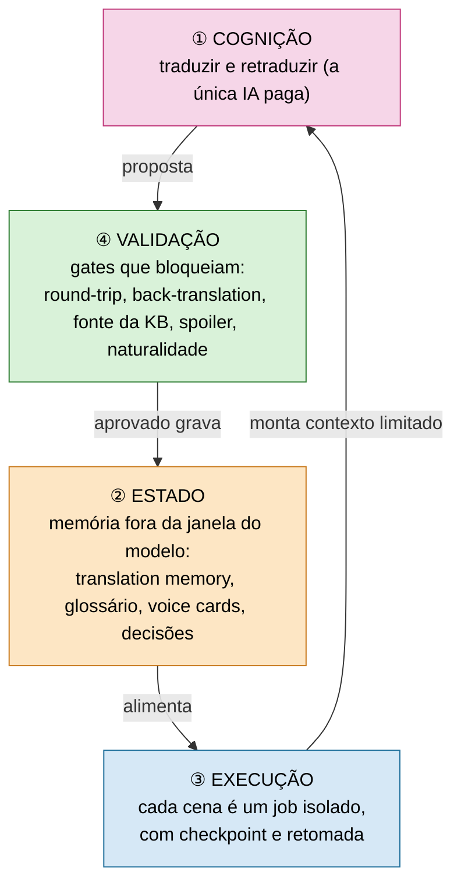
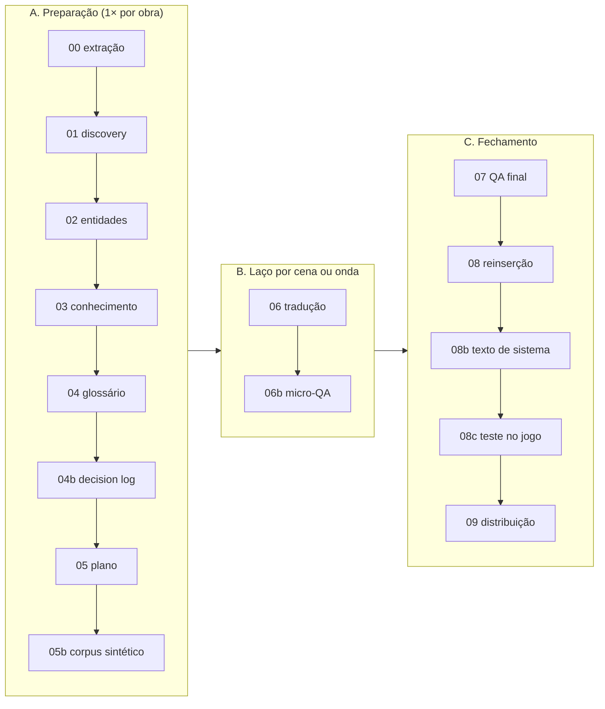

# framework/ — o motor e o processo

Tudo aqui é **genérico**: não há dado de nenhuma obra. O que é específico de um jogo vive em `projects/<obra>/`.

## O que tem dentro (C2)

| Pasta | Para que serve | Leia |
|---|---|---|
| `skills/` | As etapas `00`…`09` do processo (15 arquivos numerados), a pasta `operacao/` (4 skills do dia a dia), o `_index.md`, o `_pre_task.md` e a Carta de Governança de tradução. | [`skills/_index.md`](skills/_index.md) |
| `runtime/` | O motor: cada cena vira um job isolado e limitado. | [`runtime/README.md`](runtime/README.md) |
| `connectors/` | Contrato dos conectores e o `discover.py` (identifica o engine de um jogo novo). | `connectors/` |
| `validation/` | Gates executáveis dos artefatos. | [`validation/README.md`](validation/README.md) |
| `db/` | Modo banco: SQLite como store e busca semântica local. | `db/` |
| `distribution/` | `build_package.py`, `build_exe.py`, `verificar_exe.py` e o `patcher.py` que instala a tradução. | `distribution/` |
| `media-profiles/` | O que muda por tipo de mídia. Só `games` está validado em produção. | `media-profiles/` |
| `schemas/`, `templates/` | Esquema do `project.json` e molde para projeto novo. | `schemas/project_schema.md` |
| `SDD_RUNTIME.md` | Mapa: qual módulo executa cada etapa do processo. | [`SDD_RUNTIME.md`](SDD_RUNTIME.md) |

## Ideia central: quatro camadas

Só a primeira é estocástica. As outras três são código que dá o mesmo resultado sempre.

Por que assim e o que foi medido: [`docs/ARCHITECTURE.md`](../docs/ARCHITECTURE.md).

## O pipeline 00 → 09

Cada etapa só começa se o gate da anterior fechou. O gate que falha se resolve na causa; **não se contorna**.

## Começar um projeto novo

1. Copie `templates/project.template.json` para `projects/<obra>/project.json` e preencha.
2. Descubra o engine: `python framework/connectors/discover.py <dir-do-jogo>`.
3. Escreva o conector. A régua é o **round-trip byte-idêntico** no passo 00.
4. Rode as etapas 00…09 (a skill `skills/_index.md` mostra a ordem e os gates).

Campos do `project.json`: `title`, `media_type`, `media_profile`, `source_language`, `target_language`, `source`,
`connector`, `formatting_tokens`, `system_line_convention`, `length_constraints`, `batch_size`.
Esquema completo em [`schemas/project_schema.md`](schemas/project_schema.md).

| Genérico (aqui) | Específico do projeto (`projects/<obra>/`) |
|---|---|
| Processo, motor, gates, esquemas | Conector do engine, glossário, KB, vozes, `project.json` |
| Nenhum texto de obra | Artefatos gerados, pesquisa, decisões |

## Custo

- **Estimativa antes de gastar** e teto duro (`--max-usd`).
- **Conserto por linha**, não por cena.
- **`api_ledger.jsonl`** audita cada chamada.
- **Alavancas:** TM que só acrescenta, escolha de modelo por risco (Haiku/Sonnet/Opus), Batch API (−50%) e caminho de sessão sem API.

## Papéis

| Quem | Papel |
|---|---|
| IA-tradutora, IA-revisora | propõem e apontam |
| Gates | decidem o que passa |
| Humano ratificador, revisor, tester | aprovam a KB, leem o texto, jogam |

Governança completa: [`docs/GOVERNANCE.md`](../docs/GOVERNANCE.md). Nomes e contratos congelados: [`docs/NAMING.md`](../docs/NAMING.md).

## Ferramentas de apoio ao conector

Só no *bring-up* (primeiro dia de um engine novo) ou para depurar round-trip. Nunca fazem parte do pipeline em produção:
Kaitai/ImHex (formato binário desconhecido), Hypothesis (testes sintéticos), vbindiff e binwalk (diferenças e
conteúdo de binário), GARbro (visual novels), UABEA (Unity), FModel (Unreal), UndertaleModTool (GameMaker).
