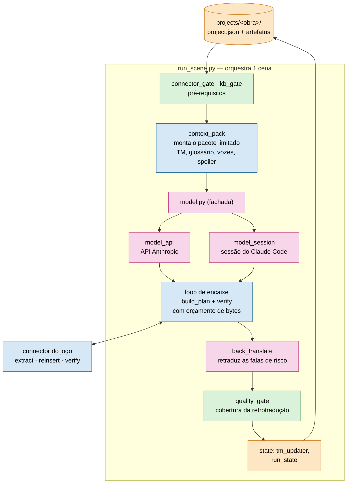
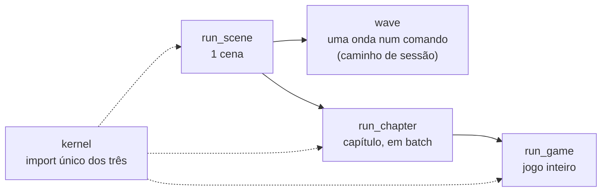

# framework/runtime — o motor

Faz de **cada cena um job isolado e limitado**: o contexto de uma execução é O(cena), não O(histórico).
É a camada que tira a orquestração e a memória da janela da IA. Por quê: [`docs/ARCHITECTURE.md`](../../docs/ARCHITECTURE.md).

## C3 — componentes: o caminho de uma cena



**A fronteira com a IA paga é só `model.py` e `back_translate.py`.** O resto é determinístico.
(`kb_build_ollama.py` também chama um LLM, mas local e sempre como rascunho.) O `model.py` é só uma fachada:
decide entre `model_api.py` e `model_session.py` ([ADR 0019](../../docs/adr/)).

## Do cena ao jogo inteiro



## Módulos por papel

**Orquestração.** `run_scene`, `run_chapter`, `run_game`, `wave`, `kernel`, `scene_lifecycle`, `touched` (reconfere só o que mudou),
`scene_dedup` (texto repetido entre cenas é traduzido uma vez), `session_lot`/`session_part` (lotes do caminho de sessão),
`progress_report`, `translate_checkpoint`.

**Contexto e regras.** `context_pack`, `pack_render`, `translation_rules`, `budget` (única conta de bytes),
`box_width`, `opcodes`, `pattern_lint`, `split_scenes`, `scaffold_project`, `config`, `paths`, `artifact_io`.

**Conector.** `connector_mgr`, `connector_gate` (completude do conector), `fingerprint_monitor`.

**IA e suporte.** `model`, `model_api`, `model_session`, `back_translate`, `llm_client` (cliente, backoff, batch),
`ollama_client`, `cost`.

**Conhecimento (KB).** `kb_gate`, `kb_phase`, `kb_fetch`, `kb_reconcile`, `kb_review`, `kb_concordance`, `kb_build_ollama`.

**Memória e spoiler.** `state_index`, `tm_lookup`, `tm_updater`, `tm_correct`, `spoiler_check`.

**Qualidade e revisão humana.** `quality_gate`, `quality_sample`, `quality_review`, `quality_fix`, `amostra_revisao`,
`glossary_lint`, `risk_triage`/`risk_triage_run`, `review_page`, `hitl`.

**Custo, lote e cota.** `cost_report`, `cost_integrity`, `cost_reconcile`, `estimar_lote`, `batch_status`, `lote_status`,
`onda_fim`, `cota_uso`, `espera_reset`, `session_usage`, `alerts`, `obs_report`, `events`.

**Benchmarks (dev, fora do pipeline).** `bench_translate`, `bench_retro_cega`, `batch_smoke`, `perf_bench`, `perf_ab`.

**Testes.** `test_*.py` ao lado de cada módulo; `conftest.py` tem a fixture `fake_pack_ctx`. O `test_runtime.py` trava
determinismo, limites, idempotência, recuperação por linha, teto de custo e o contrato do conector.

Mapa de qual módulo executa cada etapa do pipeline: [`../SDD_RUNTIME.md`](../SDD_RUNTIME.md).

## Regras que o motor se impõe

- **Escrita atômica** de estado ([ADR 0018](../../docs/adr/)): `paths.atomic_write`, `append_line`, `locked`.
- **Nenhum texto de obra em `.py`** (um teste trava isso).
- **Sem rede** no caminho `in-session`.

## Usar

```bash
# 1) materializa o estado consultável (idempotente)
python framework/runtime/state_index.py projects/<projeto>

# 2) monta o contexto limitado de uma cena
python framework/runtime/context_pack.py projects/<projeto> <cena>

# 3) roda a cena ponta a ponta (para em 'awaiting' se faltar tradução)
python framework/runtime/run_scene.py projects/<projeto> <cena> [--backend in-session|api] [--require-back] [--no-verify]
```

`<cena>` é um subdiretório de `artifacts/scenes/` (ex.: `ch_12_01`). Governança: [`docs/GOVERNANCE.md`](../../docs/GOVERNANCE.md).
Nomes: [`docs/NAMING.md`](../../docs/NAMING.md).
