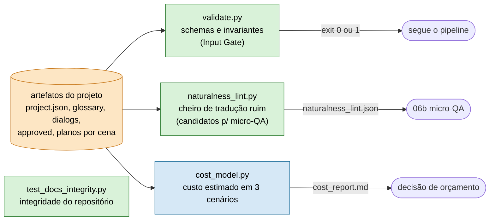

# framework/validation — gates executáveis

A contraparte em **código** dos schemas e regras escritos em prosa. Genérico: descobre tudo lendo o
`project.json` da instância e **não contém dado de obra**.



## `validate.py`

`validate_project(<dir>)` confere, para os artefatos que existirem:

| Artefato | O que confere |
|---|---|
| `project.json` | campos obrigatórios; tokens de formatação válidos |
| `glossary.csv` | `handling_rule` no enum; tradução presente quando manda traduzir; `spoiler_level` válido (WARN) |
| `dialogs.csv` | id único; `byte_budget` inteiro ≥ 0 |
| `approved_*.csv` | cada id casa com o source; **tokens preservados** |
| `translation_plan_*.json` | campos por linha; `risk_level` válido; `risk_notes` obrigatório quando risco ≥ medium |
| `entities.csv`, `aliases_map.json` | unicidade, enums, `reveal_timing` quando há spoiler |

**ERROR** (viola o invariante, exit 1) e **WARN**. Cresce aos poucos: invariante novo vira checagem e teste.

## `naturalness_lint.py`

Heurístico, complementa a Carta de Governança ([`skills/translation_governance.md`](../skills/translation_governance.md)).
Aponta **candidatos** para a revisão (06b); não conserta sozinho.

- `copia_crua`: alvo idêntico ao source (fora da whitelist de nomes, gritos e números).
- `fragmento_residual`: hesitação de 1 letra com reticências igual nos dois lados, com o resto traduzido.
- `rotulo_cru`: rótulo de falante idêntico ao source.

Saída: `artifacts/naturalness_lint.json` com `offset`, `check`, `speaker`, `source`, `target`, `note`.

## `cost_model.py`

Estima o custo de produção via API em 3 cenários (`--report` grava `artifacts/cost_report.md`).
Tokens estimados a ~chars/3,8: serve de **ordem de grandeza**, não de fatura.

## `test_docs_integrity.py`

Testes de integridade do repositório (ADRs sequenciais com status válido, `VERSION` igual à entrada mais recente do
`docs/CHANGELOG.md`, `CODEOWNERS`, lock de dependências com hash, entre outros). Roda junto com a suíte.

## Usar

```bash
python framework/validation/validate.py          projects/<titulo>   # schemas e invariantes (exit code)
python framework/validation/naturalness_lint.py  projects/<titulo>   # gera naturalness_lint.json
python framework/validation/cost_model.py        projects/<titulo> --report
pytest framework/validation/                                          # passa na referência e pega violação injetada
```
