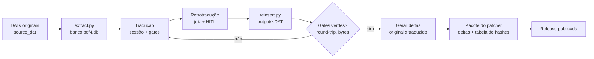
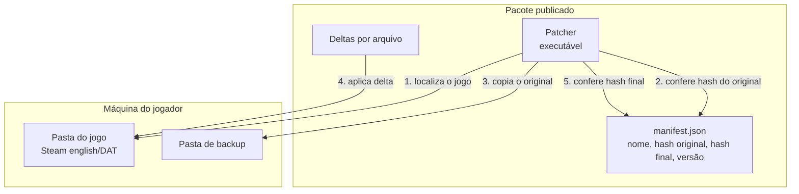
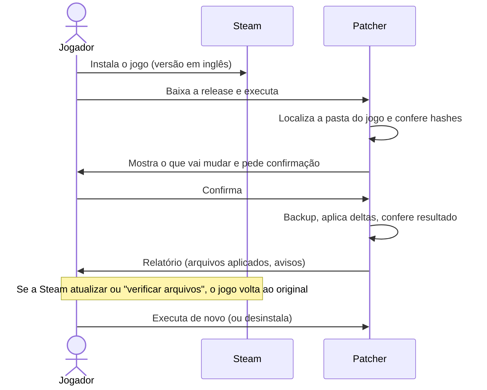
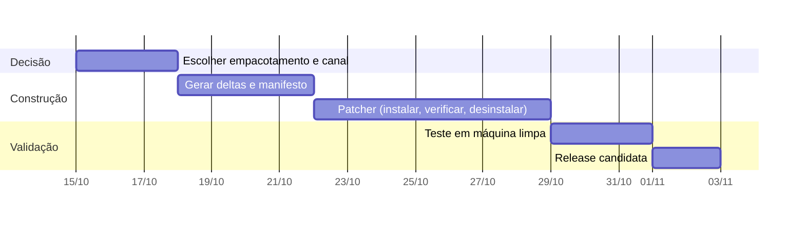

# PRD — Distribuição da tradução PT-BR de Breath of Fire IV (Steam)

> Status: decisões confirmadas em 2026-10-14. Responsável: Felipe Scudeller. Este documento não contém texto do jogo nem
> binário; só processo, decisões e critérios. Nada aqui é parecer jurídico.

## 1. Contexto e problema

A tradução PT-BR (modo banco, escopo completo: diálogo + sistema + rótulos em imagem) está pronta e instalada
na máquina do autor. O jogo é a versão Steam (pasta `english/DAT`). Falta um jeito de **outras pessoas** a
instalarem, sem que o repositório publique conteúdo do jogo (o `content_guard` bloqueia isso por regra).

**Problema:** hoje a instalação é um script local (`tools_local/install.py`) que copia DATs remontados sobre os
originais. Esses DATs contêm dados do jogo e não podem ser distribuídos.

## 2. Objetivos e não objetivos

| Objetivo | Medida de sucesso |
|---|---|
| Qualquer jogador com o jogo da Steam instala a tradução em poucos cliques | Instalação sem editar arquivo à mão |
| Não distribuir binário nem asset do jogo | Pacote publicado só traz diferenças e metadados |
| Instalação segura e reversível | Backup automático e desinstalar restaura o original, conferido por hash |
| Reprodutível a partir do repositório | Mesmo pacote sai do mesmo commit |

**Não objetivos:** tradução para outras línguas, suporte a outras versões do jogo (só a build conferida por
hash), loja ou monetização, hospedagem de arquivos do jogo.

## 3. Estado do produto (insumos)

| Item | Valor |
|---|---|
| Cenas / arquivos DAT | 305 traduzidos de 394 em `source_dat` |
| Falas | 27.021 |
| Gates | `quality_gate`, `connector_gate`, `pilot_gate`, `glossary_lint` verdes |
| Qualidade medida | Amostra: erro de 14,5% (IC 95%: 10,3% a 20,1%), medida **antes** das correções pós-amostra |
| Round-trip | Íntegro, 0 overflow de bytes |
| Rótulos em imagem | Folhas de sistema e de batalha em português; alguns mantidos em inglês |
| Limites conhecidos | "Level up", "Next up", "PAUSE", "EMPTY" e "PgUp/PgDn" em arte sem letras; largura de recorte de alguns rótulos não conferida; uma linha de habilidade com código de variável não conferido |

## 4. Fluxo de produção (do texto ao pacote)

O que sai do repositório para o pacote: **só o delta de cada arquivo** e a tabela de hashes. Os DATs de
`output/` e `source_dat/` nunca são publicados.

## 5. Arquitetura do patcher

**Regras do patcher**

1. Só aplica sobre arquivo cujo hash bate com o original do manifesto. Hash diferente: recusa e explica (jogo
   atualizado, outra versão ou já traduzido).
2. Faz backup antes de escrever e só cria o backup a partir de arquivo idêntico ao original.
3. Confere o hash do resultado; se falhar, restaura o backup do arquivo.
4. Tem modo **desinstalar** (restaura tudo do backup, conferido por hash) e modo **verificar**.
5. Não escreve fora da pasta do jogo e não precisa de rede.

## 6. Fluxo do jogador

## 7. Opções de empacotamento (decisão pendente)

| Opção | Como | Vantagem | Risco |
|---|---|---|---|
| **A. Delta binário por arquivo (recomendada)** | `xdelta3` ou `bsdiff` entre original e traduzido | Não carrega o arquivo inteiro; padrão em tradução de fãs; verificável por hash | Delta ainda carrega bytes traduzidos; avaliar com o aviso jurídico |
| B. Texto + reinserção no PC do jogador | Distribui o texto traduzido e roda o conector no jogador | Menor pacote | Distribui o texto da tradução em si; exige Python e os DATs originais do jogador |
| C. DAT completo | Publica os arquivos remontados | Mais simples | **Proibido**: é conteúdo do jogo |

## 8. Canais de publicação (decisão pendente)

| Canal | Observação |
|---|---|
| GitHub Releases | Já usamos o repositório; público e versionado |
| Nexus Mods ou similar | Alcance maior entre jogadores; segue regras do próprio site |
| Guia na Steam (comunidade) | Só aponta para a release; não hospeda arquivo |
| Steam Workshop | Em princípio não se aplica: exige suporte do jogo ao Workshop (a confirmar) |

## 9. Requisitos

**Funcionais**

- RF1. Detectar a pasta do jogo (caminho padrão da Steam e escolha manual).
- RF2. Conferir versão por hash e recusar versão desconhecida.
- RF3. Instalar, verificar e desinstalar.
- RF4. Relatório legível do que foi feito, em português.
- RF5. Manifesto versionado, com número de versão da tradução.

**Não funcionais**

- RNF1. Zero conteúdo do jogo no repositório e no pacote além do delta.
- RNF2. Windows 10/11 (plataforma do jogo na Steam); sem dependência de Python no jogador.
- RNF3. Instalação em menos de 1 minuto em disco comum.
- RNF4. Build do pacote reprodutível a partir de um commit, com hash do pacote publicado.

## 10. Critérios de aceite

- [ ] Em máquina limpa (jogo recém-baixado), instalar, jogar o trajeto do piloto e desinstalar volta ao hash original.
- [ ] Em jogo já traduzido ou de versão diferente, o patcher recusa sem alterar nada.
- [ ] Falha no meio da instalação (arquivo bloqueado) não deixa jogo em estado misto.
- [ ] Tabela de hashes do manifesto bate com os 305 arquivos traduzidos.
- [ ] Os limites conhecidos (seção 3) estão listados no texto da release.
- [ ] `content_guard` e a CI verdes no commit da release.

## 11. Riscos

| Risco | Impacto | Mitigação |
|---|---|---|
| Direitos autorais do jogo | Pedido de remoção, bloqueio da conta | Distribuir só delta, sem asset; pedir parecer antes de publicar; ter plano de retirada |
| Atualização da Steam muda os DATs | Patcher recusa por hash | Aviso na release; atualizar o manifesto por build |
| Qualidade (erro de 14,5% antes das correções) | Críticas de tradução | Registrar a taxa na release; canal de reporte de erro; reamostrar no projeto novo |
| Jogador sobrescreve backup | Perde o original | Backup só criado a partir de hash conferido; "verificar arquivos" da Steam restaura |
| Antivírus acusa o executável do patcher | Desconfiança | Código aberto, hash publicado, build reprodutível |

## 12. Roteiro

As datas são estimativas de planejamento, não compromisso.

## 13. Decisões (confirmadas por Felipe Scudeller em 2026-10-14)

| # | Decisão | Definido | Motivo |
|---|---|---|---|
| 1 | Empacotamento | **A. Delta binário** (`xdelta3`), dentro de um patcher `.exe` de um clique (sem Python no jogador) | Prioridade é a facilidade para o jogador; não publica o arquivo do jogo; verificável por hash |
| 2 | Canal | **GitHub Releases + guia na comunidade Steam** apontando para a release | Release versionada e gratuita; o guia dá visibilidade sem hospedar arquivo. Nexus Mods fica para depois, se houver demanda |
| 3 | Versão | `v0.1.0-beta` (SemVer); nova release a cada build da Steam ou lote de correções | Marca que a qualidade ainda é medida |
| 4 | Limites conhecidos | **Publicar como limitações** na release; corrigir depois | Os cortes dependem de arte sem letras, fora do escopo de texto |
| 5 | Amostra de qualidade | Beta sai com a linha de base de 14,5% (anterior às correções); **reamostrar antes da `v1.0.0`** | Beta serve para coletar erros reais; a reamostra custa revisão humana |
| 6 | Posição sobre direitos | Sem parecer jurídico prévio: a tradução é apresentada como **mod** da comunidade, só delta, sem asset do jogo, com plano de retirada | Decisão do Felipe; risco aceito por ele (seção 11) |

Próximo passo: gerar deltas e manifesto (seção 12).
