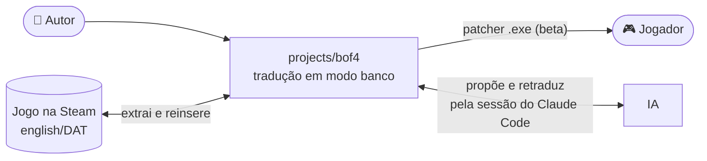
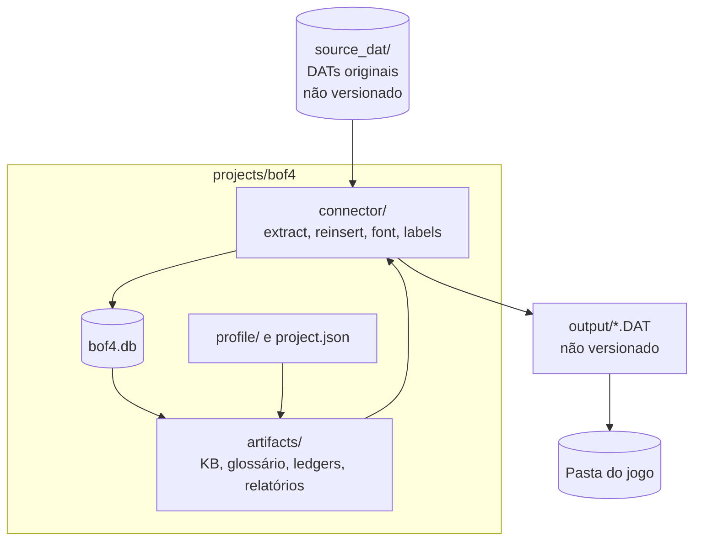
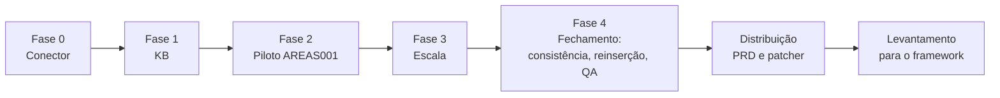

# Breath of Fire IV — EN → pt-BR (modo banco)

> **Estado (2026-10-27): projeto fechado. Traduzido, instalado e publicado como `v0.1.0-beta`; o teste do `.exe` no jogo real foi dispensado pelo autor (não executado).**

Instância do framework para o jogo da Steam (conector Capcom DAT), em **modo banco**: SQLite (`bof4.db`, não
versionado) como store e **busca semântica** obrigatória (`kb_gate`, stack de `requirements-ml.txt`).
Substitui o antigo `projects/breath_of_fire_4/` (arquivos soltos), já removido.

## Em números

| Item | Valor |
|---|---|
| Cenas traduzidas / DATs no jogo | 305 / 394 |
| Falas | 27.021 |
| Escopo | Diálogo, sistema e rótulos em imagem |
| Estouro de bytes | 0 (35 exceções registradas em `byte_budget_exceptions`) |
| Qualidade (amostra de 200) | Erro de 14,5% (IC 95%: 10,3–20,1%), medido **antes** das correções pós-amostra |
| Custo | US$ 0 pago (caminho de sessão); equivalente de API: US$ 239 |

## Contexto (C1)



## Contêineres (C2)



| Pasta / arquivo | Papel | Versionado |
|---|---|---|
| `connector/` | Conector Capcom DAT e testes (round-trip, sintético) | Sim |
| `artifacts/` | Glossário, relatórios, ledgers (allowlist do `content_guard`) | Parcial |
| `profile/`, `project.json` | Tom, regras de bytes, escopo, HITL | Sim |
| `ROADMAP.md` | Retomada, fases, registro e levantamento de fim de projeto | Sim |
| `PRD_DISTRIBUICAO.md` | Plano de distribuição | Sim |
| `source_dat/`, `output/`, `bof4.db`, `tools_local/` | Jogo, saída remontada, banco, scripts locais | **Não** |

## Linha do tempo



## Documentos

- [`ROADMAP.md`](ROADMAP.md): onde paramos, decisões ratificadas, levantamento para o framework.
- [`PRD_DISTRIBUICAO.md`](PRD_DISTRIBUICAO.md): requisitos, arquitetura do patcher, riscos.
- [`../../docs/ROADMAP.md`](../../docs/ROADMAP.md): roadmap do framework (seção "Pós-bof4").

## Regras do repositório

O repo é público: nada de binário do jogo, roteiro extraído, tradução de cena ou planilha de revisão
(`.claude/hooks/content_guard.py` barra local e na CI). Commit com o e-mail noreply do GitHub.

## Ambiente

O verify precisa de `BOF4_DAT_DIR`. Nada carrega o `.env` sozinho: exporte antes.

```bash
cp .env.example .env                     # BOF4_DAT_DIR = <jogo>/english/DAT
set -a; . projects/bof4/.env; set +a     # bash; no PowerShell: $env:BOF4_DAT_DIR = "..."
pytest projects/bof4/connector/ --dat-dir "<jogo>/english/DAT"
```
