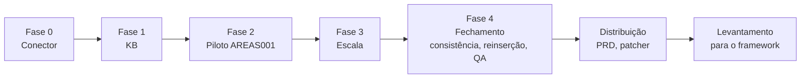
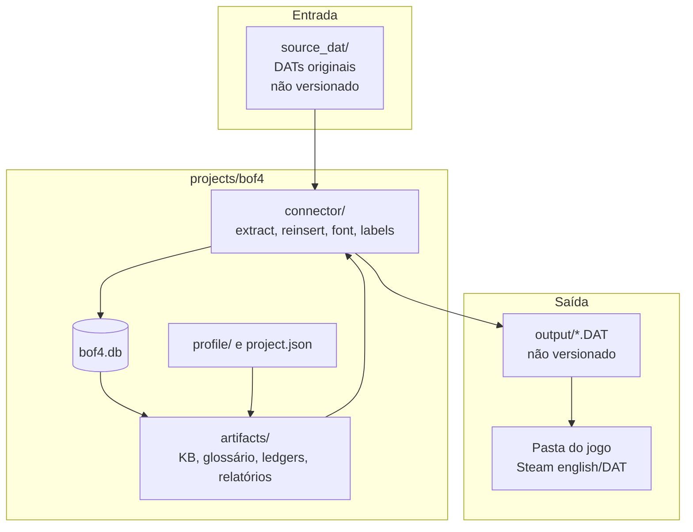

# Breath of Fire IV — Tradução PT-BR (modo banco)

> **Status (2026-10-14): tradução concluída e instalada; falta a distribuição.**
> 305 cenas traduzidas (27.021 falas), gates verdes, amostra de qualidade feita (erro de 14,5% antes das
> correções pós-amostra). Próximo marco: [`PRD_DISTRIBUICAO.md`](PRD_DISTRIBUICAO.md) (patcher para a Steam).

Instância do framework para o jogo da Steam (conector Capcom DAT), em modo banco: SQLite (`bof4.db`, não
versionado) como store e busca semântica obrigatória (`kb_gate`, stack de `requirements-ml.txt`).
Substitui `projects/breath_of_fire_4/` (flat files), removido do repositório.

## Em números

| Item | Valor |
|---|---|
| Cenas traduzidas / DATs no jogo | 305 / 394 |
| Falas | 27.021 |
| Escopo | Diálogo + sistema + rótulos em imagem |
| Overflow de bytes | 0 (35 exceções registradas em `byte_budget_exceptions`) |
| Qualidade (amostra de 200) | Erro 14,5% (IC 95%: 10,3%–20,1%), antes das correções |
| Custo | $0 pago (caminho de sessão); equivalente a $239 de API |

## Linha do tempo



## Como o projeto está organizado



| Pasta / arquivo | Papel | Versionado |
|---|---|---|
| `connector/` | Conector Capcom DAT e testes (round-trip, sintético) | Sim |
| `artifacts/` | Glossário, relatórios, ledgers (allowlist do `content_guard`) | Parcial |
| `profile/`, `project.json` | Tom, regras de bytes, escopo, HITL | Sim |
| `ROADMAP.md` | Retomada, fases, registro e levantamento de fim de projeto | Sim |
| `PRD_DISTRIBUICAO.md` | Plano de distribuição na Steam | Sim |
| `source_dat/`, `output/`, `bof4.db`, `tools_local/` | Jogo, saída remontada, banco, scripts locais | **Não** |

## Documentos

- [`ROADMAP.md`](ROADMAP.md) — onde paramos, passos e ordem, decisões ratificadas, levantamento para o framework.
- [`PRD_DISTRIBUICAO.md`](PRD_DISTRIBUICAO.md) — requisitos, arquitetura do patcher, riscos e roteiro.
- [`../../docs/ROADMAP.md`](../../docs/ROADMAP.md) — roadmap do framework (seção "Pós-bof4").

## Regras do repositório

O repo é público: nada de binário do jogo, roteiro extraído, tradução de cena ou planilha de revisão
(`.claude/hooks/content_guard.py` bloqueia local e na CI). Commit com e-mail noreply do GitHub.

## Ambiente

O verify precisa de `BOF4_DAT_DIR`. Nada carrega o `.env` sozinho — exporte antes de rodar:

```
cp .env.example .env                     # BOF4_DAT_DIR = <jogo>/english/DAT
set -a; . projects/bof4/.env; set +a     # bash; no PowerShell: $env:BOF4_DAT_DIR = "..."
pytest projects/bof4/connector/ --dat-dir "<jogo>/english/DAT"
```
