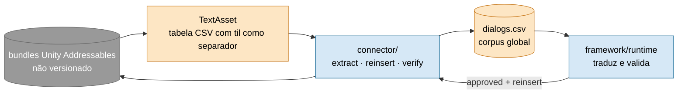

# Souldiers — EN → pt-BR

Tradução de *Souldiers* (Unity) pelo framework. Terceira obra do projeto, escolhida para provar duas coisas:
portar o framework para **Unity Addressables** (engine bem diferente de Aquaplus e Capcom) e exercitar o
**onboarding de baixo custo** numa estrutura plana, sem capítulos numerados.

| | |
|---|---|
| **Estado** | ✅ Ciclo de tradução completo |
| **Cenas** | **470/470** do índice verificadas (round-trip byte-idêntico, 100% de cobertura de retrotradução) |
| **Custo** | ~US$ 3,06 |
| **Pendência** | Só operacional: aplicar a revisão humana do XLSX de QA (fora do escopo do framework) |

## Como o texto é guardado no jogo (C2)



Três tabelas dentro de `TextAsset`: `texts_DIALOGS`, `texts_INGAME_DIALOGS` e `texts_SIDE_DIALOGS`
(a última usa a coluna `::BR::` em vez de `::PT::`).

## O que foi entregue

- **Conector** Unity Addressables: extração, reinserção e round-trip byte-idêntico.
- **KB reconstruída** de material já pesquisado mais evidência do corpus; as 22 entidades sem fonte foram resolvidas.
- **Batch API (−50%)** em pacotes menores (tradução e retrotradução), para um batch gigante não "parecer travado".
- **Revisão humana** em XLSX disponível em `artifacts/qa_revisao/para_revisar/` (aplicar com `quality_review.py apply`).

> O `run_state.json` versionado tem **485 entradas**: as 470 do índice (todas verified) mais 15 extras (armas, `INGAME_*`,
> etc.), das quais 14 verified e 1 `build_plan_failed` (`QS_NUN_DONATEPART1_1_NEGATIVE`, 1 fala). O "470/470" vale para o índice.

## Dívidas

Nenhuma aberta do lado do framework. Um **risco aceito e documentado**: o round-trip do bundle real
(`test_roundtrip.py`, 6 testes) só roda local, com `--data-dir` apontando para o jogo; **na CI ele se pula**. O
container é UnityFS lido via UnityPy, que não permite montar um bundle do zero, e reimplementar o formato à mão
custaria mais do que vale. A CI roda sempre `test_rebuild_table_logic.py`, que cobre a lógica de reescrita do CSV
(onde um bug de tradução apareceria). Ver [ADR 0011](../../docs/adr/).
Nota: `UnityPy` ainda não está em nenhum `requirements-*.txt`; é inofensivo hoje, mas quebraria se o skip fosse removido.

## Estrutura

```
project.json              configuração central (formato Unity Addressables)
connector/
  table_schema.md         formato das 3 tabelas de diálogo
  extract.py              gera artifacts/dialogs.csv (global)
  reinsert.py             rebuild_table() por tabela; caminho byte-idêntico quando sem tradução
  build_plan_chapter.py   cobertura + tokens de timing/tags TMP por cena
  verify_chapter.py       round-trip + apply + readback (exit 0/1/3)
  split_scenes.py         agrupa o corpus global em cenas
  test_roundtrip.py       6 testes (pytest --data-dir <StreamingAssets/aa/StandaloneWindows64>)
artifacts/
  dialogs.csv  entities.csv  glossary.csv  research_log.md  tone_analysis.md  universe_knowledge_base.md
  scenes/                 470 cenas verified
  state/translation_memory.jsonl   TM (só acrescenta)
  run_state.json          485 entradas (ver a nota acima)
  api_ledger.jsonl        ledger de custo auditável
  qa_revisao/             XLSX de revisão humana (gerado, aguardando aplicação)
```

Esta obra fechou a Fase D do Generic Connector System; as respostas práticas sobre família de engine, versionamento e
onboarding estão em `tier_classifier.py`, `fingerprint_monitor.py`, `scaffold_project.py` e `tm_lookup.py`.
Roadmap geral: [`docs/ROADMAP.md`](../../docs/ROADMAP.md).
