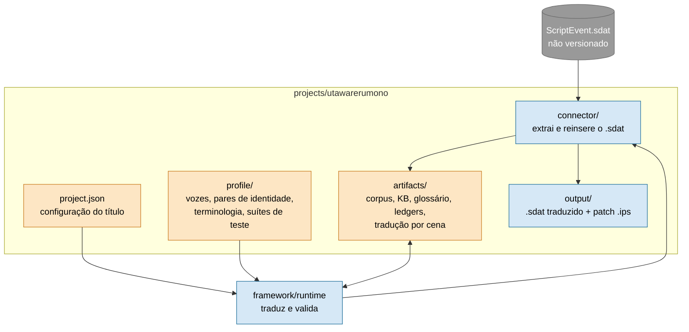
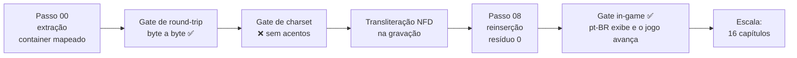

# Utawarerumono: Mask of Deception — EN → pt-BR

A **primeira obra de referência** do framework: uma visual novel de engine Aquaplus, traduzida inteira pelo
processo genérico. (A continuação, *Prelude to the Fallen*, é outro jogo e vive em
[`../utawarerumono_prelude/`](../utawarerumono_prelude/ROADMAP.md).)

| | |
|---|---|
| **Estado** | ✅ **Concluído:** 16 capítulos, 146 cenas, ~45.100 linhas |
| **Qualidade** | Round-trip byte-idêntico (resíduo 0) e retrotradução das falas de alto risco |
| **Custo** | ~R$ 338,46 (Sonnet R$ 260,17 · Opus R$ 40,01 · Haiku R$ 38,28), **R$ 0 desperdiçado** (medido no `api_ledger.jsonl`) |
| **No jogo** | pt-BR renderiza corretamente (validação in-game feita no piloto, cap. 11) |
| **O desafio** | Identidades duplas com spoiler crítico, comédia com timing, charset sem acentos |

## O que é esta pasta (C2)

A IA **propõe** a tradução, um gate aprova e o script **aplica**: ela não edita os dados à mão.
O processo ponta a ponta está no [README do framework](../../framework/README.md); aqui ficam os dados e o resultado.

## Capítulos traduzidos

| Capítulo | Cenas | | Capítulo | Cenas | | Capítulo | Cenas |
|---|---|---|---|---|---|---|---|
| 11 | 11 | | 17 | 5 | | 23 | 19 |
| 12 | 16 | | 18 | 5 | | 30 | 11 |
| 13 | 9 (Batch −50%) | | 19 | 8 | | 31 | 2 |
| 14 | 9 | | 20 | 19 | | 39 (DLC) | 4 |
| 15 | 9 | | 21 | 7 | | | |
| 16 | 5 | | 22 | 7 (reveal do final) | | **Total** | **146** |

Todos verificados ponta a ponta.

## O que se provou no caminho

Aprendizados em [`artifacts/decision_log.md`](artifacts/decision_log.md). Os principais: o ponteiro é **relativo ao arquivo**,
anexar ao fim do container foi **reprovado in-game** (a relocação é **dentro do arquivo**), e a IA nunca edita dados à mão.
Detalhes do conector em [`connector/README.md`](connector/README.md).

## Como o custo e a qualidade foram controlados

- **Modelo por risco:** Sonnet aprovado por benchmark (nível Opus à mão), com Haiku/Opus por complexidade.
- **Batch API (−50%)** e **retrotradução em batch**.
- **Memória de tradução** evita retraduzir; **conserto por linha** (1 linha ruim = 1 linha refeita).
- **Estimativa antes de pagar e teto duro** ([custo no README raiz](../../README.md#custo-previsível)).
- **Spoiler e gênero** por ledger temporal (ex.: revelação Ukon = Oshtor em `ch_13_08`).
- **Fonte da KB** exigida (`kb_review.py` e `kb_phase.py`).
- **Revisão humana via XLSX**, com a TM no centro: o jogo não é retraduzido inteiro depois do QA.
- Governança com desenhos: [`docs/GOVERNANCE.md`](../../docs/GOVERNANCE.md).

## Configuração

Tudo em [`project.json`](project.json): perfil `games` (visual novel), EN → pt-BR, fonte `artifacts/dialogs.csv`,
tokens de engine (`{W75}`, `{W80}`, `{W10}`, `{COLOR}`, `{END}`), linhas em CAPS como texto de sistema, lote de 200 linhas.

## Dados curados (`profile/`)

| Arquivo | Conteúdo | Vira, no pipeline |
|---|---|---|
| `voice_profiles_reference.md` | Voz de cada personagem e `voice_criticality` | `tone_analysis.md` |
| `identity_pairs_reference.md` | Pares de identidade dupla e regras de separação | `aliases_map.json`, `entities.csv` |
| `terminology_seeds.md` | Decisões de terminologia e fases narrativas | `glossary.csv` |
| `example_test_suites.md` | Suítes de teste sintético | `synthetic_test_corpus.json` |

São referência e modelo de preenchimento para projetos novos; no pipeline real, o equivalente é gerado como artefato.

## Artefatos (`artifacts/`)

`dialogs.csv` (saída do passo 00, depois imutável), `entities.csv`, `tone_analysis.md`, `glossary.csv`, `research_log.md`,
`universe_knowledge_base.md`, `qa_report.md`, `reinsertion_report.md`, a tradução por cena em `scenes/<cena>/` e a saída
em `output/`. O texto do jogo **não é versionado** (o repositório é público). Os artefatos do formato antigo ficam em
`artifacts/archive/`. Contratos em [`framework/schemas/artifacts_schema.md`](../../framework/schemas/artifacts_schema.md).

## Rodar

Execute as skills em ordem (00 → 09), cada uma lendo `project.json` e os artefatos da anterior
([`framework/skills/_index.md`](../../framework/skills/_index.md)). O passo 00 só avança se o round-trip passar.
Conector: `python connector/extract.py <bin>` → `python connector/reinsert.py <bin>` → `pytest connector/`.

## Características críticas do título

- Vários pares de **identidade dupla** com spoiler crítico (Ukon/Oshtor, Sakon/Mikazuchi, Mito/Mikado).
- **Spoiler** rigoroso: nome revelado nunca aparece antes do `reveal_timing`.
- **Comédia com timing** sensível (Haku, Nosuri).
- **Glifos especiais** (dígitos circulados ①②③ em puzzles), preservados pela transliteração NFD.
