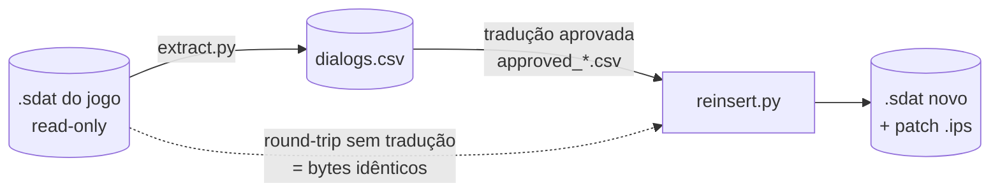
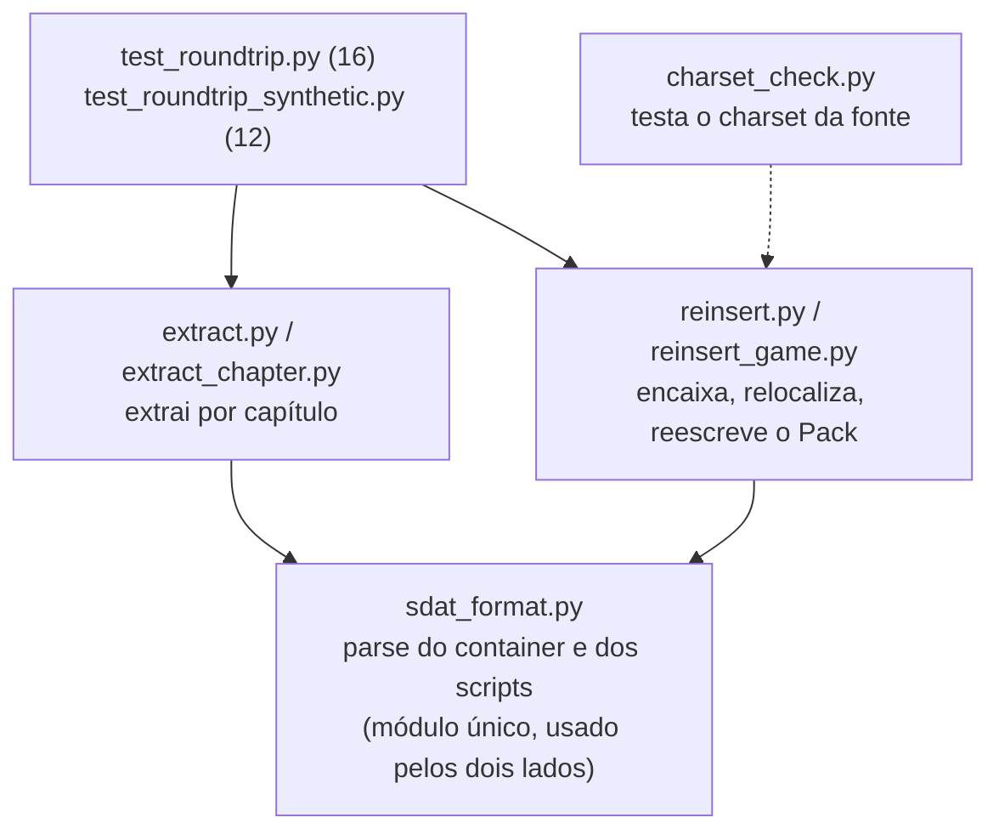

# Conector Aquaplus `.sdat` (Utawarerumono: Mask of Deception)

Código **determinístico** que tira o texto de dentro do binário do jogo e o devolve traduzido. Sem IA: é só I/O.

| | |
|---|---|
| **A régua** | **Round-trip:** extrair e reinserir **sem mudar nada** tem que gerar o binário **byte a byte** idêntico. |
| **A prova** | O jogo inteiro reinsere com **resíduo 0** e renderiza in-game; 16 testes travam os invariantes. |

## Fluxo



O binário **nunca é editado**: o `reinsert.py` gera um arquivo novo e um patch. A tradução vem de `approved_*.csv`
(a IA propôs, um gate aprovou); o conector só aplica.

## C3 — componentes



## O formato, em resumo

- **Container:** header `Filename`, tabela de nomes, `Pack` (contagem + offset/tamanho de cada arquivo) e
  **353 scripts contíguos, alinhados a 16 bytes**. Cada script é `[bytecode STSC][bloco de texto]`.
- **Texto:** strings UTF-8 terminadas em zero, contíguas. Códigos de controle são tokens ASCII (`{W75}`…).
- **Ponteiros:** dentro do bytecode, sem tabela central. O offset é **relativo ao início do arquivo** (e não absoluto).

## Decisões que valeram

| Tema | Decisão |
|---|---|
| Espaço para texto maior | `in_place` + **relocação dentro do próprio arquivo**; anexar ao fim do container foi **reprovado in-game**. |
| Charset | A fonte não tem acentos (viravam `@`): a gravação **translitera por NFD** (á→a, ç→c). NFD preserva glifos que o jogo já usa (①②③); NFKD quebrava o round-trip. |
| Escopo | Controlado por capítulo (`extract_chapter.py`; prefixo do script, ex.: `13` → `ch_13_*`). |
| Governança | Nenhum texto da obra em `.py`: um teste falha se houver frase hardcoded. |

Resultado: 1025 linhas do piloto (in_place 595, relocadas 430, **resíduo 0**) e depois os 16 capítulos
(146 cenas, ~45.100 linhas). Aprendizados em [`../artifacts/decision_log.md`](../artifacts/decision_log.md).

## Rodar

```bash
python connector/extract.py   artifacts/ScriptEvent.sdat   # -> artifacts/dialogs.csv
python connector/reinsert.py  artifacts/ScriptEvent.sdat   # -> output/ScriptEvent.sdat + .ips + reinsertion_report.md
pytest connector/                                           # round-trip, ponteiros, IPS
```

O caminho do binário nunca é fixo no código: vem do argumento ou de `connector.source_binary` no `project.json`.

## Testes

- `test_roundtrip.py` (16): identidade byte a byte, binário-fonte intacto, ponteiros file-relativos, cada linha
  relocada aponta para dentro do seu arquivo, integridade do Pack, patch IPS aplicável, e o guard de governança.
  Os que precisam de `artifacts/ScriptEvent.sdat` se pulam sem ele.
- `test_roundtrip_synthetic.py` (12): o mesmo oráculo num `.sdat` sintético montado em memória, sem o binário
  comercial. É o que a CI roda sempre.
